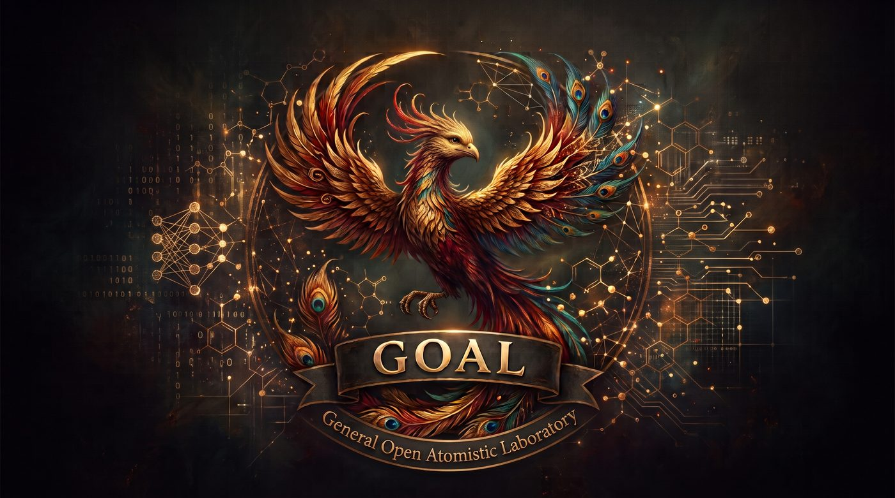
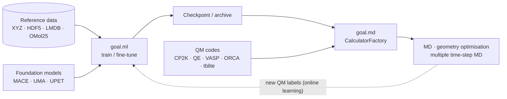

# GOAL documentation



**GOAL** (**G**eneral **O**pen **A**tomistic **L**aboratory) is a framework for building machine-learning interatomic potentials and using them, along with foundation models and quantum-chemistry codes, to run molecular dynamics. It is organised as modules under the `goal` namespace, and each module has its own section in these docs. Currently available modules:

| | Module | Start here | Typical questions |
|---|---|---|---|
| 🧠 | **`goal.ml`**: training & fine-tuning potentials | [goal.ml overview](ml/index.md) | *How do I train SIMURGH on my data? Which model should I use? How do I fine-tune MACE? How do I scale to 8 GPUs?* |
| ⚛️ | **`goal.md`**: molecular dynamics | [goal.md overview](md/index.md) | *How do I run Langevin MD with my trained model? How do I drive CP2K or VASP? What is multiple-time-step MD with online learning?* |

| 🚀 | **Integrations**: GPU fast paths & tooling | [Integrations overview](integrations/nvalchemi_overview.md) | *Can I run batched MD on an NVIDIA GPU? How do I LoRA-fine-tune a SIMURGH checkpoint? How do I store data in Zarr? What happens on AMD or Apple hardware?* |

The integrations are: [LoRA fine-tuning of SIMURGH](integrations/lora_finetune.md), the [nvalchemi model wrapper](integrations/nvalchemi_wrapper.md), [neighbour-list backends](integrations/neighbor_list.md), [batched simulation](integrations/batched_simulation.md), [Zarr data](integrations/zarr_data.md) and the [roadmap stubs](integrations/roadmap_stubs.md). Every NVIDIA-specific path falls back to a portable one on AMD, Apple and CPU.

Modules are deliberately decoupled. For example, `goal.md` never changes `goal.ml`; it loads trained models through a small bridge ([Bridge to goal.ml](md/guide/ml-bridge.md)). Each module can be installed and used on its own.



## How these docs are organised

- **[Getting started](getting-started/installation.md)** covers what all modules share: [installation](getting-started/installation.md), the [repository layout](getting-started/project-structure.md) and the [notebook catalogue](getting-started/notebooks.md).
- **goal.ml** is ordered the way you work: [training](ml/training/training.md) → [data](ml/data/loading.md) → [models](ml/models/overview.md) → [fine-tuning](ml/finetuning/overview.md) → [features](ml/features/feature-extraction.md) → [deployment](ml/deployment/ase-calculator.md), with a [reference](ml/reference/configuration.md) section for configs, CLI and pixi tasks.
- **goal.md** follows the same pattern: the [guide](md/guide/usage-patterns.md) covers everyday use, [calculators](md/calculators/overview.md) covers each backend, [multiple time-step MD](md/mts/overview.md) covers the online-learning machinery, and [reference](md/reference/configuration.md) covers configs, CLI and troubleshooting.

## Five-minute tour

The tour uses the pixi environments from a clone (`git clone https://github.com/Nourollah/GOAL.git && cd GOAL`). Without a clone, `pip install "goal-atomistic[md]"` or conda-forge `goal-atomistic-full` give you the same commands without the `pixi run -e cuda-full` prefix; see [Installation](getting-started/installation.md).

```bash
# 1. Install the ML + MD modules for an NVIDIA GPU (see Installation for cpu-full / rocm-full)
pixi install -e cuda-full

# 2. Train the default model: SIMURGH ARACE on GMD-26
pixi run -e cuda-full goal-train

# 3. Run MD with the trained model (library mode)
pixi run -e cuda-full python - <<'EOF'
from ase import units
from goal.md.core.molecule_factory import MoleculeFactory
from goal.md.core.md_factory import DynamicsFactory
from goal.md.adapters.model_loader import load_goal_calculator

atoms = MoleculeFactory.create("from_smiles", smiles="CCO")
atoms.calc = load_goal_calculator("path/to/best.ckpt")
DynamicsFactory.create("langevin_ase", atoms, timestep=0.5 * units.fs, temperature_K=300).run(1000)
EOF
```

Next, go to [Training a model](ml/training/training.md) or [Usage patterns](md/guide/usage-patterns.md).

## Working on these docs

The documentation is published at [nourollah.github.io/GOAL](https://nourollah.github.io/GOAL/). The pages are plain Markdown, so they also read fine on GitHub. The website is built with [MkDocs Material](https://squidfunk.github.io/mkdocs-material/) from the locked pixi `docs` environment:

```bash
pixi run -e docs docs-serve        # live preview at http://127.0.0.1:8000, reloads on save
pixi run -e docs docs-build        # strict build into site/ — the same check CI runs
# without pixi, from a clone:
pip install -e ".[docs]" && mkdocs serve
```

**Adding a page.** Create the `.md` file under `docs/` and add it to the `nav:` section of [`mkdocs.yml`](https://github.com/Nourollah/GOAL/blob/main/mkdocs.yml). Link other pages with relative `.md` paths, and files outside `docs/` with absolute GitHub URLs. The strict build fails on broken links, broken `#anchors` and pages missing from the nav.

**Publishing.** The [`Docs` workflow](https://github.com/Nourollah/GOAL/blob/main/.github/workflows/docs.yml) builds the site on every pull request that touches the docs (build only) and publishes it to GitHub Pages on every push to `main`.
