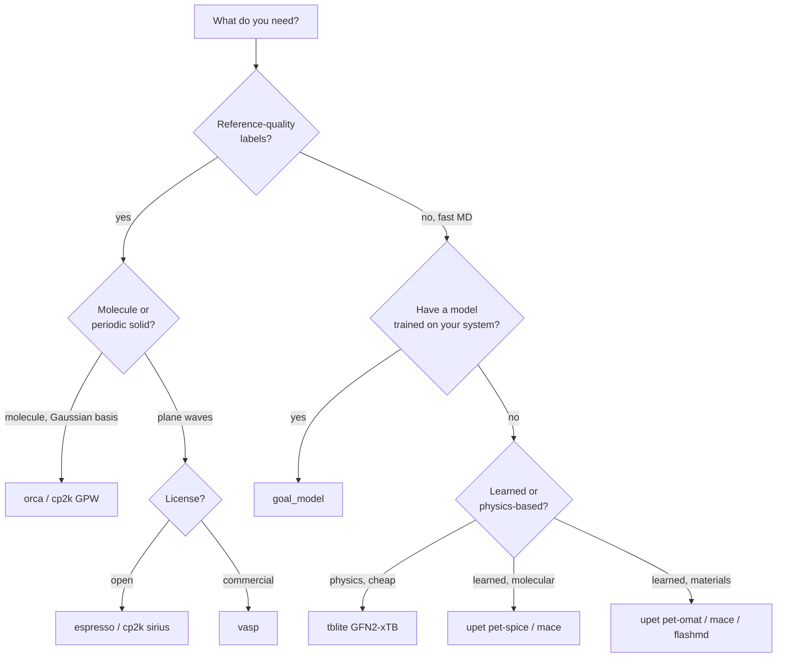

# Calculators overview

Every force/energy engine that `goal.md` can drive (your own trained GOAL models, foundation potentials, semi-empirical methods, and plane-wave or Gaussian DFT codes) is built through one entry point: `CalculatorFactory`. It always returns a plain ASE `Calculator`, so whatever you build can go into `atoms.calc`, an ASE optimiser, `Simulation`, or the [multiple-time-step integrator](../mts/overview.md).

## What `CalculatorFactory` is

`CalculatorFactory` (in [`goal/md/core/calculator_factory.py`](https://github.com/Nourollah/GOAL/blob/main/src/goal/md/core/calculator_factory.py)) is a small registry. Each backend is a `CalculatorBuilder` subclass registered under a string key with `@register_calculator("<key>")`. `CalculatorFactory.create(key, **kwargs)` looks up the builder and calls its `build(**kwargs)`:

```python
from goal.md import CalculatorFactory

calc = CalculatorFactory.create("cp2k", preset="molecular", n_mpi=4)
```

There are three practical consequences:

- **Keyword arguments are the builder's `build()` signature.** Unknown keywords raise `TypeError`. The only exception is `cp2k`, which forwards extra keywords to ASE's `CP2K`. The per-backend pages list every argument.
- **Optional dependencies are imported lazily.** `goal.md` imports fine without MACE, tblite, UPET, and so on. A missing engine only fails when you call `create()` for it. QM backends raise `GOALCalculatorNotFound` (from `goal.md.calculators`) with a message that names what is missing and how to provide it. Some ML backends raise a plain `ImportError` instead.
- **You can add your own backend.** Register a builder and it becomes available to `create()`, to configs, and to MTS. See [Extending goal.md](../guide/extending.md).

To see what is registered in your environment:

```python
from goal.md import CalculatorFactory
print(sorted(CalculatorFactory._builders))
# ['cp2k', 'espresso', 'flashmd', 'goal_model', 'mace', 'nequip', 'orca', 'tblite', 'upet', 'vasp']
```

Every backend is always *registered*, even when its engine is not installed. Registration only means the key is known.

## Registered backends

| Key | What it is | Install requirement | Config file | Page |
|-----|------------|---------------------|-------------|------|
| `goal_model` | A model you trained with `goal.ml` (`.simurgh` archive, checkpoint directory, or `.ckpt`), wrapped in `GOALCalculator` | core `goal` | [`goal_model.yaml`](https://github.com/Nourollah/GOAL/blob/main/src/goal/configs/md/calculators/goal_model.yaml) | [Trained GOAL models](goal-model.md) |
| `mace` | MACE-MP universal models (`small`/`medium`/`large`) or any MACE `.model` file | `mace-torch` in a **separate venv** (pins `e3nn==0.4.4`) | [`mace.yaml`](https://github.com/Nourollah/GOAL/blob/main/src/goal/configs/md/calculators/mace.yaml) | [MACE, NequIP & FlashMD](foundation.md#mace) |
| `nequip` | A deployed NequIP / Allegro model | `nequip` | none | [MACE, NequIP & FlashMD](foundation.md#nequip-and-allegro) |
| `flashmd` | FlashMD pretrained PET energy model (`pet-omatpes-v2` by default) | `flashmd` (in the `md` extra) | [`flashmd.yaml`](https://github.com/Nourollah/GOAL/blob/main/src/goal/configs/md/calculators/flashmd.yaml) | [MACE, NequIP & FlashMD](foundation.md#flashmd) |
| `upet` | UPET / PET-MAD metatensor foundation models, stock or fine-tuned | `upet` | [`upet.yaml`](https://github.com/Nourollah/GOAL/blob/main/src/goal/configs/md/calculators/upet.yaml) | [UPET / PET-MAD](upet.md) |
| `tblite` | GFN1-/GFN2-/IPEA1-xTB semi-empirical tight binding, in-process, analytic forces and stress | `tblite` (in the `-full` envs; `md` extra on x86-64) | [`tblite.yaml`](https://github.com/Nourollah/GOAL/blob/main/src/goal/configs/md/calculators/tblite.yaml) | [tblite (GFN-xTB)](tblite.md) |
| `cp2k` | CP2K through `cp2k_shell`: GPW (`method="quickstep"`) or pure plane-wave SIRIUS (`method="sirius"`), optional D3(BJ) | CP2K ≥ 2024.2 + ASE ≥ 3.23 (native or podman container) | [`cp2k.yaml`](https://github.com/Nourollah/GOAL/blob/main/src/goal/configs/md/calculators/cp2k.yaml), [`cp2k_pw.yaml`](https://github.com/Nourollah/GOAL/blob/main/src/goal/configs/md/calculators/cp2k_pw.yaml) | [CP2K](cp2k.md) |
| `espresso` | Quantum ESPRESSO `pw.x` | `pw.x` (ships in the `-full` envs) + ASE ≥ 3.23 + a UPF library (e.g. SSSP) | [`espresso.yaml`](https://github.com/Nourollah/GOAL/blob/main/src/goal/configs/md/calculators/espresso.yaml) | [Quantum ESPRESSO](espresso.md) |
| `vasp` | VASP (commercial) | licensed VASP build + POTCAR library | [`vasp.yaml`](https://github.com/Nourollah/GOAL/blob/main/src/goal/configs/md/calculators/vasp.yaml) | [VASP](vasp.md) |
| `orca` | ORCA DFT / wavefunction methods (and ORCA's built-in xTB) | ORCA binary (separate download) | [`mts/base_calculators/orca_reference.yaml`](https://github.com/Nourollah/GOAL/blob/main/src/goal/configs/md/mts/base_calculators/orca_reference.yaml) | [ORCA](orca.md) |

## Common options

The QM builders (`cp2k`, `espresso`, `vasp`) share a vocabulary, so switching engines doesn't mean learning new knobs.

### Presets: `molecular` vs `bulk`

All three accept `preset="molecular"` (the default) or `preset="bulk"`, and any other value raises `ValueError`. The preset only sets defaults; an explicit keyword always wins.

| Backend | `molecular` | `bulk` |
|---------|-------------|--------|
| `cp2k` (GPW) | `poisson_solver="MT"`, `stress_tensor=False` | `poisson_solver="PERIODIC"`, `stress_tensor=True` |
| `cp2k` (SIRIUS) | Γ-point, `stress_tensor=False` (no Poisson solver: SIRIUS is always periodic) | `stress_tensor=True`. `kpts` stays `(1, 1, 1)` unless you set it |
| `espresso` | adds `system.assume_isolated="mt"`, Γ-only (`kpts=None`) | `kpts=[2, 2, 2]` if not given; `control.tstress=True` unless set |
| `vasp` | `kpts=[1,1,1]`, `ismear=0`, `sigma=0.01` | `kpts=[4,4,4]`, `ismear=1`, `sigma=0.2` |

Use `molecular` for a gas-phase molecule in a vacuum box, which covers most GMD/MD17-style trajectories. Use `bulk` for crystals, liquids in periodic boxes, and anything where you need stress.

### Parallelism: `n_mpi`, `omp_threads`, `command`

| Argument | Effect |
|----------|--------|
| `command` | Full launch string. Takes precedence over everything else. |
| `n_mpi` | Builds an `mpirun -n N …` prefix, but only when you have not already given a launcher (details differ per backend; see each page). |
| `omp_threads` | Sets `OMP_NUM_THREADS` **in the current process environment** (it persists for the rest of the Python session and is inherited by every subprocess launched afterwards). |

Environment-variable fallbacks: `cp2k` reads `$ASE_CP2K_COMMAND`, `vasp` reads `$ASE_VASP_COMMAND` and `$VASP_PP_PATH`, and `espresso` reads `$ASE_ESPRESSO_COMMAND` and `$ESPRESSO_PSEUDO`. In the `-full` environments `espresso` also finds the bundled `pw.x` on `PATH`; see [its page](espresso.md#launch-command).

### Device (ML backends)

| Backend | Argument | Default |
|---------|----------|---------|
| `goal_model` | `device` | `"cpu"` |
| `upet` | `device` | `"cuda"` |
| `mace`, `flashmd`, `nequip` | `device` | `None` → `"cuda"` if available, else `"cpu"` |

## Using the YAML configs

Each file in [`src/goal/configs/md/calculators/`](https://github.com/Nourollah/GOAL/tree/main/src/goal/configs/md/calculators) is a Hydra node targeting `CalculatorFactory.create`, with the backend chosen by `key:`. The most reliable way to use one is `hydra.utils.instantiate`:

```python
from hydra.utils import instantiate
from omegaconf import OmegaConf

cfg = OmegaConf.load("src/goal/configs/md/calculators/vasp.yaml")
cfg.pp_path = "/data/vasp/potpaw"
calc = instantiate(cfg)            # -> CalculatorFactory.create(key="vasp", ...)
```

> [!WARNING]
> **Known config issues (verified against the current code):**
>
> - `goal_model.yaml`, `flashmd.yaml`, and the MTS files `mts/base_calculators/orca_reference.yaml` and `mts/ml_models/learner.yaml` use `method:` instead of `key:` for the backend name. `instantiate()` on them fails with `CalculatorFactory.create() missing 1 required positional argument: 'key'`. Override the key yourself (`cfg.key = cfg.pop("method")`) or call `CalculatorFactory.create` directly. Note that `tblite.yaml` and `cp2k_pw.yaml` legitimately use `method:` as a *builder argument* alongside `key:`.
> - `Simulation.from_config()` and `MTSSimulation.from_config()` pass every key in the calculator node, except `type`/`key`, to `build()`. That includes `_target_` and `_convert_`, which are not builder arguments. Feed them *plain* calculator mappings such as `{type: cp2k, preset: molecular}`, as in [`src/goal/configs/md/mts/simulations/mts_respa.yaml`](https://github.com/Nourollah/GOAL/blob/main/src/goal/configs/md/mts/simulations/mts_respa.yaml).

## How to pick a backend

The backends fall into three cost tiers:

| Tier | Backends | Typical cost per force call (small molecule) | Accuracy |
|------|----------|----------------------------------------------|----------|
| Learned | `goal_model`, `upet`, `mace`, `flashmd`, `nequip` | sub-millisecond to milliseconds, GPU-friendly | as good as the training data, only inside its domain |
| Cheap physics | `tblite` (GFN1/GFN2-xTB) | milliseconds (≈2 ms per MD step for ethanol) | semi-empirical: good geometries, rough energetics |
| Expensive physics | `espresso`, `cp2k`, `vasp`, `orca` | seconds to hours per call, each call a fresh SCF | DFT and beyond: reference quality |



Rules of thumb:

- **Production MD on a system you have data for:** use `goal_model`. It is cheapest per step and you control its accuracy.
- **No training data yet:** use a foundation model (`upet`, `mace`, `flashmd`) for exploration or to seed an [online-learning MTS run](../mts/overview.md). Use [`tblite`](tblite.md) when you want physics-based (not learned) energies at low cost: exploratory MD, pre-equilibration before DFT, conformer screening, or a cheap slow level for MTS.
- **Labels for training or validation:** use DFT. [`espresso`](espresso.md) gives open-source plane-wave DFT with nothing to install beyond pseudopotentials (`pw.x` ships in the `-full` environments). `cp2k` with `method="sirius"` gives pure plane-wave PBE from a podman container, and `vasp` is the choice if you hold a licence. Use [`orca`](orca.md) or `cp2k` GPW for Gaussian-basis references.
- **MTS / RESPA:** the fast level is usually `goal_model` or a foundation model. The slow level is a DFT backend, or `tblite` when DFT is too expensive. See [Multiple time-step MD](../mts/overview.md).

> [!IMPORTANT]
> Do not mix energy zeros. Pseudopotential plane-wave energies (`cp2k` SIRIUS, `espresso`, `vasp`), all-electron Gaussian energies (ORCA) and xTB energies (`tblite`) all have different zeros and differ by up to thousands of eV for the same geometry. Compare **forces** and **relative** energies across codes, never absolute energies.
