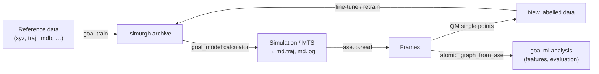

# Bridge to goal.ml

`goal.md` uses `goal.ml` only through two narrow bridges. The **model bridge** turns a trained checkpoint into an ASE calculator. The **data bridge** converts between ASE `Atoms` and goal.ml's `AtomicGraph`. This page explains both and puts them together into the train → simulate → analyse loop.

Both bridges live in `goal.md.adapters` and import goal.ml lazily, inside the functions. Importing `goal.md` therefore never initialises the training stack.

```python
from goal.md.adapters import (
    load_goal_calculator, get_model_cutoff,             # model bridge (model_loader.py)
    atomic_graph_from_ase, ase_atoms_from_atomic_graph,  # data bridge (ase_converter.py)
)
```

## Model bridge: checkpoint → ASE calculator

All paths end in `goal.ml.utils.calculator.GOALCalculator`, an ASE `Calculator` that implements `energy`, `forces` and `stress`. The calculator itself is documented in [ASE calculator](../../ml/deployment/ase-calculator.md). This section covers how `goal.md` reaches it.

### What you can load

`GOALCalculator` accepts three checkpoint formats and chooses based on the path you give it:

| Path | Format | Notes |
| --- | --- | --- |
| `…/checkpoints/best_val_forces_mae.simurgh` | Self-contained `.simurgh` archive | **Recommended.** Bundles weights, config and a frozen copy of the model source, so it keeps loading after the code base changes. |
| `…/checkpoints/` (directory) | Checkpoint directory written by `GOALCheckpointManager` | Must contain `config.yaml`, `metadata.json` and `frozen_source/`. The md wrappers always load the **best** checkpoint from it. |
| `…/checkpoints/last.ckpt` | Bare Lightning checkpoint (legacy) | Logs a warning. It is rebuilt with the *current* source, so it can break when the model code has changed since training. |

A training run started with `goal-train` writes these under `logs/<experiment>/runs/<timestamp>_<run name>/checkpoints/`. See [Checkpoints & archives](../../ml/deployment/archives.md) for how archives are produced and packed (`goal-pack-archive`).

### Three equivalent entry points

```python
# 1. Through the calculator factory (what configs use)
from goal.md import CalculatorFactory
calc = CalculatorFactory.create("goal_model", checkpoint="runs/x/checkpoints/best_val_forces_mae.simurgh",
                                device="cuda")

# 2. Through the adapter function
from goal.md.adapters import load_goal_calculator
calc = load_goal_calculator("runs/x/checkpoints/best_val_forces_mae.simurgh", device="cuda")

# 3. Directly from goal.ml (exposes every option)
from goal.ml.utils.calculator import GOALCalculator
calc = GOALCalculator(checkpoint_path="runs/x/checkpoints/", checkpoint="last", device="cuda")
```

| Argument | `goal_model` builder | `load_goal_calculator` | `GOALCalculator` |
| --- | --- | --- | --- |
| path | `checkpoint` | `checkpoint_path` (positional) | `checkpoint_path` |
| `device` | `"cpu"` | `"cpu"` | `"cpu"` |
| `dtype` | `torch.float64` | `None` → `torch.float64` | `None` → **sniffed from the model's parameters** |
| `head` | `None` | `None` | `None` |
| `cutoff` | accepted | accepted | accepted |
| `checkpoint` (which weights in a directory) | — (always `"best"`) | — (always `"best"`) | `"best"`, `"last"`, `"epoch=N"` or a `.ckpt` name |

Practical consequences:

- **`cutoff` has no effect when you load from a path.** The cutoff is always read from the saved training config; the argument only matters when you pass an in-memory `module=` to `GOALCalculator`. You cannot shorten or lengthen the cutoff of a trained model at load time, and you should not want to.
- **dtype.** The md wrappers default to float64 inputs. `GOALCalculator` on its own matches the inputs to the model's parameter dtype, which is the safer default for float32 models. If you see dtype mismatch errors, or want float32 speed, use `GOALCalculator` directly or pass `dtype=torch.float32`.
- **Picking `last` instead of `best`** from a checkpoint directory requires `GOALCalculator` (option 3).
- **`head`** selects the output head of a multi-head model; leave it `None` for single-head models.

The same options in a simulation config:

```yaml
calculator:
  type: goal_model
  checkpoint: logs/my_exp/runs/2026-10-01_12-00-00_my_run/checkpoints/best_val_forces_mae.simurgh
  device: cuda
  head: null
```

> [!NOTE]
> Hydra cannot parse an unquoted `=` inside an override value, and Lightning checkpoint names such as `best_val_forces_mae=0.0110_epoch=1204.ckpt` contain several. Prefer the `.simurgh` archive or the directory path on the command line, or quote the whole override: `'calculator.checkpoint="path/with=equals.ckpt"'`.

### `get_model_cutoff(checkpoint_path)`

`get_model_cutoff` returns the cutoff stored in a checkpoint's config (`data.cutoff`, falling back to `model.backbone.cutoff`, then 5.0 Å). It calls `GOALModule.load_from_checkpoint`, so it **only works on bare Lightning `.ckpt` files**. A `.simurgh` archive or a checkpoint directory raises an error. For those, read the config directly:

```python
from omegaconf import OmegaConf
cfg = OmegaConf.load("runs/x/checkpoints/config.yaml")
print(cfg.data.get("cutoff"), cfg.model.backbone.get("cutoff"))
```

You need the cutoff when you build `AtomicGraph`s yourself (next section). The calculator handles it internally.

### Element coverage

A model can only describe elements it was trained on. An MD run on a molecule containing an unseen element either fails during graph construction or, worse, gives meaningless forces. Check the training data's composition before starting a run. With a foundation model you do not need to check element coverage, but you should still check whether the domain (molecular vs. bulk, level of theory) matches. See [Calculators](../calculators/overview.md).

## Data bridge: `Atoms` ↔ `AtomicGraph`

### `atomic_graph_from_ase`

```python
atomic_graph_from_ase(atoms, cutoff, energy=None, forces=None, stress=None,
                      dtype=torch.float64, head=None) -> AtomicGraph
```

This is a thin wrapper over `AtomicGraph.from_ase(..., neighbor_list_backend="ase")`. It builds the radius graph (`edge_index`, periodic `unit_shifts`), stores `pos`, `z`, `cell` (shape `[1, 3, 3]`), `pbc`, and attaches `energy`/`forces`/`stress` labels when you pass them.

```python
from ase.build import molecule
from goal.md.adapters import atomic_graph_from_ase

water = molecule("H2O")
g = atomic_graph_from_ase(water, cutoff=5.0)
print(g)   # AtomicGraph(edge_index=[2, 6], pos=[3, 3], z=[3], cell=[1, 3, 3], pbc=[3], unit_shifts=[6, 3], weight=[1])
```

The wrapper exposes only the common arguments. For fragment indices, a different neighbour-list backend or per-sample weights, call `goal.ml.data.graph.AtomicGraph.from_ase` directly.

### `ase_atoms_from_atomic_graph`

```python
ase_atoms_from_atomic_graph(graph) -> ase.Atoms
```

This function recovers `numbers`, `positions`, `cell` and `pbc` from a **single** graph. It does not copy labels (energy, forces) or velocities, and it does not split a batched graph. For a batch, iterate over `batch.to_data_list()` first (PyG batches support this).

## The train-simulate-analyse loop



### 1. Train

```bash
pixi run -e cuda-full goal-train --config-name simurgh_gmd26        # see the ML training guide
# → logs/simurgh_gmd26/runs/<timestamp>_<name>/checkpoints/best_val_forces_mae.simurgh
```

See [Training a model](../../ml/training/training.md).

### 2. Simulate

```python
from goal.md import CalculatorFactory, MoleculeFactory, Simulation

CKPT = "logs/simurgh_gmd26/runs/2026-10-01_12-00-00_run/checkpoints/best_val_forces_mae.simurgh"

atoms = MoleculeFactory.create("from_smiles", smiles="CCO")
calc = CalculatorFactory.create("goal_model", checkpoint=CKPT, device="cuda")

sim = Simulation(atoms, calc, steps=20_000, timestep_fs=0.5, friction=0.01,
                 temperature_K=300.0, log_interval=50,
                 trajectory_file="ethanol.traj", log_file="ethanol.log",
                 output_dir="outputs/md/ethanol_ml")
sim.run()
```

### 3. Analyse

Check stability and select frames for validation:

```python
import numpy as np
from ase.io import read
from ase.io.trajectory import Trajectory

frames = read("outputs/md/ethanol_ml/ethanol.traj", index=":")
print(len(frames), "frames")

# Physical sanity: minimum interatomic distance per frame (catches collapse / explosion)
dmin = [np.min(f.get_all_distances()[np.triu_indices(len(f), 1)]) for f in frames]
print(f"min distance over run: {min(dmin):.2f} Å")

# Pick every 20th frame for QM validation / active learning
subset = frames[::20]
```

Compare the model with a reference method on those frames. Frames read from a `.traj` keep the energies and forces the model computed during the run, so you only need the reference values:

```python
from goal.md import CalculatorFactory

ref = CalculatorFactory.create("tblite", method="GFN2-xTB")   # or espresso / cp2k / orca for DFT
err = []
for f in subset:
    f_ml = f.get_forces()                 # stored by the trajectory writer
    g = f.copy(); g.calc = ref
    err.append(np.sqrt(np.mean((g.get_forces() - f_ml) ** 2)))
print(f"force RMSE vs reference: {np.mean(err):.3f} eV/Å")
```

Label the frames with the reference and write them in a format goal.ml reads (`extxyz` or `.traj`, see [Loading data](../../ml/data/loading.md)) for fine-tuning:

```python
from ase.calculators.singlepoint import SinglePointCalculator
from ase.io import write

labelled = []
for f in subset:
    g = f.copy(); g.calc = ref
    e, F = g.get_potential_energy(), g.get_forces()
    g.calc = SinglePointCalculator(g, energy=e, forces=F)
    labelled.append(g)
write("data/ethanol_md_round1.extxyz", labelled)
```

To process the frames with goal.ml directly (feature extraction, custom evaluation), convert them to graphs with the **model's** cutoff:

```python
from goal.md.adapters import atomic_graph_from_ase
graphs = [atomic_graph_from_ase(f, cutoff=5.0) for f in subset]   # use the trained model's cutoff
```

Then see [Feature extraction](../../ml/features/feature-extraction.md) and [Evaluation](../../ml/deployment/evaluation.md).

> [!TIP]
> To automate this loop, with QM labelling and fine-tuning happening *during* the simulation, use the online learner in the [MTS module](../mts/overview.md).
