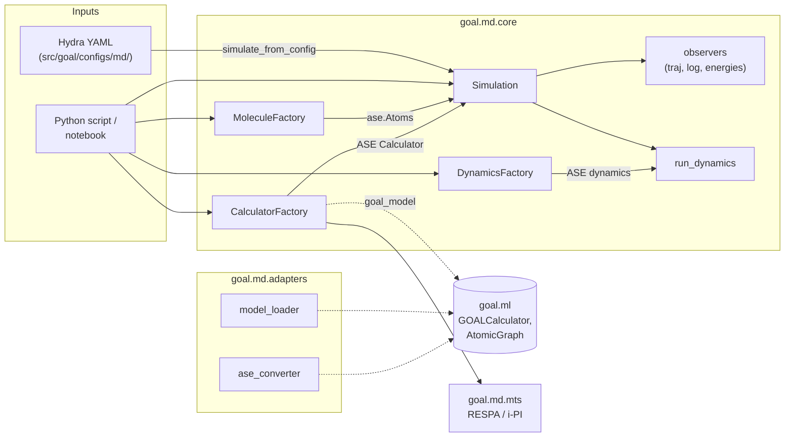

# goal.md: molecular dynamics

`goal.md` is GOAL's molecular-dynamics module. It takes a structure, a force calculator (a model you trained with [`goal.ml`](../ml/index.md), a foundation model, a semi-empirical method or a full QM code) and a thermostat, and turns them into an [ASE](https://wiki.fysik.dtu.dk/ase/) simulation with trajectory and log output. It also includes a multiple-time-step (RESPA) engine that pairs a cheap ML force field with an expensive QM correction.

Everything in `goal.md` is plain ASE underneath. Every object it builds is an ordinary `ase.Atoms`, `ase.calculators.calculator.Calculator` or ASE dynamics instance, so you can drop down to raw ASE whenever the convenience layer gets in your way.

## What you can do with it

- **Run MD with a model you trained in goal.ml.** Point the `goal_model` calculator at a `.simurgh` archive or checkpoint directory and run Langevin NVT. See [Bridge to goal.ml](guide/ml-bridge.md).
- **Swap force fields without touching your script.** `CalculatorFactory` gives one interface to GOAL models, MACE, FlashMD, UPET/PET-MAD, NequIP, GFN-xTB (tblite), ORCA, CP2K, Quantum ESPRESSO and VASP. tblite and Quantum ESPRESSO ship in the `-full` environments, so cheap semi-empirical and full plane-wave DFT forces work out of the box. See [Calculators](calculators/overview.md).
- **Build starting structures quickly** from SMILES (RDKit ETKDG + MMFF94) or from any file ASE can read. See [Molecules](guide/molecules.md).
- **Run QM-accurate MD cheaply** with RESPA multiple time-stepping (ML inner loop, QM outer correction) and an online learner that fine-tunes the ML model during the run. See [Multiple time-step MD](mts/overview.md).
- **Convert data** between ASE `Atoms` and goal.ml `AtomicGraph`, so MD frames can go back into training or analysis.

## Design principles

These principles explain why the module looks the way it does.

1. **goal.ml stays untouched.** `goal.md` is a satellite of `goal.ml`. It only calls public goal.ml APIs (`GOALCalculator`, `AtomicGraph.from_ase`, `GOALModule`), and it imports them lazily inside functions. `import goal.md` therefore never pulls in the training stack, and nothing in `goal.ml` imports `goal.md`.
2. **The CLI is isolated.** The MD entry points (`goal-simulate`, `goal-simulate-mts`) live in `goal.md.cli` and share nothing with the `goal-train` family. See [CLI](reference/cli.md).
3. **Config-first for production runs.** A whole simulation (molecule, calculator, thermostat parameters, output paths) can be written as one Hydra YAML file and overridden from the command line. The file is your record of what ran. See [Configuration](reference/configuration.md).
4. **Direct import always works.** Every config-driven path is a thin layer over factories and classes you can call from a notebook. Hydra is never required.
5. **Heavy dependencies are optional.** RDKit, FlashMD, tblite, MACE, UPET, NequIP and the QM codes are all imported inside `try/except`. A missing backend fails only when you ask for it, and the error says what to install.

## Module architecture

```text
src/goal/md/
├── __init__.py              # public API re-exports (factories, Simulation, observers, runner)
├── core/
│   ├── molecule_factory.py  # MoleculeFactory + from_smiles / from_file / from_db builders
│   ├── molecule_tools.py    # generate_3d_coordinates_from_smiles, box_molecule
│   ├── calculator_factory.py# CalculatorFactory + every backend builder
│   ├── md_factory.py        # DynamicsFactory + langevin_ase / langevin_flashmd
│   ├── observers.py         # TrajectoryObserver, MDLogObserver, EnergyCollector, setup_observers
│   ├── runner.py            # run_dynamics (chunked run + progress bar) and RunResult
│   └── simulation.py        # Simulation, SimulationConfig, simulate_from_config
├── adapters/
│   ├── model_loader.py      # load_goal_calculator, get_model_cutoff
│   └── ase_converter.py     # atomic_graph_from_ase, ase_atoms_from_atomic_graph
├── calculators/
│   └── base.py              # GOALCalculatorNotFound, UnsupportedOperationError
├── cli/
│   └── simulate.py          # Hydra entry points: goal-simulate, goal-simulate-mts
└── mts/                     # RESPA integrator, i-PI adapter, dual / online-learning calculators
```

The diagram shows how a simulation is assembled. Solid arrows are object construction; the dashed arrow is the optional dependency on `goal.ml`.



| Package | Responsibility | Start reading at |
| --- | --- | --- |
| `core/` | Factories, the `Simulation` orchestrator, observers and the run loop | [Dynamics](guide/dynamics.md) |
| `adapters/` | Loading goal.ml checkpoints; `Atoms` ↔ `AtomicGraph` | [Bridge to goal.ml](guide/ml-bridge.md) |
| `calculators/` | Shared exception types. The builders themselves live in `core/calculator_factory.py` | [Calculators](calculators/overview.md) |
| `cli/` | Hydra entry points | [CLI](reference/cli.md) |
| `mts/` | Multiple-time-step integration and online learning | [MTS overview](mts/overview.md) |

## Installation

`goal.md` ships inside the `goal` package. ASE and RDKit are already core dependencies, so the library API (factories, `Simulation`, SMILES builder) works in a plain install:

```bash
git clone https://github.com/Nourollah/GOAL.git
cd GOAL
pixi install -e cuda-full     # ML + MD modules; or cpu-full / rocm-full
pixi run -e cuda-full python -c "import goal.md; print('goal.md OK')"
```

With pip, the MD module's dependencies (`flashmd`, `tblite` on x86-64, `ase`, `typer`, `pandas`, `ipi`) are the `md` extra:

```bash
pip install "goal-atomistic[md]"
```

With conda, install the `goal-atomistic-md` package from conda-forge (`pixi add goal-atomistic-md` or `conda install -c conda-forge goal-atomistic-md`). It also brings tblite and Quantum ESPRESSO, but not `flashmd`, which is not on conda-forge (`pip install flashmd` if you need it).

In pixi, the `-full` environments (`cuda-full`, `cpu-full`, `rocm-full`) add them on top of the ML environments, with tblite taken from conda-forge (so it is available on aarch64 too), plus the Quantum ESPRESSO binaries (`pw.x`, MPI-parallel). `typer` is required for `goal-simulate` to start at all.

See [Installation](../getting-started/installation.md) for environments, CUDA and the separate MACE environment.

## Quick start

This example builds ethanol from SMILES, attaches GFN2-xTB forces from tblite and runs 2 ps of Langevin NVT at 300 K. Change `CalculatorFactory.create(...)` to switch to any other backend.

```python
from goal.md import CalculatorFactory, MoleculeFactory, Simulation

# 1. Structure: SMILES → RDKit ETKDG embedding → MMFF94 pre-optimisation
atoms = MoleculeFactory.create("from_smiles", smiles="CCO")

# 2. Forces: GFN2-xTB via tblite (in the -full envs). For a trained GOAL model use
#    CalculatorFactory.create("goal_model", checkpoint="path/to/best.simurgh")
calc = CalculatorFactory.create("tblite", method="GFN2-xTB")

# 3. Langevin NVT, 0.5 fs × 4000 steps = 2 ps
sim = Simulation(
    atoms,
    calc,
    steps=4000,
    temperature_K=300.0,
    timestep_fs=0.5,
    friction=0.01,              # 1/fs (a 100 fs coupling time)
    log_interval=20,
    trajectory_file="ethanol.traj",
    log_file="ethanol.log",
    output_dir="outputs/md/ethanol",
)
result = sim.run()

print(f"{result.steps_completed} steps, "
      f"E_pot = {result.final_energy:.4f} eV, T = {result.final_temperature:.1f} K")
```

The run writes `outputs/md/ethanol/ethanol.traj` (open it with `ase gui`) and a per-atom energy/temperature log in `ethanol.log`. `result.energy_history` holds the potential energy at every logged step, ready for plotting.

> [!TIP]
> To try the pipeline without any optional backend, use ASE's toy EMT potential: `from ase.calculators.emt import EMT; calc = EMT()`. The notebook [`notebooks/md_introduction.ipynb`](https://github.com/Nourollah/GOAL/blob/main/notebooks/md_introduction.ipynb) does this on bulk copper.

## Where to go next

### Guide

- [Usage patterns](guide/usage-patterns.md): library mode, trained models, config-first runs, data conversion and model comparison, with complete scripts.
- [Molecules](guide/molecules.md): `MoleculeFactory`, SMILES embedding, file loading and periodic boxes.
- [Dynamics](guide/dynamics.md): integrators, `Simulation`, observers, the run loop, thermostats and time-step choice.
- [Bridge to goal.ml](guide/ml-bridge.md): loading checkpoints, `Atoms` ↔ `AtomicGraph`, and the train → simulate → analyse loop.
- [Extending goal.md](guide/extending.md): registering your own calculators, integrators and molecule builders.

### Calculators

- [Overview](calculators/overview.md), [Trained GOAL models](calculators/goal-model.md), [tblite (GFN-xTB)](calculators/tblite.md), [MACE, NequIP & FlashMD](calculators/foundation.md), [UPET / PET-MAD](calculators/upet.md), [CP2K](calculators/cp2k.md), [Quantum ESPRESSO](calculators/espresso.md), [VASP](calculators/vasp.md), [ORCA](calculators/orca.md)

### Multiple time-step MD

- [Overview](mts/overview.md), [RESPA integrator](mts/respa.md), [i-PI adapter](mts/ipi.md), [Design notes](mts/design.md)

### Reference

- [Configuration](reference/configuration.md): every YAML under `src/goal/configs/md/`.
- [CLI](reference/cli.md): `goal-simulate`, `goal-simulate-mts` and the pixi tasks.
- [Troubleshooting](reference/troubleshooting.md): known limitations and fixes for common errors.
