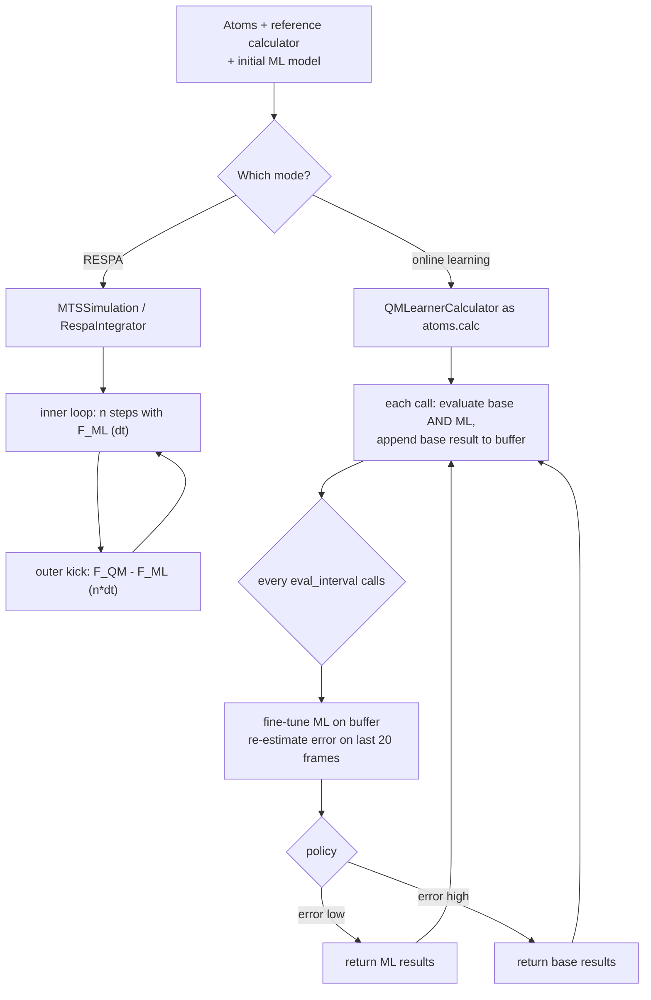

# Multiple time-step MD

`goal.md.mts` combines two ideas for making accurate MD affordable. **Multiple time-stepping** (RESPA) evaluates an expensive potential only every few steps and integrates a cheap one in between. **Dual-calculator online learning** runs an expensive reference next to an ML model, fine-tunes the model on the reference data as the trajectory goes, and hands control to the model once it is accurate enough. This page explains both, what is implemented today, and how to run them. Background design notes are in [Design notes](design.md).

## Concepts

### Multiple time-stepping (RESPA)

Split the force into a cheap, rapidly varying part and an expensive, slowly varying correction:

$$
\mathbf F = \underbrace{\mathbf F_\text{ML}}_{\text{fast, every inner step}} + \underbrace{(\mathbf F_\text{QM} - \mathbf F_\text{ML})}_{\text{slow, every } n \text{ inner steps}}
$$

If the ML model is good, the correction is small and smooth, so it can be applied with an outer timestep $n\,\delta t$. The trajectory is then propagated on the **QM surface** at roughly $1/n$ of the QM cost. `MTSSimulation` and `RespaIntegrator` implement this. See [RESPA integrator](respa.md).

### Dual-calculator online learning

`QMLearnerCalculator` is an ASE calculator that wraps a *base* (reference) calculator and an *ML* calculator:

1. While the **base** calculator is active, every force call evaluates both, returns the base result and stores it in a replay buffer.
2. Every `eval_interval` calls it runs an optional fine-tuner on the buffer and re-estimates the ML error on recent frames.
3. A **switch policy** decides which calculator drives the dynamics. It hands over to ML when the error is below threshold and returns to the base calculator, with hysteresis, if the error grows.
4. While **ML** is active the base calculator is skipped, except for one re-calibration reference every `eval_interval` calls. That is where the cost saving comes from (see [How the QM→ML switch works](#how-the-qmml-switch-works)).

### How they relate

The two mechanisms are independent. RESPA is an *integrator* with two force levels. The learner is a *calculator*, so it plugs into any ASE dynamics, including `Langevin`, `VelocityVerlet`, and `Simulation`. The shipped CLI (`goal-simulate-mts`) runs RESPA, or the learner when the config has `base_calculator` and `ml_calculator` sections.

## Workflow



## Quick start

### RESPA with an ML fast level and a DFT slow level

```python
from goal.md import CalculatorFactory, MoleculeFactory
from goal.md.mts import MTSConfig, MTSSimulation

atoms = MoleculeFactory.create("from_smiles", smiles="CCO")
atoms.center(vacuum=7.0)
atoms.pbc = True

fast = CalculatorFactory.create("goal_model", checkpoint="models/ethanol.simurgh", device="cpu")
slow = CalculatorFactory.create("cp2k", method="sirius", preset="molecular",
                                pw_cutoff=18.0, gk_cutoff=9.0, dispersion="d3bj")

cfg = MTSConfig(
    timestep_fs=0.5,      # inner (ML) step
    mts_ratio=4,          # DFT correction every 4 inner steps -> 2 fs outer step
    total_steps=2000,     # OUTER steps -> 4 ps
    temperature_K=300.0,  # Langevin; None = NVE
    friction=0.01,        # 1/fs
    trajectory_file="ethanol_respa.traj",
    log_file="ethanol_respa.log",
    output_dir="outputs/md/mts/ethanol",
)
result = MTSSimulation(atoms, fast, config=cfg, slow_calculator=slow).run()
print(result["steps_completed"], result["final_energy"], result["mts_stats"])
```

`run()` returns a dict with `steps_completed`, `final_energy`, `final_temperature`, `mts_stats`, and `energy_history`. With `temperature_K` set, velocities are first drawn from a Maxwell–Boltzmann distribution.

Any calculator can be the slow level. Two common alternatives to CP2K:

```python
# Quantum ESPRESSO: pw.x ships in the -full environments; you supply the pseudopotentials
slow = CalculatorFactory.create("espresso", pseudo_dir="/home/me/pseudo", n_mpi=8,
                                pseudopotentials={"H": "H.pbe-rrkjus_psl.1.0.0.UPF",
                                                  "C": "C.pbe-n-rrkjus_psl.1.0.0.UPF",
                                                  "O": "O.pbe-n-rrkjus_psl.1.0.0.UPF"},
                                input_data={"system": {"ecutwfc": 50, "ecutrho": 400}})

# tblite GFN2-xTB: semi-empirical, milliseconds per call, for cheap exploratory MTS runs
slow = CalculatorFactory.create("tblite", method="GFN2-xTB")
```

See [Quantum ESPRESSO](../calculators/espresso.md) and [tblite](../calculators/tblite.md).

### Online learning with a QM reference

```python
from ase import units
from ase.md.langevin import Langevin
from ase.md.velocitydistribution import MaxwellBoltzmannDistribution

from goal.md import CalculatorFactory, MoleculeFactory
from goal.md.mts import GOALOnlineFinetuner, QMLearnerCalculator, ThresholdPolicy

atoms = MoleculeFactory.create("from_smiles", smiles="CCO")
atoms.center(vacuum=7.0)

qm = CalculatorFactory.create("tblite", method="GFN2-xTB")            # cheap; or espresso / cp2k / orca for DFT
ml = CalculatorFactory.create("goal_model", checkpoint="models/ethanol.simurgh")

finetuner = GOALOnlineFinetuner(
    ml,                             # fine-tunes ml.module in place, on ml's device
    learning_rate=1e-4, epochs_per_update=3, batch_size=8,
    min_buffer_size=20,
    energy_weight=1.0, forces_weight=10.0,
)
learner = QMLearnerCalculator(
    base_calculator=qm,
    ml_calculator=ml,
    policy=ThresholdPolicy(force_rmse=0.05, energy_mae=0.005, min_steps=500),
    fine_tuner=finetuner,
    eval_interval=100,
    data_buffer_size=5000,
)

atoms.calc = learner
MaxwellBoltzmannDistribution(atoms, temperature_K=300)
Langevin(atoms, 0.5 * units.fs, temperature_K=300, friction=0.01).run(5000)

print(learner.get_training_history())
print(learner.get_metrics()["base_calls"], "QM calls in", learner.get_metrics()["ml_calls"], "steps")
```

## Config-based usage

### `goal-simulate-mts` (RESPA)

`goal-simulate-mts` is a Hydra entry point (`goal.md.cli.simulate:simulate_mts`) whose default config is [`src/goal/configs/md/mts/simulations/mts_respa.yaml`](https://github.com/Nourollah/GOAL/blob/main/src/goal/configs/md/mts/simulations/mts_respa.yaml). It calls `MTSSimulation.from_config(cfg)`, which reads four top-level blocks:

```yaml
molecule:                 # -> MoleculeFactory.create(method, **rest)
  method: from_smiles
  smiles: CCO

fast_calculator:          # -> CalculatorFactory.create(type, **rest); default type: goal_model
  type: goal_model
  checkpoint: ???
  device: cpu

slow_calculator:          # optional; null = fast-only (plain Verlet/Langevin); default type: orca
  type: cp2k
  method: sirius
  preset: molecular

mts:                      # -> MTSConfig; unknown keys are ignored
  timestep_fs: 1.0
  mts_ratio: 4
  total_steps: 10000
  temperature_K: 300.0
  friction: 0.01
  log_interval: 50
  trajectory_file: trajectory.traj
  log_file: md.log
  output_dir: outputs/md/mts
  chunk_size: 50
  show_progress: true
```

Calculator blocks use `type:` (or `key:`) for the backend. Every other key goes to the builder, so do **not** put `_target_`/`_convert_` in these blocks.

> [!WARNING]
> **The CLI does not currently see this structure.** The shipped config has no `# @package _global_` header. Hydra therefore nests a primary config loaded from `md/mts/simulations/` under `md.mts.simulations`, and `MTSSimulation.from_config` finds no `molecule`/`fast_calculator` at the top level. The default `slow_calculator` in `mts_respa.yaml` is [ORCA](../calculators/orca.md), which also needs a local ORCA installation and an absolute `orca_path`. Until the header is fixed, compose the config yourself and pass the sub-node. The example below also swaps the slow level for `tblite`, so it runs in a `-full` environment without ORCA:
>
> ```python
> from pathlib import Path
> from hydra import compose, initialize_config_dir
> from goal.md.mts import MTSSimulation
>
> with initialize_config_dir(config_dir=str(Path("configs").resolve()), version_base="1.3"):
>     cfg = compose("md/mts/simulations/mts_respa", overrides=[
>         "md.mts.simulations.fast_calculator.checkpoint=models/ethanol.simurgh",
>         "md.mts.simulations.mts.total_steps=500",
>     ])
> sim_cfg = cfg.md.mts.simulations
> # Replace (not merge) the ORCA block. A Hydra "++key={...}" override would MERGE
> # and leave ORCA-only keys such as orca_path behind.
> sim_cfg.slow_calculator = {"type": "tblite", "method": "GFN2-xTB"}
> result = MTSSimulation.from_config(sim_cfg).run()
> ```

### Online learning from a config

[`online_learner.yaml`](https://github.com/Nourollah/GOAL/blob/main/src/goal/configs/md/mts/simulations/online_learner.yaml) and [`orca_ml_learner.yaml`](https://github.com/Nourollah/GOAL/blob/main/src/goal/configs/md/mts/simulations/orca_ml_learner.yaml) (the same run composed from the `base_calculators/` and `ml_models/` templates) run with `goal-simulate-mts`. When a config has `base_calculator` and `ml_calculator`, `MTSSimulation.from_config` builds a `QMLearnerCalculator` as the only force provider (no RESPA slow correction, so these configs set `mts.mts_ratio: 1`), plus a `GOALOnlineFinetuner` when the ML calculator is a GOAL model and `learner.fine_tuning` is set:

```bash
pixi run -e cuda-full goal-simulate-mts --config-name md/mts/simulations/online_learner \
    ml_calculator.checkpoint=models/ethanol.simurgh base_calculator.orca_path=/opt/orca/orca

# a cheap reference instead of ORCA: replace the whole mapping
pixi run -e cuda-full goal-simulate-mts --config-name md/mts/simulations/online_learner \
    ml_calculator.checkpoint=models/ethanol.simurgh '~base_calculator' '+base_calculator={key: tblite}'
```

The keys map one-to-one onto the constructor arguments:

| `online_learner.yaml` key | Python |
|---------------------------|--------|
| `learner.eval_interval`, `learner.data_buffer_size` | `QMLearnerCalculator(eval_interval=..., data_buffer_size=...)` |
| `learner.fine_tuning.*` | `GOALOnlineFinetuner(learning_rate=..., epochs_per_update=..., batch_size=..., min_buffer_size=..., grad_clip=..., energy_weight=..., forces_weight=...)` (`cutoff` is taken from the GOAL model) |
| `learner.policy.type: threshold` + `force_rmse`, `energy_mae`, `min_steps`, `return_threshold_scale` | `ThresholdPolicy(...)` |
| `learner.policy.type: step_fraction` / `always_base` | `StepFractionPolicy(...)` (`total_steps` defaults to the run length) / `AlwaysBasePolicy()` |

The short directory guide is [`src/goal/configs/md/mts/README.md`](https://github.com/Nourollah/GOAL/blob/main/src/goal/configs/md/mts/README.md).

## How the QM→ML switch works

On every force call `DualCalculator.calculate()` first asks the policy which calculator is active, then runs only what that step needs:

| Active | Base (QM) call | ML call | Result returned | Buffered |
|---|---|---|---|---|
| `base` | yes | yes (error tracking) | base | the base frame |
| `ml`, ordinary step | **no** | yes | ML | nothing |
| `ml`, every `eval_interval`-th step | yes (re-calibration) | yes | ML | the base frame |

At each evaluation step (every `eval_interval` calls, whichever calculator is active) the fine-tuner runs on the buffer and the ML error is re-estimated on the 20 most recent buffered frames. On ML steps the re-calibration reference then gives a fresh error on the geometry the trajectory is actually visiting, so `should_return_to_base` can hand control back if the model drifts out of its training distribution. With `eval_interval=100`, a run that stays on ML calls QM once per 100 steps instead of on every step. `learner.get_metrics()` reports the counts as `base_calls` / `ml_calls`.

Before October 2026 the base calculator ran on every call regardless of the switch, so online learning saved no QM time.

## Switching strategies

`QMLearnerCalculator` takes a `policy` with two methods, `should_switch_to_ml(state)` and `should_return_to_base(state)`. Both receive a `DualCalculatorState` (`step`, `force_rmse`, `energy_mae`, `active_calculator`, plus the last base/ML energies and forces). The built-in policies live in `goal.md.mts.dual_calculator.qm_ml_learner` and are re-exported from `goal.md.mts`:

| Policy | Switch to ML when | Return to base when | Use for |
|--------|-------------------|---------------------|---------|
| `ThresholdPolicy(force_rmse=0.05, energy_mae=0.005, min_steps=500, return_threshold_scale=2.0)` (default) | `step ≥ min_steps` and both errors are below threshold | either error exceeds `threshold × return_threshold_scale` (hysteresis prevents flip-flopping) | production online learning |
| `StepFractionPolicy(switch_fraction=0.1, total_steps=10000)` | `step ≥ switch_fraction × total_steps` | never | baseline comparisons |
| `AlwaysBasePolicy()` | never | never | pure data collection with the ML model shadowing |

A custom policy is any object with those two methods:

```python
from goal.md.mts import DualCalculatorState

class ForceOnlyPolicy:
    def __init__(self, f_tol: float = 0.08, min_steps: int = 200):
        self.f_tol, self.min_steps = f_tol, min_steps

    def should_switch_to_ml(self, s: DualCalculatorState) -> bool:
        return s.step >= self.min_steps and s.force_rmse is not None and s.force_rmse < self.f_tol

    def should_return_to_base(self, s: DualCalculatorState) -> bool:
        return s.force_rmse is None or s.force_rmse > 2 * self.f_tol
```

> [!NOTE]
> `goal.md.mts.dual_calculator.calculator_switch` also defines `AccuracyBasedSwitcher`, `TimeBasedSwitcher`, `HybridSwitcher`, and `FallbackSwitcher`. They implement a *different* interface, `decide(step, base_forces, ml_forces, base_energy, ml_energy) -> "base" | "ml"`, and are **not used** by `QMLearnerCalculator`. They are standalone building blocks for a custom `DualCalculator.decide_calculator()`. `HybridSwitcher(blend_mode=True)` does not blend yet; it behaves like a force-RMSE threshold.

## Training modes

Only one training mode is implemented: **periodic batch replay**. Every `eval_interval` force calls, `GOALOnlineFinetuner.update(buffer)`:

1. returns immediately if the buffer has fewer than `min_buffer_size` frames;
2. converts the *whole* buffer (up to `data_buffer_size` most recent frames) to `AtomicGraph`s with the calculator's own `build_graph` (same cutoff, dtype and fragment labels as inference);
3. runs `epochs_per_update` shuffled epochs of `MiniTrainer` (`graph_step`, AdamW, gradient clipping, loss = `energy_weight·EnergyLoss + forces_weight·ForcesLoss`);
4. keeps the optimiser state across updates, so AdamW's moments accumulate over the run;
5. puts the shared model back into evaluation mode for the MD steps that follow.

Per-step online gradient updates and random-subsample experience replay, both mentioned in older docs, are not implemented. To use another trainer, pass any object with `is_ready` (property) and `update(buffer) -> dict` as `fine_tuner`. The buffer is a `deque` of `(atoms, forces_eV_per_A, energy_eV)` tuples.

## Monitoring and control

```python
learner.get_metrics()           # {'step', 'force_rmse', 'energy_mae', 'active_calculator', 'ml_uncertainty', 'base_calls', 'ml_calls'}
learner.get_state()             # the full DualCalculatorState
learner.get_training_history()  # buffer size, number of fine-tune calls, last 10 fine-tune metric dicts,
                                # current errors, active calculator, total force calls

# Seed the buffer with existing reference data (e.g. frames you already computed):
for frame in reference_frames:
    learner.data_buffer.append((frame.copy(), frame.get_forces(), frame.get_potential_energy()))
```

Switch events are logged at `INFO` level by `goal.md.mts.dual_calculator.qm_ml_learner` (disable with `log_switch_events=False`). Fine-tuning failures are logged as `WARNING`s and do not stop the run, so watch the log.

For RESPA, `result["mts_stats"]` reports the inner/outer timesteps and ratio. The call counters read a `calculation_count` attribute that most ASE calculators don't have, so they usually show `"N/A"`.

## Known limitations

These come from reading the current code. Plan your runs around them.

> [!WARNING]
> - **Mixed error definitions.** On every call that runs the base calculator, the base class overwrites `state.force_rmse` and `state.energy_mae` with that step's values. For energy this is the *total* $|E_\text{ML}-E_\text{ref}|$ in eV, not per atom. At evaluation steps they are replaced by averages over the last 20 buffered frames, with energy *per atom*. The policy therefore usually compares `energy_mae` thresholds against total-energy errors. Size the threshold accordingly, or write a custom policy.
> - **In-sample error estimate.** The 20 frames used for re-evaluation are also in the training buffer, so the error after fine-tuning is optimistic.
> - **Correlated data.** Every base-calculator call is buffered, including intermediate calls if your integrator makes several per step. Consecutive MD frames are strongly correlated, so a large `eval_interval` or a smaller buffer is often better than more epochs.
> - **Stress** is listed as implemented but only `energy` and `forces` are propagated, so do not use the learner for NPT.

## Use cases

- **QM-accuracy trajectories at reduced cost:** RESPA with a trained GOAL model as the fast level and DFT as the slow level. The ML model only has to be good enough that $\mathbf F_\text{QM}-\mathbf F_\text{ML}$ is smooth.
- **Bootstrapping a potential for a new system:** start from a foundation-model-initialised or briefly trained GOAL model, run the learner with an `AlwaysBasePolicy` or `ThresholdPolicy`, and keep the buffer as an on-trajectory training set for a proper `goal-train` run.
- **Deciding when an ML model is trustworthy:** run with `AlwaysBasePolicy` and read `get_metrics()` over time to see whether the model's error stays bounded on the trajectory it actually generates.
- **Hierarchies of models:** both levels can be ML (e.g. a small fast GOAL model and a large UPET or MACE model), which is useful when DFT is out of reach but a better reference model exists.

## API summary

| Import from `goal.md.mts` | Module | Status |
|---------------------------|--------|--------|
| `MTSConfig`, `MTSSimulation`, `IPICompatibleDriver` | `ipi_adapter` | working; `use_ipi_backend()` is a stub, see [i-PI adapter](ipi.md) |
| `RespaIntegrator` | `integrators.respa` | working, see [RESPA integrator](respa.md) |
| `DualCalculator`, `DualCalculatorState` | `dual_calculator.base` | working (abstract base) |
| `QMLearnerCalculator`, `ThresholdPolicy`, `StepFractionPolicy`, `AlwaysBasePolicy`, `GOALOnlineFinetuner` | `dual_calculator.qm_ml_learner` | working, with the limitations above |
| (not re-exported) `AccuracyBasedSwitcher`, `TimeBasedSwitcher`, `HybridSwitcher`, `FallbackSwitcher` | `dual_calculator.calculator_switch` | standalone, not wired in |
| none | `config_parsers`, `ensemble_managers` | **planned**: empty packages |
