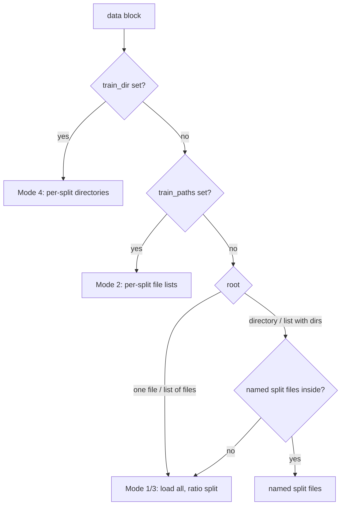

# Loading data

Every `goal.ml` training run gets its structures from one class,
[`GOALDataModule`](https://github.com/Nourollah/GOAL/blob/main/src/goal/ml/data/datamodule.py),
a Lightning `DataModule` driven entirely by the `data:` block of the config.
`data.dataset_type` picks the reader. The keys you set in the block (`root`,
`train_paths`, `train_dir`, ...) pick one of four **loading modes**. This page
covers both, plus label keys, merging, splitting and the DataLoader options.

## Supported formats (`dataset_type`)

| `dataset_type` | Files | Reader | Access | Label keys |
|---|---|---|---|---|
| `xyz` | `.xyz`, `.extxyz` | `ase.io.read` → [xyz.py](https://github.com/Nourollah/GOAL/blob/main/src/goal/ml/data/datasets/xyz.py) | eager (in RAM) | `key_mapping` / `*_key` |
| `trajectory` | `.traj` | `ase.io.Trajectory` → [trajectory.py](https://github.com/Nourollah/GOAL/blob/main/src/goal/ml/data/datasets/trajectory.py) | eager (in RAM) | `key_mapping` / `*_key` |
| `hdf5` | `.h5`, `.hdf5` | pre-built graphs → [hdf5.py](https://github.com/Nourollah/GOAL/blob/main/src/goal/ml/data/datasets/hdf5.py) | lazy (random access) | fixed names |
| `lmdb` | `.lmdb` | FairChem/OCP pickled dicts → [lmdb.py](https://github.com/Nourollah/GOAL/blob/main/src/goal/ml/data/datasets/lmdb.py) | lazy (memory-mapped) | `key_mapping` / `*_key` |
| `aselmdb` | `.aselmdb` | FairChem ASE-DB shards (OMol25, OMat24, ODAC23) → [aselmdb.py](https://github.com/Nourollah/GOAL/blob/main/src/goal/ml/data/datasets/aselmdb.py) | lazy + cached catalogue | `key_mapping` / `*_key` |
| `zarr` | a GOAL Zarr store (`*.zarr`, one group per split) | `zarr>=3` → [zarr_dataset.py](https://github.com/Nourollah/GOAL/blob/main/src/goal/ml/data/zarr_dataset.py); build with `goal-pack-zarr` | lazy (chunked random access) | fixed names; see [Zarr data](../../integrations/zarr_data.md) |
| `md17`, `rmd17`, `md22`, `qm9`, `ani1`, `ani1x`, `spice` | downloaded on first use | `src/goal/ml/data/benchmarks/` | eager, cached `.pt` | n/a |

`lmdb` and `aselmdb` are **not interchangeable**. `lmdb` expects pickled
dicts keyed `"0"`, `"1"`, ...; FairChem's `.aselmdb` shards store
zlib-compressed JSON `ase.db` rows. Pointing `lmdb` at an `.aselmdb` file fails
to unpickle. See [ASE-LMDB & OMol25](aselmdb-omol25.md) and
[Benchmark datasets](benchmarks.md) for those loaders.

Every reader returns
[`AtomicGraph`](https://github.com/Nourollah/GOAL/blob/main/src/goal/ml/data/graph.py)
objects. ASE is touched only at the dataset boundary, so it never appears in
the training loop. The neighbour list is built at `data.cutoff`. The default
`ase` backend runs on the CPU and handles PBC correctly. You can also pick
`data.neighbor_list_backend: matscipy` (faster, optional dependency) or
`nvalchemiops` (GPU, opt-in). `hdf5` takes no backend because it reads
pre-computed edges.

### Format details worth knowing

- **`xyz` / `trajectory`**: every frame is read and converted to a graph once,
  when the dataset is built. After that, an epoch does no I/O. Memory grows
  linearly with frame count. That suits GMD-sized data (tens of thousands of
  frames), but a file with millions of frames needs a lazy format instead.
- **`hdf5`**: one HDF5 group per structure, holding `positions`,
  `atomic_numbers`, `cell`, `pbc`, `edge_index`, `edge_vectors`,
  `edge_lengths`, and optionally `energy`, `forces`, `stress` and `weight`.
  Edges are read as stored, and `data.cutoff` is **not** applied to them, so
  build the file at the cutoff your model uses. Label names are fixed, and
  neither `key_mapping` nor `neighbor_list_backend` is accepted.
- **`lmdb`**: each value is a pickled dict with `positions`, `atomic_numbers`
  and optionally `cell`, `pbc` and labels. If the dict also holds `edge_index`,
  those edges are used as stored. Otherwise the neighbour list is built when
  each item is read, at `data.cutoff`. The length comes from a `length` key
  when present, otherwise from the LMDB entry count.

### Label keys (`key_mapping`)

For `xyz`, `trajectory`, `lmdb` and `aselmdb`, each label is resolved in this
order
([keys.py](https://github.com/Nourollah/GOAL/blob/main/src/goal/ml/data/keys.py)):

1. the configured key: energy and stress in `atoms.info`, forces in
   `atoms.arrays` (for `lmdb`, the key in the stored dict);
2. the attached ASE calculator (`get_potential_energy`, `get_forces`,
   `get_stress`);
3. `None`, if that property was never configured. If it **was** configured
   explicitly, loading stops with an error that lists the keys the frame
   actually contains.

Step 2 means trajectories written by an ASE calculator load with no
configuration. It also covers ExtXYZ files whose `energy=`/`forces` columns
ASE attaches as a `SinglePointCalculator`.

If your file uses other names, map them to GOAL's canonical properties with
one dict, the same way MACE and FairChem do:

```yaml
data:
  dataset_type: xyz
  root: /path/to/data.xyz
  key_mapping:
    energy: REF_energy     # atoms.info["REF_energy"]
    forces: REF_forces     # atoms.arrays["REF_forces"]
    stress: virial         # atoms.info["virial"]
```

The older per-key form (`energy_key`, `forces_key`, `stress_key`) means the
same thing. When both are set, `key_mapping` wins.

> [!TIP]
> A wrong key fails at load time with a message like
> `Label 'energy' not found: the configured key 'REF_energy' is not in atoms.info/atoms.arrays ...`
> followed by the keys that are available. Before this check existed, a wrong
> key dropped the label silently and surfaced much later as `KeyError: 'energy'`
> inside the loss.

`xyz` also takes `head: <name>`, which tags every graph from that file for
multi-head training.

## Loading modes

`GOALDataModule.setup()` checks the keys in this order and uses the **first**
match:



> [!IMPORTANT]
> `train_dir` beats `train_paths`, which beats `root`. Most shipped configs
> (for example `simurgh_gmd26`) set `train_dir`/`val_dir`/`test_dir` **and**
> `root`, and in those configs `root` is only used in the run name. To switch
> such a config to a `root` split from the command line, null out the
> directories:
> `data.train_dir=null data.val_dir=null data.test_dir=null data.root=/path/to/file.xyz`.

### Mode 1: one source, ratio split

`root` is a single file. It is loaded once and split by `split_ratio` with a
seeded `random_split`.

```yaml
data:
  dataset_type: trajectory
  root: ${paths.data_dir}/GMD/O2C2H4_PBE.traj
  cutoff: 5.0
  batch_size: 8
  split_ratio: [0.8, 0.1, 0.1]   # train / val / test
  split_seed: 42
```

If `root` is a **directory**, GOAL first looks inside it for named split files
and uses them directly, with no ratio split. A directory with no such files is
expanded into every data file it contains (see Mode 3), and that set is
ratio-split. The names each reader looks for are:

| `dataset_type` | named split files |
|---|---|
| `xyz` | `train.xyz`, `val.xyz`, `test.xyz` (not `.extxyz`) |
| `trajectory` | `train.traj`, `val.traj`, `test.traj` |
| `hdf5` | `train.h5`, `val.h5`, `test.h5` (not `.hdf5`) |
| `lmdb` | `train.lmdb`, `val.lmdb`, `test.lmdb` |
| `aselmdb` | `train.aselmdb`, `val.aselmdb`, `test.aselmdb` |

`test.<ext>` is optional. Without it there is no test split.

> [!NOTE]
> Older versions had a data-leakage bug here. With a file `root`, each split
> fell back to "the whole file", so train, val and test were identical and
> `split_ratio` was ignored. File roots now always go through the ratio
> split.

### Mode 2: pre-split file lists

Use `train_paths` and `val_paths` (and optionally `test_paths`). Each split
loads its own list, and several files in one list are merged with
`merge_strategy`. `split_ratio` is ignored.

```yaml
data:
  dataset_type: xyz
  train_paths: [${paths.data_dir}/A/train.xyz, ${paths.data_dir}/B/train.xyz]
  val_paths:   [${paths.data_dir}/A/val.xyz]
  test_paths:  [${paths.data_dir}/A/test.xyz]    # optional
  merge_strategy: sequential
  cutoff: 5.0
  batch_size: 8
```

### Mode 3: several sources merged, then ratio-split

`root` is a **list**. Every entry is loaded (directories are expanded into
their data files), the results are merged with `merge_strategy`, and the
merged set is split by `split_ratio`.

```yaml
data:
  dataset_type: trajectory
  root:
    - ${paths.data_dir}/C2H6_PBE.traj
    - ${paths.data_dir}/C3H8_PBE.traj
  merge_strategy: random
  split_ratio: [0.8, 0.1, 0.1]
  split_seed: 42
  cutoff: 5.0
```

If **every** entry in a list root is a directory that contains its own named
split files, those files are used instead, and train is merged with train,
val with val, and so on. If any entry lacks them, the whole list falls back
to the merge-then-split path.

> [!WARNING]
> Make a list root all files or all directories, never a mix. If a mixed
> list's directories contain named split files, the file entries are loaded
> whole into train **and** into val.

### Mode 4: per-split directories

Set `train_dir` and `val_dir` (both required), plus `test_dir` if you want a
test split. Every file in each directory whose extension GOAL recognises
(`.xyz .extxyz .h5 .hdf5 .lmdb .aselmdb .traj .db`) is picked up in sorted
order, loaded as its own dataset, and merged into that split.

```yaml
data:
  dataset_type: trajectory
  train_dir: ${paths.data_dir}/GMD/FragmentDuplication/Training
  val_dir:   ${paths.data_dir}/GMD/FragmentDuplication/TestID
  test_dir:  ${paths.data_dir}/GMD/FragmentDuplication/TestOOD   # optional
  cutoff: 8.0
  batch_size: 48
```

> [!WARNING]
> Files are picked up by extension only, not by `dataset_type`. Every
> recognised file in the directory is handed to the configured reader. Keep
> one format per directory: a stray `.xyz` next to your `.traj` files would
> be passed to the trajectory reader and fail. `.db` is on the list, but no
> core reader opens `ase.db` files, so leave those out too.

## Merge strategies

When a split is built from several files (Modes 2, 3 and 4), the files are
combined with `ConcatAtomicDataset`:

| `merge_strategy` | Behaviour |
|---|---|
| `sequential` (default) | files concatenated in the given (or sorted) order |
| `random` | indices permuted once at load, seeded by `split_seed` |

The training loader shuffles every epoch either way, so `random` does not
change what the model sees during training. It matters in two places: the
order of the val/test loaders, and (in Mode 3) which frames end up in which
split. Mode 3's `random_split` is itself random, though, so `sequential` is
already safe there.

## Auto-splitting rules

`split_ratio` applies only to Mode 1/3 ratio splits:

```yaml
data:
  split_ratio: [0.8, 0.1, 0.1]   # train / val / test (default)
  # split_ratio: [0.9, 0.1]      # train / val, no test split
  split_seed: 42                 # default 42
```

- The val and test sizes are rounded **down**, and train gets the rest, so
  the three sizes always add up to the total and no frame is lost. A
  one-frame dataset puts its single frame in train.
- If a split has a positive ratio but rounds to zero frames, GOAL warns
  instead of failing silently. Use more data or explicit per-split files.
- Splits are reproducible for a fixed `split_seed` and the same file list.

## Monitoring the test split during training

```yaml
data:
  monitor_test_during_training: true
```

With this set, the validation loop also runs the test split and logs it in
its own sections (`test/`, `test_energy/`, `test_forces/`) every validation
epoch. It is designed for the GMD layout: an in-distribution val set
(`TestID`) and an out-of-distribution test set (`TestOOD`). There you see
the generalisation gap as a curve instead of a single number at the end. The
cost is one extra forward pass over the test split per validation epoch.

> [!WARNING]
> Do not select checkpoints or stop early on `test/*` metrics. Selecting on
> the monitored set turns it into a second validation set. With a random
> ratio split, test is statistically the same as val, so monitoring it only
> draws the same curve twice.

## DataLoader options

Batching uses PyG's `DataLoader`, which concatenates variable-size graphs.
The training loader shuffles. The val and test loaders do not.

```yaml
data:
  batch_size: 32
  num_workers: 4            # default 0
  pin_memory: true          # default false; true when training on CUDA
  persistent_workers: true  # default true when num_workers > 0
  prefetch_factor: 2        # only used when num_workers > 0
  # multiprocessing_context: fork   # auto on Linux/macOS; override if needed
```

- **When workers help:** eager readers (`xyz`, `trajectory`, benchmarks)
  already hold every graph in memory, so `num_workers: 0` is usually fine.
  Lazy readers (`lmdb`, `aselmdb`) decode rows and build neighbour lists in
  `__getitem__`, and for them workers are what keep the GPU busy.
- **Python 3.14:** on Linux, multiprocessing now starts workers with
  `forkserver` by default, which makes torch DataLoader workers fail with
  `ValueError: too many fds`. When `num_workers > 0`, `GOALDataModule` passes
  a `fork` context automatically on every platform except Windows. Set
  `data.multiprocessing_context` to override it.
- **Batch size is really a memory budget in edges.** GPU memory scales with
  the number of edges in a batch, not with the number of structures. A
  370-atom molecule at 5 Å has orders of magnitude more edges than a 9-atom
  one, so re-tune `batch_size` whenever the molecule or `cutoff` changes.

## Fragment labels

Fragment-aware models such as [NF_SIMURGH](../models/nf-simurgh.md) need
per-atom `fragment_index` labels. Every core reader and every benchmark loader
except `ani1` and `spice` computes them when you enable it:

```yaml
data:
  compute_fragment_index: true
  fragment_scheme: connected     # connected | rdkit_components | rotatable | brics | recap | custom
  fragment_covalent_cutoff: 1.8  # Angstrom, bond threshold for `connected`
  fragment_charge: 0             # total charge for rdkit bond perception
  fragment_on_failure: fallback  # or "raise"
  fragment_smarts: null          # bonds to cut; required by `custom`
  fragment_keep_groups: null     # SMARTS whose atoms must stay together
```

The scheme and SMARTS are validated when the dataset is built, not
thousands of frames in. If a reader does not support the options and
`compute_fragment_index` is `false`, the fragment keys are dropped silently.
If it is `true`, the run stops with an explicit error. See
[`fragments.py`](https://github.com/Nourollah/GOAL/blob/main/src/goal/ml/data/fragments.py)
for what each scheme cuts.

## Statistics derived from the data

After `setup("fit")`, the training entry point
([train.py](https://github.com/Nourollah/GOAL/blob/main/src/goal/ml/cli/train.py))
reads several model inputs from the **train split**:

| Quantity | Function | Injected when |
|---|---|---|
| `elements` | `compute_unique_elements` | backbone is `simurgh`, `simurgh_ace_first`, `simurgh_arace`, `simurgh_monolithic` or `monolithic_arace` (overwrites the config) |
| atomic reference energies (E0s) | `compute_atomic_references` | `atomic_energies.mode: dataset` (or `compute_from_dataset: true`) and no `values` given |
| `scale` | `compute_energy_scale` | atomic-energy mode is `dataset` or `provided` and `scale` is null |
| `avg_num_neighbors` | `compute_avg_num_neighbors` | `dressing_kwargs.avg_num_neighbors: null`, or backbone `simurgh_arace` with a null top-level key |
| `pair_counts` | `compute_pair_counts` | `rare_artisan.enabled: true` and `pair_counts: null` |

Every injected value is also written back into the config the run saves (`hparams` and `checkpoints/config.yaml`), so a model rebuilt from a checkpoint — `GOALCalculator`, `goal-eval`, a bare `.ckpt` — gets exactly these values. (Before October 2026 only `pair_counts` was written back.)

> [!WARNING]
> `nf_simurgh` and the SIMURGH Simplified backbones are **not** on the
> `elements` list. Their configs hard-code `elements` and
> `avg_num_neighbors`. When you change the dataset, the molecule or
> `data.cutoff`, recompute both, because an element missing from `elements`
> contributes exactly zero energy and nothing warns. Foundation-model
> backbones re-estimate their E0s through `FoundationE0Callback` instead
> (see [Fine-tuning](../finetuning/overview.md)).

Frames are loaded as **float64** on the CPU. Lightning moves batches to the
device, and the trainer's `precision` decides the compute dtype.

## Use cases

### "I have one big extxyz file"

```yaml
data:
  dataset_type: xyz
  root: /data/my_system/all_frames.extxyz
  key_mapping: {energy: REF_energy, forces: REF_forces}   # if not the defaults
  split_ratio: [0.9, 0.05, 0.05]
  split_seed: 42
  cutoff: 5.0
  batch_size: 16
```

Starting from a shipped config, override from the command line. Null out its
directory keys so Mode 1 is used:

```bash
pixi run -e cuda goal-train --config-name simurgh_gmd26 \
    data.dataset_type=xyz data.root=/data/my_system/all_frames.extxyz \
    data.train_dir=null data.val_dir=null data.test_dir=null \
    'data.split_ratio=[0.9,0.05,0.05]'
```

If the frames are consecutive MD snapshots, a random split puts near-duplicate
frames in train and in val, which makes validation optimistic. When you need
an honest generalisation number, hold out whole trajectories or conditions
with Mode 2 or 4.

### "I already have train / val / test files"

Put them in one directory as `train.xyz`, `val.xyz` and `test.xyz` and set
`root` to that directory. Or name them explicitly:

```bash
pixi run -e cuda goal-train --config-name simurgh_gmd26 data.dataset_type=xyz \
    data.train_dir=null data.val_dir=null data.test_dir=null \
    '+data.train_paths=[/data/A/train.xyz]' \
    '+data.val_paths=[/data/A/val.xyz]' \
    '+data.test_paths=[/data/A/test.xyz]'
```

`train_paths`, `val_paths` and `test_paths` are not in that config, so Hydra
needs the `+` prefix to add them.

### "I want to merge three sources"

When the sources share one split policy, use Mode 3:

```yaml
data:
  dataset_type: xyz
  root:
    - /data/bulk_water.xyz
    - /data/ice_ih.xyz
    - /data/water_surface.xyz
  merge_strategy: random
  split_ratio: [0.8, 0.1, 0.1]
  split_seed: 7
```

To validate on one source only (for example, train on bulk and ice, validate
on the surface), use Mode 2 and list the sources per split. All sources must
share a format and the same `cutoff`. Atoms from every source end up in the
union of elements that the model sees.

### "My data is organised in folders, one per split"

Use Mode 4 (`train_dir`, `val_dir`, `test_dir`). Add
`monitor_test_during_training: true` when the test folder is genuinely out of
distribution.

### "My corpus does not fit in memory"

Convert it to `lmdb` or `hdf5`, or for FairChem corpora read the `.aselmdb`
shards directly ([ASE-LMDB & OMol25](aselmdb-omol25.md)). Set
`num_workers` > 0 so decoding overlaps with the training step.

### Inspecting a split in Python

```python
from omegaconf import OmegaConf
from goal.ml.data.datamodule import GOALDataModule

cfg = OmegaConf.create({"data": {
    "dataset_type": "xyz",
    "root": "/data/my_system/all_frames.extxyz",
    "cutoff": 5.0,
    "batch_size": 4,
    "split_ratio": [0.8, 0.1, 0.1],
}})
dm = GOALDataModule(cfg)
dm.setup("fit")
print(len(dm.data_train), len(dm.data_val))
batch = next(iter(dm.train_dataloader()))
print(batch.num_graphs, batch.pos.shape, batch.energy.shape)
```

## Known limitations

- `xyz` and `trajectory` are eager readers, so memory grows with frame count.
- One malformed frame aborts the load. Label extraction tolerates missing
  optional keys, but graph construction does not tolerate bad frames.
- Very small datasets can produce an empty val or test split (GOAL warns).
- The named-split lookup checks one extension per reader: `xyz` does not
  match `train.extxyz`, and `hdf5` does not match `train.hdf5`.
