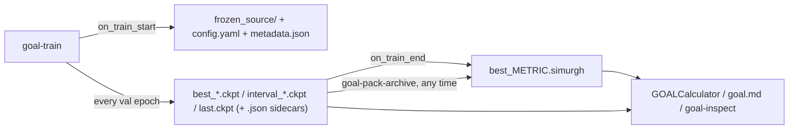

# Checkpoints & archives

A plain PyTorch checkpoint stores only weights. To load it later you need the exact model code that produced them, and a renamed class or a changed constructor in between breaks it. GOAL avoids this: at training start it freezes the model's source, its resolved config and provenance metadata next to the checkpoints. It can also pack any checkpoint into a single `.simurgh` file that loads anywhere with the code it was trained with.

This page covers the checkpoint manager that writes these files, the on-disk formats, the two command-line tools (`goal-pack-archive`, `goal-inspect`) and how to load a model back.



## The checkpoint manager

`GOALCheckpointManager` (`goal.ml.training.callbacks.checkpoint_manager`) is a Lightning callback configured by a top-level `checkpoint_manager:` block in every experiment config:

```yaml
checkpoint_manager:
  _target_: goal.ml.training.callbacks.checkpoint_manager.GOALCheckpointManager
  dirpath: ${paths.output_dir}/checkpoints   # logs/<task_name>/runs/<run_name>/checkpoints

  top_k:                       # pool 1: the K best by a validation metric
    enabled: true
    k: 5
    metric: "val_forces/forces_mae"
    mode: "min"                # "min" for errors, "max" for similarities

  interval:                    # pool 2: rolling snapshots every N epochs
    enabled: true
    every_n_epochs: 2
    keep_last_n: 5

  last:                        # pool 3: always overwritten, for crash recovery
    enabled: true
    filename: "last.ckpt"

  save_archive: true           # pack the best top-k checkpoint at the end of training
  archive_interval: false      # also pack an archive per interval checkpoint (large!)
```

The values shown are the constructor defaults. If `dirpath` is `null`, it falls back to `<trainer.log_dir>/checkpoints`.

### The three pools

All three pools update at the end of every validation epoch, on rank 0 only:

| Pool | Filename | Kept | Purpose |
| --- | --- | --- | --- |
| top-k | `best_<metric_slug>=<value:.4f>_epoch=<epoch:04d>.ckpt` | the `k` best values of `top_k.metric` | model selection, deployment |
| interval | `interval_epoch=<epoch:04d>.ckpt` | the newest `keep_last_n` | looking back at training dynamics, rolling back |
| last | `last.ckpt` (or `last.filename`) | 1, overwritten | resuming after a crash or pre-emption |

`<metric_slug>` is the metric with `/` replaced by `_`, so `val_forces/forces_mae` becomes `best_val_forces_forces_mae=0.0052_epoch=1440.ckpt`.

Rules worth knowing:

- **Atomic writes.** Each checkpoint is written to `*.tmp` and then `os.replace`d, so a job killed mid-write never leaves a truncated `.ckpt` behind.
- **Pool state persists.** `checkpoint_state.json` records pool membership and the pool config after every epoch, so a resumed run continues evicting correctly. A file in both the top-k and interval pools is not deleted when it leaves only one of them.
- **Resumed runs never delete the previous run's files.** When a run resumes into a new Hydra output directory, the inherited pool entries still point at the old directory. Evicting them removes them from the pool but leaves the files on disk. See [Resuming & extending](../training/resuming.md).
- **Metric names.** Energy and force metrics are logged under `val_energy/…` and `val_forces/…`. An old-style key such as `val/forces_mae` is translated to `val_forces/forces_mae` with a warning. If the metric is missing from `callback_metrics` entirely, the top-k save is skipped with a warning that lists the available keys.
- **Mode sanity check.** A known "lower is better" metric (`forces_mae`, `energy_mae_per_atom`, `total`, …) combined with `mode: max`, or a "higher is better" one (`forces_cosine_similarity`, `r2`, `accuracy`) combined with `mode: min`, triggers a `UserWarning`.
- **Choose on validation, never on test.** With `data.monitor_test_during_training`, `test_*` curves also appear in `callback_metrics`. Pointing `top_k.metric` at them turns the test set into a second validation set.

### What is frozen at training start

In `on_train_start`, before any weights are written, the manager writes three things:

| File | Contents |
| --- | --- |
| `frozen_source/goal/…` | every `goal.*` `.py` file the model depends on, keeping the package layout |
| `config.yaml` | the fully resolved Hydra config (`OmegaConf.to_yaml(cfg, resolve=True)`) |
| `metadata.json` | provenance and model facts (below) |

The source closure is found by walking the import graph (`goal.ml.training.archive.get_model_source_files`). The walk starts from the defining module of every `nn.Module` inside the `GOALModule`, plus a fixed set of loader modules: the registry, `AtomicGraph`, `GOALModule`, losses, EMA, and the model and head packages. Each module's globals are scanned for further `goal.*` modules and objects. As a safety net, every sibling `.py` in the model's own package is added too, so imports inside functions are not missed. Files outside `src/goal` (site-packages, stdlib) are never copied. A typical SIMURGH snapshot is around 80 files.

On resume, an existing `frozen_source/` is kept: the snapshot always matches the code the run **started** with. If freezing fails, training continues, but an error is logged saying the directory's checkpoints are **not** self-contained.

`metadata.json` is gathered defensively, so fields the model does not expose are simply absent:

```json
{
  "simurgh_version": "0.1.0",
  "git_commit": "152d8e8342ff9510f6e323fdb20e477711ec6ef8",
  "timestamp": "2026-08-07T09:55:38",
  "model_class": "SimurghAraceBackbone",
  "source_frozen": true,
  "elements": [1, 6, 8],
  "atomic_references": {"1": -13.5953, "6": -1028.4812, "8": -2041.1177},
  "scale": 1.1180739402770996
}
```

Other optional keys are `pair_frequencies`, `dedicated_pairs`, `rare_artisan` and `avg_num_neighbors`. `simurgh_version` is the installed `goal` package version.

### Per-checkpoint sidecars

Every `.ckpt` gets a `.json` sidecar with the same stem, deleted together with it:

```json
{
  "epoch": 1440,
  "pool": "top_k",
  "metrics": {
    "lr-AdamW/pg1": 4.005637674708851e-05,
    "train_forces/forces": 0.0037806184502847577,
    "val_forces/forces_mae": 0.005163683401432532,
    "...": "every scalar in callback_metrics"
  },
  "timestamp": "2026-10-07T14:35:35",
  "config_path": "config.yaml",
  "frozen_source_path": "frozen_source/",
  "metadata_path": "metadata.json"
}
```

`metrics` holds every scalar in Lightning's `callback_metrics` at that epoch, including learning rates and train/test curves. The three paths are relative, so the directory can be moved.

### A finished run directory

```text
logs/simurgh_gmd26/runs/<run>/checkpoints/
├── frozen_source/goal/...                         model source at t = 0
├── config.yaml                                    resolved config
├── metadata.json                                  provenance
├── checkpoint_state.json                          pool membership (resume)
├── best_val_forces_forces_mae=0.0052_epoch=1440.ckpt   + .json   ┐
├── ...                                                            ┘ top-k pool
├── interval_epoch=2998.ckpt                       + .json   ┐ interval pool
├── ...                                                      ┘
├── last.ckpt                                      + .json     last pool
├── best_val_forces_forces_mae.simurgh             end-of-training archive (save_archive)
└── TRAINING_COMPLETE                              sentinel: training finished normally
```

## The `.simurgh` archive

An archive is a plain zip, readable with `unzip -l`, holding one checkpoint plus the directory context it needs:

```text
weights.pt          the selected .ckpt (full Lightning checkpoint: state_dict, goal_ema, hyper-parameters, ...)
config.yaml         resolved config of the run
metadata.json       provenance
checkpoint.json     that checkpoint's sidecar (when present)
frozen_source/goal/...
```

Archives are written atomically. With `save_archive: true` the best top-k checkpoint is packed to `{dirpath}/best_<metric_slug>.simurgh` when training ends normally. A run that is killed before the end does not get one, so pack it yourself.

### `goal-pack-archive`

`goal-pack-archive` packs any checkpoint of a managed directory at any time: mid-training to ship the current best, after a crash, or to archive a specific epoch.

```bash
pixi run -e cuda goal-pack-archive \
    --checkpoint-dir logs/simurgh_gmd26/runs/<run>/checkpoints \
    --checkpoint best \
    --output models/simurgh_gmd26.simurgh
# Packed best_val_forces_forces_mae=0.0052_epoch=1440.ckpt -> models/simurgh_gmd26.simurgh
```

| Flag | Default | Meaning |
| --- | --- | --- |
| `--checkpoint-dir` | required | directory written by `GOALCheckpointManager` |
| `--checkpoint` | `best` | `best`, `last`, `epoch=N`, or a `.ckpt` filename/path |
| `--output` | `<ckpt stem>.simurgh` inside the checkpoint directory | archive path; parent directories are created |

The command exits with status 1 and a one-line `error:` message if the selector matches nothing or the directory lacks `config.yaml`, `metadata.json` or `frozen_source/`.

### `goal-inspect`

`goal-inspect` describes a model **without building it**. It accepts all three formats:

```bash
pixi run -e cuda goal-inspect models/simurgh_gmd26.simurgh          # archive
pixi run -e cuda goal-inspect logs/simurgh_gmd26/runs/<run>/checkpoints/   # directory (also lists every .ckpt)
pixi run -e cuda goal-inspect logs/.../checkpoints/last.ckpt        # bare checkpoint (+ its sidecar / directory metadata)
```

```text
Format:           archive
Source frozen:    yes
Version:          0.1.0
Git commit:       152d8e83
Saved:            2026-08-07T09:55:38
Model class:      SimurghAraceBackbone
Elements:         H C O
Scale:            1.11807
Epoch:            1124
Pool:             top_k
val/energy:       0.0002
val/energy_mae_per_atom:0.0002
...
val/forces_mae:   0.0100
val/total:        0.0102
```

For a directory, the epoch and metrics come from the sidecar of the `best` checkpoint, and `Available ckpts` lists every `.ckpt`. `Source frozen: NO — not self-contained` means the model will load from the live code only.

> [!NOTE]
> The metric rows only show keys starting with `val/`. Runs from the current code log energy and force metrics under `val_energy/` and `val_forces/`, so for those runs `goal-inspect` shows only `val/total`. The full set is in the sidecar JSON (`checkpoint.json` inside an archive).

## Loading a model back

| You have | Load with |
| --- | --- |
| an archive | `GOALCalculator(checkpoint_path="model.simurgh")` |
| a checkpoint directory | `GOALCalculator(checkpoint_path=dir, checkpoint="best")`; other selectors: `"last"`, `"epoch=N"`, `"<file>.ckpt"` |
| a bare `.ckpt` | `GOALCalculator(checkpoint_path="x.ckpt")`: live source, warns |
| MD in `goal.md` | `CalculatorFactory.create("goal_model", checkpoint=...)`, see [Trained GOAL models](../../md/calculators/goal-model.md) |

All of these go through the same loader as the [ASE calculator](ase-calculator.md). For archives and directories, the `GOALModule` is rebuilt inside `frozen_source_imports(...)`, so every `goal.*` import inside the block resolves to the snapshot first and falls back to the live package only for modules that were never frozen. On exit the original `sys.modules` entries are restored, while objects created inside keep pointing at the frozen code. The live code and an old model can therefore coexist in one process.

To reach the `GOALModule` itself (for evaluation, fine-tuning or feature extraction), take it from the calculator:

```python
from goal.ml.utils.calculator import GOALCalculator

calc = GOALCalculator(checkpoint_path="models/simurgh_gmd26.simurgh", device="cuda")
module = calc.module          # GOALModule (backbone + head), eval mode, on `device`
print(module.config.model.backbone.name)
```

The lower-level helpers live in `goal.ml.training.archive`:

```python
from pathlib import Path
import tempfile

import torch

from goal.ml.training.archive import (
    frozen_source_imports,     # context manager: goal.* imports resolve from a frozen tree
    inspect_checkpoint,        # dict behind goal-inspect (format, metadata, sidecar, ckpt list)
    is_managed_checkpoint_dir, # has config.yaml + metadata.json + frozen_source/?
    pack_simurgh_archive,      # (checkpoint_path, output_path=None) -> Path
    resolve_checkpoint,        # (dirpath, "best" | "last" | "epoch=N" | "x.ckpt") -> Path
    unpack_simurgh_archive,    # (archive_path, dest_dir) -> Path; rejects path-traversal members
)

info = inspect_checkpoint("models/simurgh_gmd26.simurgh")
print(info["format"], info["metadata"]["elements"], info["sidecar"]["epoch"])

# Raw access to the weights / EMA shadow of an archive
with tempfile.TemporaryDirectory() as tmp:
    root = unpack_simurgh_archive("models/simurgh_gmd26.simurgh", tmp)
    raw = torch.load(root / "weights.pt", map_location="cpu", weights_only=False)
    print(raw.keys())          # state_dict, hyper_parameters, goal_ema (EMA runs, current code), ...
```

> [!WARNING]
> `frozen_source_imports` swaps global interpreter state (`sys.modules`, `sys.meta_path`) and is **not thread-safe**. Load models one at a time.

## Sharing a model

1. **Pick the checkpoint** with `goal-inspect <dir>`, then pack it with `goal-pack-archive … --output name.simurgh`. Prefer an archive over sending a directory: it holds exactly one set of weights.
2. **Describe it.** `goal-inspect name.simurgh` gives the git commit, element set and validation metrics to paste into a README or paper SI.
3. **The recipient** needs `goal` installed, with compatible versions of the third-party stack: PyTorch, e3nn, PyG, Lightning. Only `goal.*` source is frozen; third-party libraries are imported live.
4. **Load** with `GOALCalculator(checkpoint_path="name.simurgh")` or `goal.md`'s `goal_model` calculator.

> [!WARNING]
> Checkpoints are unpickled with `torch.load(..., weights_only=False)`, and an archive's frozen source is **executed** when it loads. Treat a `.simurgh` file like a Python package: only load archives from people you trust.

## Pitfalls

- **Moving or copying a run directory.** `checkpoint_state.json` stores absolute paths. If the original directory still exists, `checkpoint="best"` on a **copy** resolves to the file in the *original* location. Once the original is gone, it falls back to parsing the `best_*` filenames, which is correct. Name the file explicitly (`checkpoint="best_…ckpt"`) when you work on copies.
- **Ties in the filename.** Values are formatted to four decimals, so several top-k files can show the same number (`=0.0123_epoch=2490`, `=0.0123_epoch=2508`, …). `best` uses the full-precision values in `checkpoint_state.json`.
- **Interval archives are large.** `archive_interval: true` writes a full archive, weights plus source, every `every_n_epochs`. They are evicted together with their checkpoints.
- **Bare `.ckpt` files** (Lightning's own `ModelCheckpoint`, or files copied out of a run directory) carry no frozen source. Keep them inside their directory or pack them while the code still matches.
- **Data-derived settings.** Some backbone arguments are computed from the training set at launch and are not written back to `config.yaml`/the embedded config (notably `atomic_energies.values` in `mode: dataset`). The weights are fine, but rebuilding such a model needs the workaround on the [ASE calculator](ase-calculator.md#atomic_energiesmode-dataset) page.

## See also

- [Resuming & extending](../training/resuming.md): how `last.ckpt`, pool state and `TRAINING_COMPLETE` drive resumption.
- [Evaluation](evaluation.md): test-set metrics from a checkpoint directory.
- [CLI reference](../reference/cli.md).
