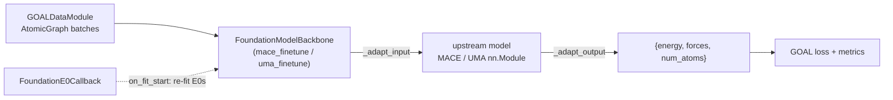

# Fine-tuning foundation models

GOAL fine-tunes pre-trained interatomic potentials **in-process**. A
foundation model is wrapped as an ordinary GOAL *backbone* and trained by the
same `GOALModule` and Lightning trainer as a native model. There is no
separate training loop, so the loss, stage curriculum, optimiser,
`GOALCheckpointManager`, multi-GPU strategies (DDP/FSDP) and HPO all apply
unchanged.

| Model | How | Backbone / entry point | Config |
|---|---|---|---|
| MACE (MACE-MP-0, local `.model` files) | in-process, trainable | `mace_finetune` via `goal-train --config-name finetune/mace` | [`src/goal/configs/ml/finetune/mace.yaml`](https://github.com/Nourollah/GOAL/blob/main/src/goal/configs/ml/finetune/mace.yaml) |
| UMA / FairChem | in-process, **needs a raw-module load path** in your fairchem version | `uma_finetune` via `goal-train --config-name finetune/uma` | [`src/goal/configs/ml/finetune/uma.yaml`](https://github.com/Nourollah/GOAL/blob/main/src/goal/configs/ml/finetune/uma.yaml) |
| UPET / PET | metatrain subprocess (`mtt train`) | `goal-finetune-upet` | command-line flags |
| **SIMURGH** (your own trained checkpoint) | in-process, LoRA on the artisans | `simurgh_lora` via `goal-train --config-name finetune/simurgh_lora` (also `goal-finetune`'s default) | [`src/goal/configs/ml/finetune/simurgh_lora.yaml`](https://github.com/Nourollah/GOAL/blob/main/src/goal/configs/ml/finetune/simurgh_lora.yaml) |

Per-model pages: [MACE](mace.md), [UMA / FairChem](uma.md), [UPET / PET](upet.md), [SIMURGH LoRA](../../integrations/lora_finetune.md).

> [!NOTE]
> The foundation-model wrappers choose their strategy with `model.backbone.strategy` (`head_only` / `full` / `lora`). SIMURGH LoRA is a backbone of its own, `simurgh_lora`, with LoRA settings (`rank`, `alpha`, `target_modules`, …) under `model.backbone`. Neither uses the top-level `strategy:` key, which is the distributed-training strategy (DDP, FSDP, DeepSpeed).

## How the in-process path works



`FoundationModelBackbone`
([base.py](https://github.com/Nourollah/GOAL/blob/main/src/goal/ml/nn/models/foundation/base.py))
loads the upstream model as a **real `nn.Module`** and registers it as a
submodule. That is what makes fine-tuning work. Its parameters appear in the
`GOALModule` `state_dict`, so checkpoints contain the fine-tuned weights. The
optimiser sees them through `self.parameters()`. Lightning moves them to the
right device and dtype.

The backbone is **monolithic**: it returns the property dict directly, so the
config must set `model.head: null`. `train.py` enforces the pairing and
raises if a monolithic backbone has a head, or a modular one lacks one.

The upstream packages (`mace-torch`, `fairchem-core`, `peft`) are imported
lazily. The backbones therefore register even where those packages are
missing, and a package is only required when a model is actually loaded.

## The three strategies

Set `model.backbone.strategy`:

| `strategy` | What trains | When to use | Suggested LR |
|---|---|---|---|
| `head_only` (default) | parameters whose name contains a readout fragment (MACE: `readouts`); everything else is frozen | small datasets (fewer than ~5,000 structures); fastest and most stable | ~1e-4 |
| `full` | every parameter | larger datasets; risks catastrophic forgetting on small ones | ~1e-5, **much smaller** |
| `lora` | frozen base plus LoRA adapters (`peft`) on every `nn.Linear`, or on `lora_target_modules` | parameter-efficient adaptation that keeps the base model intact | ~1e-4 |

```yaml
model:
  backbone:
    strategy: lora
    lora_rank: 4
    lora_alpha: 16.0
    lora_target_modules: null   # null = every nn.Linear in the wrapped model
  head: null
training:
  optimizer:
    lr: 1.0e-4
```

Frozen parameters get `requires_grad=False`. GOAL builds optimiser parameter
groups only from trainable parameters, so frozen weights cost no optimiser
state. With `head_only`, the log reports how many parameter tensors stay
trainable (`[finetune] strategy=head_only — n/N params trainable`). Check
this line on the first run.

> [!IMPORTANT]
> `head_only` and `lora` leave many parameters out of the autograd graph.
> Under DDP, set `strategy.find_unused_parameters: true`, otherwise DDP
> raises on the first backward pass.

## Re-estimate E0s: do not skip this

The **most common cause of fine-tuning failure** is that the foundation
model's per-element reference energies (E0s) do not match your data. Those
E0s were fitted to the model's own training set (MPTrj for MACE-MP, for
example), and a different level of theory or code shifts total energies by
O(eV) per atom. Left alone, that offset has to be absorbed by the
interaction network.

With `reestimate_e0s: true` (the default) and the callback enabled,
`FoundationE0Callback`
([foundation.py](https://github.com/Nourollah/GOAL/blob/main/src/goal/ml/training/callbacks/foundation.py))
runs at `on_fit_start`. It fits $E_\text{total} = \sum_Z n_Z\, e_Z$ by least
squares on `datamodule.data_train` and writes the result into the model's
atomic-energy buffer **before the first step**:

```yaml
callbacks:
  foundation_e0:
    _target_: goal.ml.training.callbacks.foundation.FoundationE0Callback
```

Both shipped fine-tuning configs include it. The fitted values are logged
(`[finetune] re-estimated atomic energies: H(1)=..., C(6)=...`). Elements
your data contains but the model's z-table does not are skipped with a
warning. Note that MACE cannot represent such elements at all (see
[MACE](mace.md)).

Zero-shot MACE-MP-0 on GMD carboxylic acids (PBE/def2-SVP) shows how large
the offset is. Raw energies were off by roughly 600 eV/atom, against MPTrj's
PBE/PAW references. After a per-element linear correction, the residual fell
to 2 to 5 meV/atom.

## Choosing a starting model

- **Organic molecules / drug-like chemistry:** MACE-OFF or MACE-OMol (pass
  the `.model` file path), UMA with `head: omol`, or `pet-spice-*`.
- **Inorganic materials / periodic solids:** MACE-MP-0, UMA with
  `head: omat`, `pet-omat-*` or `pet-mad-*`.
- **Domain match is not a guarantee.** Zero-shot on GMD carboxylic acids,
  force MAE ranked MACE-MP-0 medium (0.14 to 0.18 eV/Å) ahead of
  `pet-mad-s` (0.15 to 0.25), with the molecular `pet-spice-s` *last*
  (0.21 to 0.32). Evaluate a few candidates zero-shot before investing in a
  fine-tune.

Whatever you pick, **set `data.cutoff` to the model's cutoff** (MACE-MP-0
small, medium and large all use $r_\text{max} = 6.0$ Å). The neighbour list
GOAL builds must match the one the model was trained with.

## dtype

Foundation MACE models are float64. The wrappers cast inputs to the model
dtype (`_adapt_input`) and cast predictions back to the label dtype
(`_adapt_output`). Set the trainer to match:

```yaml
model:
  backbone:
    dtype: float64
trainer:
  precision: "64"
  inference_mode: false   # required: forces come from autograd, also during validation
```

## Typical workflow

1. **Get your data into a GOAL-readable format.** Any `dataset_type` from
   [Loading data](../data/loading.md) works. The shipped configs read ExtXYZ
   from `data/finetune` with a 90/10 split. To export an existing GOAL
   dataset:

   ```python
   from goal.ml.data.export import write_extxyz
   write_extxyz(my_dataset, "data/finetune/train.xyz")   # iterable of AtomicGraph
   ```

2. **Evaluate zero-shot first.** Load the foundation model as an MD
   calculator ([MACE, NequIP & FlashMD](../../md/calculators/foundation.md),
   [UPET](../../md/calculators/upet.md)) and measure force MAE on your
   validation frames. That baseline tells you whether fine-tuning is worth
   it and which model to start from.
3. **Start with `head_only`.** Move to `lora` or `full` only if
   `head_only` plateaus and you have the data to support it.
4. **Use the result** like any GOAL checkpoint, through `GOALCalculator`
   ([ASE calculator](../deployment/ase-calculator.md)). The base model must
   still be resolvable at load time, because reconstruction reloads its
   architecture and then overlays the fine-tuned weights.

## Feature-extraction adapters (not for fine-tuning)

Separately from the trainable backbones, `goal.ml.adapters` contains
`MACEAdapter` and `UMAAdapter`
([adapters/](https://github.com/Nourollah/GOAL/tree/main/src/goal/ml/adapters)).
They wrap a foundation model as a *modular* backbone that emits
`NodeFeatures`, for feature extraction and inference. They are registered
lazily as `mace-small`, `mace-medium`, `mace-large` and `uma-small`, and are
built through `from_pretrained(variant)` / `from_local(path)`. See
[Feature extraction](../features/feature-extraction.md).

> [!WARNING]
> The adapters predate the trainable backbones and are not maintained to the
> same standard:
>
> - `MACEAdapter.extract_features` fails against `mace-torch` 0.3.16 with
>   `AttributeError: ... no attribute 'irreps_out'`, because MACE models
>   expose no `irreps_out`.
> - `MACEAdapter.from_pretrained` lets MACE choose the device (CUDA when
>   available) and dtype, so move your graph to the model's device yourself.
> - `UMAAdapter.from_pretrained` uses `fairchem.core.OCPCalculator`, a
>   fairchem-core v1 API.
>
> For anything that trains, use `mace_finetune` / `uma_finetune`.

The legacy `goal-finetune` entry point
([cli/finetune.py](https://github.com/Nourollah/GOAL/blob/main/src/goal/ml/cli/finetune.py))
was built around these adapters (`backbone.pretrained` / `variant` /
`local_checkpoint`). It looks for `src/goal/configs/train.yaml`, which no
longer exists, and it requires a `model.head`. Use
`goal-train --config-name finetune/<model>` instead.
