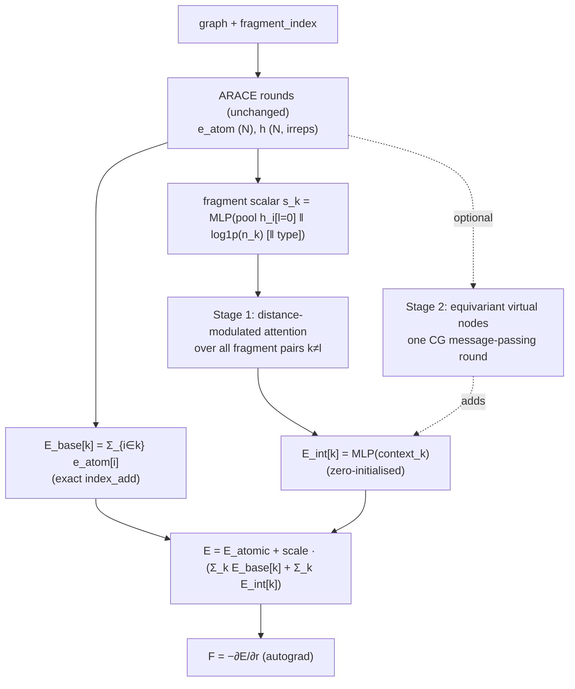

# NF_SIMURGH

**NF_SIMURGH** (Native Fragment SIMURGH, registry name `nf_simurgh`) is an experimental monolithic model. It runs ordinary ARACE rounds, pools the per-atom energies and features onto **fragment virtual nodes** (one per molecular fragment), and lets those virtual nodes interact pairwise over a much longer range than the atom-level cutoff. It is built to capture coupling between distant parts of a structure that local message passing reaches only slowly or not at all.

Source: [`models/simurgh/nf_simurgh.py`](https://github.com/Nourollah/GOAL/blob/main/src/goal/ml/nn/models/simurgh/nf_simurgh.py). Fragment decomposition: [`data/fragments.py`](https://github.com/Nourollah/GOAL/blob/main/src/goal/ml/data/fragments.py). Read [SIMURGH](simurgh.md) first for the ARACE rounds this model reuses.

> [!IMPORTANT]
> NF_SIMURGH is **not** "ARACE with a fragment switch". No key disables the virtual nodes, and there is no fallback when fragment labels are missing: a graph without `fragment_index` raises. The model also rejects `virtual_node.{use_fragments, enable_virtual_nodes, use_fragment_ca, enabled, init_zero}`. NF_SIMURGH without virtual nodes *is* `monolithic_arace`, so run that instead.

## Architecture

The pipeline from the module docstring:

1. **ARACE rounds** run unchanged. NF_SIMURGH builds `AraceBackbone` with both add-ons off, so with the same seed its rounds are bit-identical to `monolithic_arace`. They produce per-atom energies $e_i$ and features $h_i$.
2. **Fragment base energy.** $E_\text{base}[k] = \sum_{i\in k} e_i$. This is a plain `index_add`, so $\sum_k E_\text{base}[k] = \sum_i e_i$ holds *exactly*. Nothing is learned or approximated here.
3. **Fragment representation.** The $l=0$ channels of each fragment's atoms are pooled (`mean` by default) and concatenated with $\log(1+n_k)$, plus an optional pooled element embedding, then passed through an MLP to give $s_k$. The fragment centroid geometry is computed alongside.
4. **Stage 1: distance-modulated attention.** For every ordered pair $k \ne l$ of fragments in the same structure:

    $$\text{logit}_{kl} = \text{MLP}(s_k \,\|\, s_l \,\|\, \text{rbf}(d_{kl})),\quad p_{kl} = \text{softmax}_l(\text{logit}_{kl}),\quad w_{kl} = p_{kl}\cdot \text{env}(d_{kl})$$

    $$\text{context}_k = \sum_l w_{kl}\, s_l,\qquad E_\text{int}[k] = \text{MLP}(\text{context}_k)$$

    The envelope multiplies the *normalised* attention. Total interaction strength therefore decays with separation and reaches exactly zero at `vnode_cutoff`. Attention over chemical summaries alone would keep full strength at any distance.
5. **Interaction energy.** The final layer of the energy MLP is **zero-initialised** (a design invariant, not a config key) and the MLP is bias-free. A freshly built NF_SIMURGH therefore reproduces `MonolithicArace` numerically, and a fragment with no partners contributes exactly zero.
6. **Totals.** $E = E_\text{atomic} + \text{scale}\cdot\big(\sum_i e_i + \sum_k E_\text{int}[k]\big)$, and $\mathbf F = -\partial E/\partial \mathbf r$.

**Equivariance.** The energy is an invariant scalar, so forces are equivariant by differentiation. Collapsing to invariants at the readout is the standard equivariant design. The $l>0$ contractions that Stage 1 can optionally use ($\mu_k\cdot\hat r_{kl}$ and so on) require natural parity, $p=(-1)^l$. The model refuses irreps such as `1e` that would turn them into pseudoscalars.

**Stage 2 (staging, off by default).** With `vnode_equivariant: true`, the full irreps are mean-pooled into *equivariant* virtual nodes $H_k$ and exactly **one** round of CG message passing runs between them, $H'_k = H_k + \sum_l \text{gate}_{kl}\, \mathrm{TP}(H_l, Y(\hat r_{kl}); w(d_{kl}))$. The result is collapsed to a scalar only at the readout. Stage 2 is *added* to Stage 1 rather than replacing it, so both paths keep receiving gradients (the DDP static-graph contract). Toggling the flag then isolates Stage 2's own contribution. The code marks it "STAGING: remove once Stage 2 is validated".

**Smoothness.** The fragment pair *set* is every ordered $k\ne l$ in a structure. It is never truncated at `vnode_cutoff`. Truncating it would make the softmax denominator jump when a fragment crossed the boundary, putting a discontinuity in $E$ and therefore wrong forces. Only the smooth envelope decays.

**Outputs.** `energy`, `forces`, `vnode_energies`, and `vnode_interaction_energies`. The last one is the one to watch: it is zero at initialisation, and when it grows during training the fragment channel is being used.

## How fragments are built

Fragment labels are attached to every graph at dataset-load time (and renumbered per graph during batching) when `data.compute_fragment_index: true`. Every scheme returns contiguous `(N,)` int64 labels and needs no supervision.

| `data.fragment_scheme` | Splits on | rdkit? |
|---|---|---|
| `connected` (code default) | distance graph at `fragment_covalent_cutoff`; label propagation in pure torch, minimum-image PBC, never fails | no |
| `rdkit_components` | connected components of the *perceived* molecule | yes |
| `rotatable` | every non-ring single bond between heavy atoms | yes |
| `brics` | BRICS retrosynthetic rules | yes |
| `recap` | RECAP cleavage rules | yes |
| `custom` | exactly the bonds you name in `fragment_smarts` | yes |

Related data keys:

| Key | Meaning |
|---|---|
| `fragment_covalent_cutoff` | bond threshold in Å (1.8 in the shipped configs; about 2.4 for metal–ligand bonds) |
| `fragment_smarts` | bond patterns to **cut**, used only by `custom`. A 3-atom pattern needs `:1`/`:2` atom maps to say which bond is cut, e.g. `"[C:1](=O)-[O:2]"`. |
| `fragment_keep_groups` | SMARTS whose atoms must end up in one fragment; works with every scheme |
| `fragment_charge` | total charge passed to rdkit bond perception |
| `fragment_on_failure` | `fallback` (warn once, use `connected` for that structure) or `raise` |

rdkit perception (xyz2mol) is cached on the bond graph, so an MD trajectory whose topology does not change pays for it once.

> [!WARNING]
> **`connected` gives K = 1 on any single covalently bonded molecule.** That covers every GMD subset (despite names like "FragmentDuplication"), every MD17/MD22 trajectory and every QM9 molecule. With K = 1 there is one virtual node and no pairs, so the interaction term is identically zero on every batch. The model trains and reports plausible numbers, but the mechanism under test never fired. Use `connected` only for genuinely multi-molecule data (OMol25 clusters, solvated systems). Otherwise cut bonds with `rotatable`, `brics`, `recap` or `custom`. With `fragment_on_failure: fallback`, a perception failure also silently gives K = 1 for that structure, which is why the single-topology configs use `raise`.

Measured decompositions recorded in the shipped configs:

| Molecule (config) | Scheme | K, sizes | Far pairs |
|---|---|---|---|
| butanoic acid, C4 (`nf_simurgh_gmd26`) | `custom` `["[CX4]-[CX4]", "[CX4]-[CX3]"]` | K=4, [4,3,3,4] | |
| decanoic acid, C10 (`nf_simurgh_gmd26`) | same | K=10, [4,3,3,3,3,3,3,3,3,4] = COOH + 8×CH2 + CH3 | 4 of 45 centroid pairs beyond 8 Å (max 9.8 Å) |
| aspirin (`nf_simurgh_md17`) | `custom` `["[C:1](=O)-[O:2]", "c-[CX3]"]` + keep `C(=O)[OX2H1]` | K=3: ring+O (11), acetyl (6), carboxyl (4) | 1 of 3 beyond 5 Å |
| aspirin (comparison) | `rotatable` | K=6 (includes a bare O and a lone HO) | 3 of 15 |
| Ac-Ala3-NHMe (`nf_simurgh_md22`) | `custom` `["[CX4:1]-[CX3:2](=O)"]` + keep `C(=O)N` | 5 residue units | mean 5.5 of 10 beyond 5 Å, up to 12.4 Å |
| benzene (`nf_simurgh_md17_benzene`) | every scheme | K=1 | none: the channel is dead on benzene |

## Configuration reference

### Backbone keys

`nf_simurgh` takes the `monolithic_arace` keys (`num_rounds`, `share_artisan_weights`, `artisan` including `rare_artisan`/`pair_counts`, `cutoff`, `embedding_dim`, `num_elements`, `avg_num_neighbors`, `atomic_energies`, `scale`, `num_elements_table`), **plus**:

| Key | Meaning |
|---|---|
| `elements` | **must be set by hand.** `goal-train` does not inject it for `nf_simurgh`, and a wrong list is silent (missing pairs are zero-masked). |
| `avg_num_neighbors` | not auto-injected for `nf_simurgh`. `null` means no aggregation normalisation; set a number to enable it. |
| `correlation` | `null` (default) or 1/2/3: MACE-style per-element `SymmetricContraction` inside each ARACE round, raising the body order. Exposed only through `nf_simurgh` (`simurgh_arace` and `monolithic_arace` do not accept it). The coupling table is sized by `elements`, not `num_elements`. |
| `virtual_node` | hyperparameters of the always-on mechanism (below). An empty section means "defaults", not "off". |

### `virtual_node` keys

| Key | Default | Meaning |
|---|---|---|
| `pooling` | `mean` | how the $l=0$ representation is pooled: `mean` (scale-consistent across fragment sizes), `sum`, `attention`. The *energy* pooling is always an exact sum. |
| `use_size_scalar` | `true` | append $\log(1+n_k)$; `false` only for ablations |
| `n_scalar` | `16` | width of $s_k$ |
| `vnode_num_rbf`, `vnode_radial_hidden` | `8`, `32` | fragment radial basis (a separate instance from the atom-level one) |
| `vnode_cutoff` | `15.0` | where the interaction envelope reaches zero (Å); keep it well above `data.cutoff` |
| `n_heads` | `4` | attention heads; `context_k` concatenates them |
| `final_hidden` | `16` | interaction-energy MLP width |
| `dropout` | `0.0` | dropout inside the logit MLP |
| `vnode_max_fragments` | `512` | cap on K (pair enumeration is $O(K^2)$) |
| `pool_l1l2`, `l1l2_invariants` | `false`, `[norm, axial, mutual, quad]` | feed pooled $l=1$/$l=2$ invariants (‖μ‖, μ·r̂, μ_k·μ_l, r̂ᵀQr̂) to the logit MLP. Staging. |
| `vnode_equivariant`, `vnode_irreps`, `vnode_sh_lmax` | `false`, node irreps, `2` | Stage 2 equivariant virtual nodes. Staging. |
| `vnode_type_conditioned` | `false` | condition $s_k$ on a pooled learned element embedding, a continuous, DDP-safe alternative to routing fragments to separate experts |

### Shipped configs

All are self-contained (`head: null`) and run with `goal-train --config-name <name>`.

| Config | Data | Fragments | Notable settings |
|---|---|---|---|
| [`nf_simurgh_gmd26`](https://github.com/Nourollah/GOAL/blob/main/src/goal/configs/ml/nf_simurgh_gmd26.yaml) | GMD-26 FragmentDuplication | `custom` CH3/CH2/COOH | `elements: [1,6,8]`, cutoff 8, batch 48, `vnode_cutoff: 15`. The direct A/B against `monolithic_arace_gmd26` (same data, artisans, optimiser, loss). |
| [`nf_simurgh_gmd26_typecond`](https://github.com/Nourollah/GOAL/blob/main/src/goal/configs/ml/nf_simurgh_gmd26_typecond.yaml) | same | same | the **only** change is `vnode_type_conditioned: true` (+1,088 parameters). The config motivates it by showing that ID monoacids and OOD diacids give identical fragment-size multisets. |
| [`nf_simurgh_gmd26_FF`](https://github.com/Nourollah/GOAL/blob/main/src/goal/configs/ml/nf_simurgh_gmd26_FF.yaml) | GMD-26 **FragmentFusion** | same | identical to `_typecond` apart from the data directories and task name (`nf_simurgh_gmd26_fusion`) |
| [`nf_simurgh_md17`](https://github.com/Nourollah/GOAL/blob/main/src/goal/configs/ml/nf_simurgh_md17.yaml) | rMD17 aspirin | `custom` K=3 | cutoff 5, batch 6, `precision: "64"`, `correlation: 3`, `vnode_cutoff: 10`, `avg_num_neighbors: 14.3806` |
| [`nf_simurgh_md17_benzene`](https://github.com/Nourollah/GOAL/blob/main/src/goal/configs/ml/nf_simurgh_md17_benzene.yaml) | rMD17 benzene | `connected` (K=1) | an **atom-level baseline only**: the virtual-node channel is dead on benzene. `correlation: 3`, batch 24. |
| [`nf_simurgh_md22`](https://github.com/Nourollah/GOAL/blob/main/src/goal/configs/ml/nf_simurgh_md22.yaml) | MD22 Ac-Ala3-NHMe | `custom` residue cut | `elements: [1,6,7,8]`, `correlation: 3`, `vnode_cutoff: 13` |
| [`nf_simurgh_qm9`](https://github.com/Nourollah/GOAL/blob/main/src/goal/configs/ml/nf_simurgh_qm9.yaml) | QM9 (U0) | `rotatable`, `fallback` | **no forces**: losses are energy (+ gate_reg) only, and checkpoint/early stopping monitor `val_energy/energy_mae_per_atom`. Batch 32, `vnode_cutoff: 10`, `elements: [1,6,7,8,9]`. |
| [`nf_simurgh_omol25`](https://github.com/Nourollah/GOAL/blob/main/src/goal/configs/ml/nf_simurgh_omol25.yaml) | OMol25 train_4M (`aselmdb`) | `connected`, `fallback` | 72 elements with **rare-pair routing on** (`min_pair_frequency: 2.0e-2`), cutoff 6, `max_atoms: 128`, charge 0 / spin 1 only, precomputed `scale` and `avg_num_neighbors` |

The MD17, benzene, MD22 and QM9 files are derived from `nf_simurgh_gmd26_typecond.yaml` (same model, same artisan and virtual-node settings). Each changes only the numbers that depend on the dataset.

> [!NOTE]
> The only benchmark number recorded in the repository for this model is in a comment in `nf_simurgh_md17.yaml`: the config "reached 21 meV/Å force MAE on rMD17 aspirin against MACE's published 6.6, with 5.2 M parameters". That result is the stated reason `correlation: 3` was switched on. The same comment gives the cost as 5.2 M → 6.8 M parameters.

### Rare-pair routing on OMol25

From the comments in `nf_simurgh_gmd26.yaml` and `nf_simurgh_omol25.yaml`, measured at a 6 Å cutoff:

| `min_pair_frequency` | Dedicated pairs | Params | Edges covered |
|---|---|---|---|
| 1e-2 | 9 | ~8 M | 91.3% |
| 1e-3 | 27 | ~24 M | 97.2% |
| 1e-4 | 114 | ~100 M | 99.1% |
| 5e-5 | 163 | ~142 M | 99.5% |
| 1e-5 | 313 | ~272 M | 99.9% |
| unrouted | 3,081 | 2,671 M | 100% |

The OMol25 config uses **2e-2**. At that threshold the seven pairs that clear it (H–C, H–H, C–C, H–O, H–N, C–O, C–N) get dedicated artisans, and everything else shares one rare artisan per round. The config's comment puts this at 6.9 M parameters, against 2,278 M unrouted. Its argument for the high threshold: the shared artisan sees more edges per epoch (60.7 M) than the weakest dedicated one (24.2 M), so **lowering the threshold makes undertraining worse, not better**. On the small-element GMD/MD17/QM9 sets routing is `enabled: false`, because nothing would fall below the threshold.

## Memory sizing

Peak memory for a full training step (forward, autograd forces, backward, AdamW) is close to **linear in the number of edges per batch**. The configs record these measurements (CUDA, precision "32"):

| Config | Element pairs | Batch | Edges | Peak |
|---|---|---|---|---|
| `nf_simurgh_md17` (aspirin) | 6 | 6 / 12 / 24 | 1,790 / 3,596 / 7,208 | 1.9 / 3.8 / 7.5 GiB |
| `nf_simurgh_qm9` | 15 | 8 / 16 / 24 / 32 / 48 | 2,078 / 4,304 / 6,700 / 8,954 / 13,406 | 5.3 / 11.1 / 17.2 / 22.9 / 34.2 GiB (64: OOM on 48 GB) |

These two measurements agree to 3% on a rule of thumb of **≈ 0.175 MiB per edge per element pair**: about 1.1 MiB/edge at 6 pairs and about 2.6 MiB/edge at 15 pairs. Use it to size a batch before a long run:

$$\text{peak} \approx 0.175\ \text{MiB} \times n_\text{pairs} \times n_\text{edges per batch}$$

The pair count matters because every artisan runs on every edge under zero-masking. Applying the rule:

- **MD22 (10 pairs):** about 1.75 MiB/edge, so batch 8 (≈ 7,180 edges) needs about 12.6 GiB. The 370-atom nanotube is about 7,900 edges in *one* structure, so use batch 1–2 there.
- **Benzene (3 pairs):** about 0.53 MiB/edge, so batch 24 needs about 1.6 GiB.

Two things double the figure: `precision: "64"`, as in `nf_simurgh_md17`, and turning on `correlation` or wider `hidden_irreps`. `trainer.precision: bf16-mixed` roughly halves it, at some risk to the accuracy of autograd forces. Measure on your card first.

> [!WARNING]
> In `nf_simurgh_md22.yaml` the memory table marks batch 8 as "this file", but the actual key is `batch_size: 24`. By the rule above that is about 38 GiB. Lower it to 8 unless your GPU has that much memory.

## Pitfalls

- **Set `elements` yourself, and set it correctly.** A missing element's edges contribute exactly zero, with no warning.
- **Fragment labels are mandatory**, including at inference: graphs built for an ASE calculator must also carry `fragment_index`.
- **Check K before trusting a result.** Watch `vnode_interaction_energies`: if it stays at zero, either K = 1 everywhere or the channel is not learning.
- **Keep the A/B fair.** `nf_simurgh_gmd26` and `monolithic_arace_gmd26` share the atomic-energy baseline and leave `avg_num_neighbors: null`. Change both, or neither.
- The header of `nf_simurgh_md17.yaml` still says `rotatable` is used. The live key is `fragment_scheme: custom`, and the body of the file explains why `rotatable` was rejected for aspirin.

See also: [Benchmark datasets](../data/benchmarks.md), [ASE-LMDB & OMol25](../data/aselmdb-omol25.md), [SIMURGH Simplified](simurgh-simplified.md) (which has its own fragment line).
