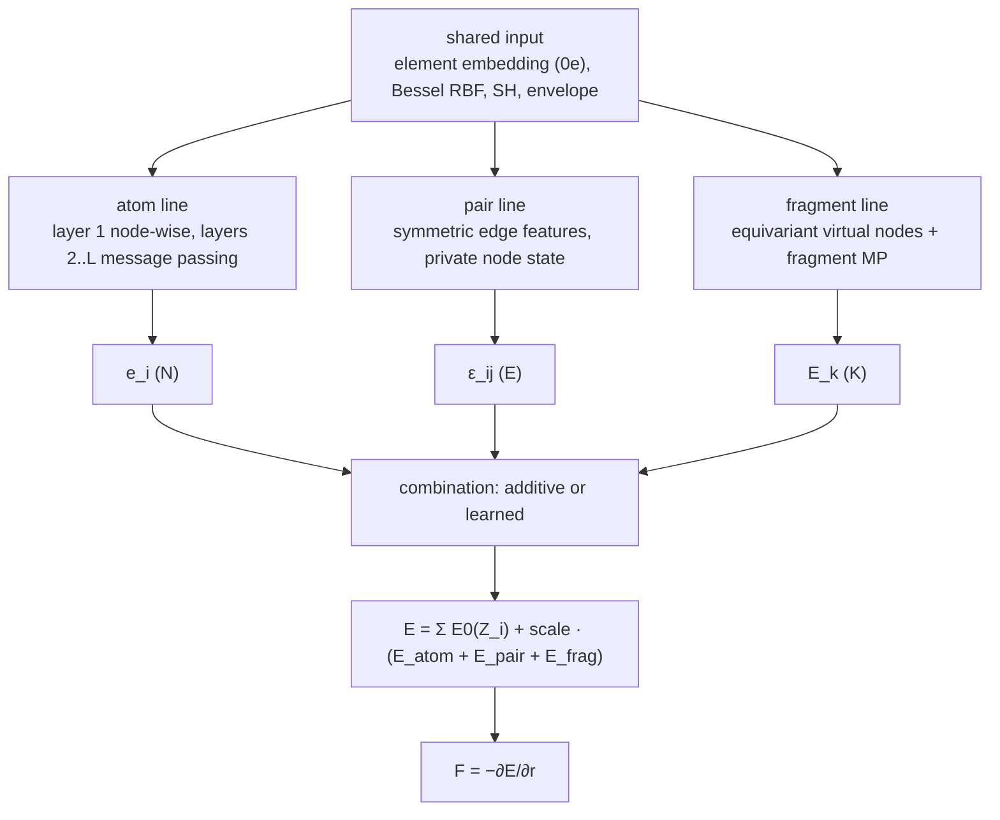

# SIMURGH Simplified

SIMURGH Simplified is a pair of experimental monolithic models that replace SIMURGH's *sequential* pipeline with **three parallel lines** (atom, pair, fragment). The lines share one input and meet only at the readout. The two registered models, `simurgh_simplified_monolithic` and `simurgh_simplified_routed`, run the identical skeleton and differ in exactly one thing: the processor plugged into each line. That makes them a clean ablation pair for the question "do routed artisans and experts beat plain stacks?".

Source:

- [`simurgh_simplified_layers.py`](https://github.com/Nourollah/GOAL/blob/main/src/goal/ml/nn/models/simurgh/simurgh_simplified_layers.py): the shared skeleton, units, readouts and the base `SimurghSimplifiedModel`
- [`simurgh_simplified_monolithic.py`](https://github.com/Nourollah/GOAL/blob/main/src/goal/ml/nn/models/simurgh/simurgh_simplified_monolithic.py)
- [`simurgh_simplified_routed.py`](https://github.com/Nourollah/GOAL/blob/main/src/goal/ml/nn/models/simurgh/simurgh_simplified_routed.py)

> [!NOTE]
> "Monolithic" here names the *processor style* (one stack per line). **Both** models are monolithic in the GOAL sense: they return the property dict directly and are configured with `head: null`.

## The three-line skeleton



- **Shared input.** The element embedding table is the only learnable part. Radial basis, spherical harmonics and envelope are fixed functions of the geometry. No message passing happens here.
- **Atom line.** Layer 1 is node-wise. Layers 2..`num_layers` pass messages, with `h ← RMSNorm(h + update)` after each layer. The input is scalar-only, so layer 1's $l>0$ blocks are structurally empty and fill from layer 2. For that reason `num_layers` must be at least 2.
- **Pair line.** Edge features use **even-$l$ harmonics only**, which makes $\varepsilon_{ij} = \varepsilon_{ji}$ exact. The pair irreps must therefore be even parity (e.g. `16x0e + 16x1e + 16x2e`); odd blocks could never be populated, and the model refuses them. The line keeps its own private node state, fed only by its own edges. The pair energy is multiplied by the envelope once more.
- **Fragment line.** Atom positions relative to the fragment centroid are expanded with unnormalised harmonics on the length scale `fragment_radius`, mean-pooled into equivariant virtual nodes $V_k$, and refined by `num_layers` rounds of fragment–fragment message passing. Aggregation is a **sum with a fixed scale**, with no softmax, so two copies farther apart than `vnode_cutoff` are exactly separable. The fragment readout is **zero-initialised**.
- **Combination.** `additive` gives $E = \sum E_0 + \text{scale}\cdot(E_\text{atom}+E_\text{pair}+E_\text{frag})$. `learned` applies per-atom line weights $g = 1+\tanh(\text{MLP}(0e \text{ of the atom line}))$ to per-atom line energies. The pair energy is split half and half between its two atoms, and the fragment energy is shared equally by its atoms. $g$ is bounded and local, so the energy stays size-extensive. It is zero-initialised, so `learned` starts equal to `additive`.

### Design invariants (from the module docstring)

1. Every line stays equivariant until its own readout; scalar-only lines are refused.
2. Nonlinearities are `e3nn.nn.Gate` only. No pointwise nonlinearity touches an $l>0$ component.
3. Every scalar decision (type modulation, MoE weights, combination weights) is computed from $0e$ channels and applied as a multiplier.
4. Lines never read each other's features.
5. Pooling onto virtual nodes is a mean at every $l$.
6. The fragment readout and the learned combination gate are zero-initialised.
7. All learnable maps are bias-free, so zero input gives zero output.
8. Radial weights are always multiplied by the polynomial envelope, and the fragment pair set is never truncated.
9. Every parameter reaches the loss on every step (DDP static graph).
10. The energy is a sum of local terms: size-extensive.

## Monolithic vs Routed

| Line | `simurgh_simplified_monolithic` | `simurgh_simplified_routed` |
|---|---|---|
| atom | one node-wise unit plus one message unit per layer, for all atoms | **frequency-routed artisans**: each frequent element owns an artisan, and all other elements share one rare artisan. Routing is by the receiving atom's element. |
| pair | one edge unit per layer, for all edges | **frequency-routed pair artisans** by unordered element pair, plus a shared rare pair artisan. The edge type is the element pair only, never geometric. |
| fragment | one virtual-node message unit per layer | **mixture of experts**. A gate scores the experts per virtual node from a $0e$ *composition code* (mean element embedding ‖ $\log(1+n_\text{atoms})$) and activates the top-k. |

Routing details in the routed model:

- **Frequencies come from the training split only.** They are read from `artisan.pair_counts`, which `goal-train` counts over `data_train` because `artisan.rare_artisan.enabled: true` is set. Element frequency is derived exactly from the same counts: the share of directed edges whose *receiver* is element $Z$.
- **Thresholds are fractions.** A type at or above `min_element_frequency` / `min_pair_frequency` is dedicated.
- **Routing is saved with the model.** The type-to-artisan maps are buffers (`element_route`, `pair_route`) and travel in the checkpoint.
- **Unseen types never raise.** Any element or pair not dedicated, including atomic numbers beyond the table, goes to the rare artisan. Rare artisans are therefore *always* built here, unlike in the ARACE bank. Their type code is zero-initialised.
- **Execution is by index gather, not zero-masking.** Cost scales with the members routed to a unit rather than `num_units ×` the batch. A unit with no members runs on an empty gather, so its parameters stay in the autograd graph.
- **The MoE is continuous in positions.** The gate depends only on element labels and the fragment partition, so hard top-k cannot switch along a trajectory. The trade-off is that experts specialise by fragment chemistry, not conformation. With `top_k: 1` the weight is the raw gate probability (Switch-style, so the gate still learns). With `top_k ≥ 2` the selected probabilities are renormalised. An optional Switch load-balancing loss (`balance_loss_weight`) is returned as `aux_loss` and added to the total loss by `GOALModule`.

### When to use which

- **Run both as a pair.** This is the reason they exist. The two GMD configs differ only in `model.backbone.name` and the two routed-only sections (`artisan:`, `fragment_experts:`), and a test in `tests/ml/simurgh/test_simurgh_simplified.py` fails if any other backbone key drifts between them. Any metric difference is therefore attributable to routing.
- **`simurgh_simplified_monolithic`** is the simpler, cheaper model, and the right baseline. Prefer it when per-type data is thin. The [ablation study](ablation-study.md) found that an element-pair-specialised bank transferred much worse out of distribution on GMD-26, because each specialised network sees only its own slice of the data.
- **`simurgh_simplified_routed`** is useful when you specifically want to test per-type specialisation, or when chemically diverse fragments give the MoE something to separate. On GMD-26 there are only about three fragment chemistries (COOH, CH2, CH3). That is why its config keeps `balance_loss_weight: 0.0`: identical compositions cannot be split across experts.
- **Prefer [NF_SIMURGH](nf-simurgh.md)** if you want ARACE rounds with a fragment channel added on top, rather than a separate three-line design.

## Configuration

```bash
pixi run -e cuda goal-train --config-name simurgh_simplified_monolithic_gmd26
pixi run -e cuda goal-train --config-name simurgh_simplified_routed_gmd26
pixi run -e cuda goal-train --config-name simurgh_simplified_monolithic_md17
pixi run -e cuda goal-train --config-name simurgh_simplified_routed_md17
```

Shared keys (shipped GMD-26 values, code defaults in brackets):

| Key | Value | Meaning |
|---|---|---|
| `cutoff` | `${data.cutoff}` [5.0] | atom-level neighbour cutoff |
| `embedding_dim` | `32` [32] | width of the $0e$ element embedding |
| `num_elements` | `120` [120] | embedding table size |
| `num_rbf`, `radial_hidden` | `8`, `32` [8, 32] | Bessel basis and radial MLP width for every unit |
| `sh_lmax` | `2` [2] | must be ≥ 2 (the pair line needs an even $l>0$ harmonic) |
| `avg_num_neighbors` | `20.861964` [None] | atom- and pair-line aggregation normaliser. **Not** auto-injected for these models; the value is the GMD-26 FragmentDuplication mean degree at 8 Å. |
| `combination` | `additive` [additive] | `additive` or `learned` |
| `atom_line` | `hidden_irreps: "16x0e + 16x1o + 16x2e"`, `num_layers: 3` | `num_layers ≥ 2` |
| `pair_line` | `hidden_irreps: "16x0e + 16x1e + 16x2e"`, `num_layers: 2` | even parity only |
| `fragment_line` | `hidden_irreps: "16x0e + 16x1o + 16x2e"`, `num_layers: 2`, `vnode_cutoff: 15.0`, `fragment_radius: 3.0`, `avg_num_fragment_neighbors: null`, `max_fragments: 512` | `vnode_cutoff` is far above the 8 Å atom cutoff on purpose |
| `readout` | `n_scalar: 16`, `hidden: 16` | line readouts, the only irreps → $0e$ collapses |
| `atomic_energies`, `scale` | `provided` H/C/N/O, `null` | same contract as the other SIMURGH models |

Unknown keys in any section raise `ValueError`. Routed-only sections:

```yaml
artisan:
  rare_artisan:
    enabled: true               # REQUIRED: the flag goal-train reads to inject pair_counts
    min_element_frequency: 0.05 # fraction of received messages
    min_pair_frequency: 0.02    # fraction of directed edges
    type_embed_dim: 16          # rare-artisan type-code width
  pair_counts: null             # injected from the training split
fragment_experts:
  num_experts: 4                # code defaults: 4 / 1 / 0.0
  top_k: 1
  balance_loss_weight: 0.0
```

With these thresholds on GMD-26 (measured in the config: pairs H–C 39.9%, H–H 36.5%, H–O 9.5%, C–C 8.8%, C–O 5.0%, O–O 0.39%; receivers H 61.2%, C 31.2%, O 7.6%), H, C and O all get dedicated atom artisans. The rare atom artisan therefore gets **no** training data and acts only as a safety net for unseen elements. Five pair artisans are dedicated, and the rare pair artisan trains on O–O.

The **rMD17 aspirin** pair (`*_md17.yaml`) is derived from `nf_simurgh_md17.yaml`: same split, custom K=3 fragments, `precision: "64"`, batch 6, `avg_num_neighbors: 14.3806`. The routed version uses `min_pair_frequency: 0.05` (so only O–O is rare and the rare pair artisan trains) and `num_experts: 3` (aspirin has exactly three fragment compositions).

### Outputs

`energy`, `forces`, `energy_atom_line`, `energy_pair_line`, `energy_fragment_line` and `energy_baseline`. The line energies plus the baseline sum to `energy`. `aux_loss` is added when the MoE balance loss is enabled. The per-line energies are returned but **not logged** by `GOALModule`; inspect them from the model output yourself.

## Pitfalls

- **Fragment labels are required.** The fragment line always runs. All four configs set `data.compute_fragment_index: true` and use `fragment_scheme: custom`, and with labels off the model raises at the first batch. As with NF_SIMURGH, a scheme that gives K = 1 (e.g. `connected` on a single molecule) leaves the fragment line contributing nothing.
- **Set `avg_num_neighbors` by hand.** If you leave it `null`, aggregation is not normalised.
- **Removing `rare_artisan.enabled: true` from the routed config makes it raise.** The flag is how `pair_counts` get injected. Outside `goal-train`, pass `pair_counts` explicitly.
- These models have no artisan gate parameters, so none of the four configs lists a `gate_reg` loss. Do not add one: it would always be zero.
