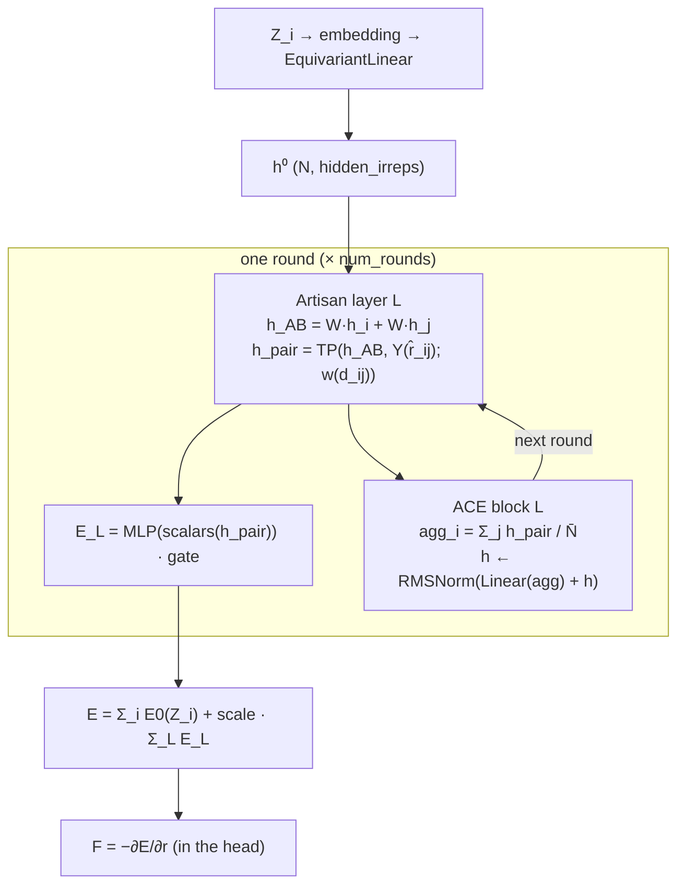

# SIMURGH

SIMURGH is GOAL's native E(3)-equivariant interatomic potential. It is built around **potential artisans**: one small equivariant energy network for each unordered element pair (H–H, H–C, C–O, …). This page covers the default **ARACE** architecture (`simurgh_arace`), its monolithic counterpart (`monolithic_arace`), and the legacy **ACE-first** architecture (`simurgh` / `simurgh_ace_first`, `simurgh_monolithic`).

SIMURGH stands for *Symmetry-aware Interatomic Model with element-pair Routed Gated artisans* (from the package docstring in [`models/simurgh/__init__.py`](https://github.com/Nourollah/GOAL/blob/main/src/goal/ml/nn/models/simurgh/__init__.py)).

## Potential artisans in one paragraph

For $K$ elements, the artisan bank holds $K(K+1)/2$ artisans. Each edge $i \to j$ is handled by exactly one artisan, chosen deterministically by the element pair $(Z_i, Z_j)$. There is no learned router.

Every artisan **runs on every step** under a static-shape *zero-masking schedule*. Its inputs are multiplied by a 0/1 edge mask before the forward pass and its output is masked again afterwards. Edges of other pair types therefore contribute exactly zero, but the autograd graph stays identical on every rank. This makes DDP safe without `find_unused_parameters` and keeps AdamW moments from going stale.

Each artisan carries a learnable scalar **gate** (initialised to 1.0), which is logged per pair so you can spot an artisan collapsing. All learnable maps inside an artisan are bias-free, so a masked (all-zero) input produces exactly zero output.

> [!NOTE]
> Masking does not save compute. Every artisan processes the full edge list, so the cost of the bank grows with the number of element pairs, both in parameters **and** in FLOPs. The ablation study measured this directly: an element-pair bank with 6 pairs ran at about 56 s/epoch versus about 11 s/epoch for a single shared interaction ([ablation README](https://github.com/Nourollah/GOAL/blob/main/src/goal/configs/ml/ablations/README.md), §3). For large element sets, use [rare-pair routing](#rare-pair-routing).

## ARACE: the default architecture

**ARACE = ARtisan + Atomic Cluster Expansion.** The artisans are the *primary* computation at every layer. They alternate with an ACE-style aggregation block that writes the artisan edge features back onto the nodes:

```text
nodes → edges (artisan) → nodes (ACE) → edges (artisan) → nodes (ACE) → …
```



Step by step, for one round $L$:

1. **Symmetric endpoint embedding.** $h_{AB} = W h_i + W h_j$, using **one** shared bias-free `EquivariantLinear` $W$. Because the map is shared and the two terms are summed, $E(A,B)=E(B,A)$ by construction.
2. **Geometry coupling.** $h_\text{pair} = \mathrm{TP}\big(h_{AB},\, Y^{l}(\hat r_{ij});\, w(d_{ij})\big)$. This is a Clebsch–Gordan tensor product with the edge spherical harmonics. The weights $w$ come from a radial MLP over a Bessel basis, damped by a polynomial envelope. With `element_conditioned: true` they are also multiplied by a linear map of the destination element's one-hot.
3. **Optional depth.** With `num_layers > 1`, add `num_layers − 1` residual `EquivariantLinear` + RMS-norm refinements of $h_\text{pair}$.
4. **Per-round energy.** $E_L = \text{gate}\cdot\mathrm{MLP}(\mathrm{scalars}(h_\text{pair}))$. Half of each edge energy goes to the source atom.
5. **ACE block.** $\text{agg}_i = \sum_j h_{\text{pair},j\to i}/\bar N$, then $h \leftarrow \mathrm{RMSNorm}(\mathrm{Linear}(\text{agg}) + h)$. Unlike MACE, the quantity aggregated here is the artisan output itself, not a message built inside the block. Artisan layer $L+1$ therefore sees context that layer $L$ produced.

The total energy is

$$E = \sum_i E_0(Z_i) + \text{scale}\cdot\sum_L \sum_{\text{edges}} E_L .$$

The backbone puts this into `NodeFeatures.node_energies`, so a standard head (`energy_forces`, `dual_forces`, `energy`) sums it and takes $-\partial E/\partial \mathbf r$ itself. Everything stays equivariant until the scalar readout inside each artisan.

**Why this design.** Each round contributes its own energy, so the per-round split is a built-in diagnostic: it is logged as `energy_round_{L}`, and a round contributing nothing is easy to spot. Pair-specific networks let each chemical pair learn its own radial and angular response instead of sharing one interaction conditioned on species. The trade-off is cost and per-pair data efficiency (see [Known pitfalls](#known-pitfalls)).

### Building blocks

| Piece | Where |
|---|---|
| `SimurghAraceBackbone` (`simurgh_arace`) | [`models/simurgh/backbone_arace.py`](https://github.com/Nourollah/GOAL/blob/main/src/goal/ml/nn/models/simurgh/backbone_arace.py) |
| `_AracePairArtisan`, `_AraceRarePairArtisan`, `ArtisanLayer`, `_PairRMSNorm`, `route_element_pairs` | [`blocks/artisans.py`](https://github.com/Nourollah/GOAL/blob/main/src/goal/ml/nn/blocks/artisans.py) |
| `AceBlock`, `AraceRound` | [`blocks/ace_block.py`](https://github.com/Nourollah/GOAL/blob/main/src/goal/ml/nn/blocks/ace_block.py) |
| `MonolithicArace` (`monolithic_arace`), `AraceBackbone`, `AraceBlock` | [`models/simurgh/arace.py`](https://github.com/Nourollah/GOAL/blob/main/src/goal/ml/nn/models/simurgh/arace.py) |
| `differentiable_edges` (edges rebuilt from `graph.pos` so forces flow) | [`models/simurgh/geometry.py`](https://github.com/Nourollah/GOAL/blob/main/src/goal/ml/nn/models/simurgh/geometry.py) |
| `EquivariantFragmentInteraction`, `AdaptiveDepthGate` (optional add-ons) | [`blocks/fragment_interaction.py`](https://github.com/Nourollah/GOAL/blob/main/src/goal/ml/nn/blocks/fragment_interaction.py), [`blocks/adaptive_gate.py`](https://github.com/Nourollah/GOAL/blob/main/src/goal/ml/nn/blocks/adaptive_gate.py) |

## Running it

```bash
pixi run -e cuda goal-train                                   # = --config-name simurgh_gmd26 (the hydra default)
pixi run -e cuda goal-train model.backbone.num_rounds=3 model.backbone.artisan.hidden_irreps="32x0e + 32x1o + 32x2e"
pixi run -e cuda goal-tune --config-dir src/goal/configs/ml --config-name simurgh_gmd26_hpo   # Ray Tune search, see below
```

Both configs target GMD-26 FragmentDuplication (H/C/O carboxylic acids, PBE/def2-SVP). [`simurgh_gmd26.yaml`](https://github.com/Nourollah/GOAL/blob/main/src/goal/configs/ml/simurgh_gmd26.yaml) is self-contained: every option the project supports is either set there or documented in a comment.

## Hyperparameters of the default config

These are the keys under `model.backbone` in `simurgh_gmd26.yaml`, with constructor defaults from `SimurghAraceBackbone.__init__` and `_AracePairArtisan.__init__`. Where a range is given, it is the Ray Tune search space in [`simurgh_gmd26_hpo.yaml`](https://github.com/Nourollah/GOAL/blob/main/src/goal/configs/ml/simurgh_gmd26_hpo.yaml), which is the range the project actually searches.

### Backbone

| Key | Shipped value | Code default | Meaning | Sensible range / guidance |
|---|---|---|---|---|
| `name` | `simurgh_arace` | | registry name | |
| `num_rounds` | `2` | `2` | number of artisan + ACE rounds; the receptive field is `num_rounds × cutoff` | HPO: 1–3. More rounds add one artisan bank each (unless shared). |
| `share_artisan_weights` | `false` | `false` | `true` = one artisan bank shared by all rounds | HPO: both. `true` divides the artisan parameters by `num_rounds`. |
| `cutoff` | `${data.cutoff}` (8.0 Å) | `5.0` | neighbour radius for artisans and envelopes | must equal `data.cutoff` (interpolated) |
| `embedding_dim` | `64` | `32` | width of the scalar atomic-number embedding, projected to `hidden_irreps` | 32–64 |
| `num_elements` | `9` | `120` | embedding-table size | must be **> max Z** in the data (9 covers H–F) |
| `avg_num_neighbors` | `null` | `None` | $\bar N$ in the ACE aggregation | leave `null`; `goal-train` injects the training-set mean |
| `atomic_energies.mode` | `provided` | `learned` | per-element baseline $E_0$: `learned` (zero-init parameter), `dataset` (least squares on the train split), `provided` (fixed values) | `provided` when isolated-atom DFT energies are available, otherwise `dataset` |
| `atomic_energies.values` | H, C, N, O PBE/def2-SVP | | `{Z: eV}` | required for `provided`; leave null for `dataset` |
| `atomic_energies.compute_from_dataset` | `false` | | `true` upgrades `learned` to `dataset` | |
| `scale` | `null` | `None` (= 1.0) | multiplicative gain on the interaction energy | leave `null`. It is auto-computed for `dataset`/`provided`. |
| `num_elements_table` | (not set) | `120` | size of the Z-indexed $E_0$ table | |
| `elements` | (not set) | `(1, 6, 7, 8)` | element list defining the pair bank | **always overwritten** by `goal-train` from the training set |

### Artisans (`model.backbone.artisan`)

| Key | Shipped | Code default | Meaning | Guidance |
|---|---|---|---|---|
| `architecture` | `equivariant` | `equivariant` | must be `"equivariant"`; any other value raises | |
| `hidden_irreps` | `16x0e + 16x1o + 16x2e` | same | node and pair equivariant width (also `irreps_out`) | HPO: `16x0e+16x1o+16x2e`, `32x0e+32x1o+32x2e`, `32x0e+32x1o`. Keep `0e` first (see pitfalls). |
| `num_layers` | `1` | `1` | `1` = TP only; `n>1` adds `n−1` residual EquivLinear+RMSNorm layers on `h_pair` | HPO: 1–2 |
| `num_rbf` | `8` | `8` | Bessel radial basis size | 8 is standard |
| `radial_hidden` | `32` | `32` | radial MLP hidden width | HPO: 32, 64 |
| `n_scalar_out` | `16` | `16` | invariant scalars fed to the per-edge energy MLP | HPO: 16, 32 |
| `final_hidden` | `16` | `16` | energy MLP hidden width | 16–32 |
| `element_conditioned` | `true` | `true` | multiply the TP weights by a linear map of the destination element's one-hot | see [Choosing `n_elements`](#choosing-n_elements) |
| `n_elements` | `auto` | `120` (key absent) | rows of the element-conditioning tables (`element_linear`, the rare artisan's `pair_embed`), indexed by atomic number | `auto` = `max(elements) + 1`; see [Choosing `n_elements`](#choosing-n_elements) |
| `rare_artisan` | (not set) | off | frequency-based pair routing, see below | only useful for large element sets |
| `pair_counts` | (not set) | | training-split pair counts; injected automatically when routing is on | |

#### Choosing `n_elements`

The element-conditioning tables are looked up **by atomic number** (`one_hot(Z)`), so they need `max(Z) + 1` rows — H, C and O need 9 rows, not 3. Every row above the largest atomic number in the data receives no gradient. With the legacy width of 120 rows that was most of the model: `element_linear` maps the one-hot onto all tensor-product weights, which made it 337,920 of an artisan's 433,489 parameters at the shipped widths.

`n_elements: auto` sizes the tables exactly from the backbone's `elements` (which `goal-train` discovers from the training set and now also saves in the run's config, so a rebuild resolves `auto` to the same size). Measured with H/C/O:

| Config | `n_elements` absent (120 rows) | `n_elements: auto` (9 rows) |
|---|---|---|
| `simurgh_gmd26` | 5.40 M parameters | 1.65 M |
| `nf_simurgh_gmd26` | 5.21 M | 1.46 M |
| `monolithic_arace_gmd26` | 5.21 M | 1.45 M |

Every production ARACE/NF_SIMURGH config ships `n_elements: auto` (the ablation-study configs do not, so their rungs stay comparable). Rules:

- **Absent → 120.** Checkpoints whose saved config has no `n_elements` were trained with 120 rows and must rebuild with 120 to load, so the code default stays 120.
- **An int must exceed `max(elements)`**; a smaller value raises at construction rather than folding several elements onto one row.
- An atomic number above `max(elements)` (only possible for pairs routed to the rare artisan) is clamped onto the last row.
- The same key works for the legacy backbone under `artisan_config.equivariant.n_elements`.

### Optional add-ons (enabled by the *presence* of their section)

Both add-ons attach to every ARACE round. An absent **or empty** section means the module is never built. It then has zero parameters, and the forward pass is bit-identical to plain ARACE.

> [!NOTE]
> As currently shipped, `simurgh_gmd26.yaml` has the `fragment_interaction:` block **uncommented** (enabled, with `data.compute_fragment_index: true` and `fragment_scheme: custom`), while `adaptive_gate:` is commented out. The comment above those blocks still says "Both are OFF in this file". Go by the YAML, not the comment. To get plain ARACE, run with `'~model.backbone.fragment_interaction'`.

**`fragment_interaction`**: an e3nn convolution over the *fragment graph*. Per round it does the following:

1. Pool the full irreps of each fragment's atoms: $f_k = \text{mean}_{i\in k}\, h_i$.
2. Compute the fragment centroids $c_k$.
3. Exchange messages between fragments: $m_k = \sum_l \mathrm{TP}(f_l, Y(\hat r_{kl}); w(d_{kl}))/n_k$.
4. Hand a linear correction back to every atom of the fragment.

The correction is equivariant at every $l$. Within a structure, pairs are limited by `cutoff` and the polynomial envelope. A structure with a single fragment ($K=1$) gets exactly zero correction. It needs `data.compute_fragment_index: true`.

| Key | Shipped | Meaning |
|---|---|---|
| `irreps_hidden` | `null` | `null` = reuse `artisan.hidden_irreps`; a narrower string makes the channel cheaper |
| `num_rbf`, `radial_hidden` | `8`, `32` | radial branch for the centroid separation |
| `num_layers` | `1` | `>1` adds residual EquivLinear+RMSNorm refinements |
| `init_zero` | `true` | zero-init output projection: the module starts as an exact no-op. Strongly recommended. |
| `max_fragments` | `512` | guard on the $O(K^2)$ pair enumeration; exceeding it raises |
| `cutoff` | `12.0` | maximum centroid separation (Å); omit to inherit the backbone cutoff. The mechanism only reaches further than message passing when this exceeds `data.cutoff`. |

**`adaptive_gate`**: a per-atom, per-irrep-block invariant gate, $h_\text{next} = g\, h_\text{new} + (1-g)\, h$. It is soft during training and a hard threshold at inference. A sparsity penalty $\lambda\,\text{mean}(g)$ is added to the total loss automatically through `last_aux_loss`, so it needs no `training.losses` entry. Diagnostics are logged under `train_gate/` / `val_gate/`.

| Key | Suggested in config | Meaning |
|---|---|---|
| `n_scalar` | `16` | width of the gate's scalar input projection |
| `hard_threshold` | `0.5` | inference-time cut |
| `aux_loss_weight` | `0.01` | $\lambda$; `0.0` disables the penalty |
| `init_bias` | `1.0` | initial logit: sigmoid(1) ≈ 0.73, so the gate starts open |
| `per_irrep` | `true` | one gate per irrep block instead of one per atom |

Reading `gate_mean_round_{L}`: ≈ 1.0 means the gate is not selective (raise `aux_loss_weight`). ≈ 0.5 means it is discriminating between atoms. → 0 means whole rounds are being skipped (lower `aux_loss_weight`).

You can toggle either add-on from the CLI without editing the file:

```bash
pixi run -e cuda goal-train '~model.backbone.fragment_interaction'
pixi run -e cuda goal-train '+model.backbone.adaptive_gate={n_scalar:16,hard_threshold:0.5,aux_loss_weight:0.01,init_bias:1.0,per_irrep:true}'
```

### Head

The shipped head is `energy_forces` with `irreps_in: ${model.backbone.artisan.hidden_irreps}` (interpolated, so the two cannot drift) and `hidden_dim: 128`. Because the backbone populates `node_energies`, the head only sums them and differentiates. Its own `ScalarReadout` is unused. To add a small non-conservative correction, switch to `dual_forces` with `mode: hybrid` (see [Heads](heads.md)). `mode: pairwise` is **not** supported with `simurgh_arace`, because it never fills `node_forces`.

### Rare-pair routing

The bank is quadratic in the number of elements. With routing enabled, an element pair keeps a dedicated artisan only if its share of training-set directed edges is at least `min_pair_frequency`. All other pairs, including pairs that never occur, share **one** rare artisan per round. The rare artisan is conditioned on a learned element embedding, `embed(Z_lo) + embed(Z_hi)`, and is built only if something is actually routed to it.

```yaml
artisan:
  rare_artisan:
    enabled: true
    min_pair_frequency: 2.0e-2   # FRACTION of directed edges, not a count
    pair_embed_dim: 16
  pair_counts: null              # goal-train counts the train split and writes them into config.yaml
```

Because frequencies sum to 1, at most $1/f$ pairs can be dedicated. The `pair_counts` are written into the run's saved `config.yaml` (as `"Zlo_Zhi"` keys). This matters because routing decides which modules exist, so a checkpoint cannot load into a model rebuilt without the counts. The OMol25 measurements behind these settings are in [NF_SIMURGH](nf-simurgh.md#rare-pair-routing-on-omol25).

## Monolithic ARACE (`monolithic_arace`)

`MonolithicArace` has the same physics as `simurgh_arace` in a self-contained `MonolithicModel`. It computes its own autograd forces and returns `energy`, `forces`, `num_atoms` and a detached `layer_energies` `(L, B)`. It accepts the same keys (`num_rounds`, `share_artisan_weights`, `artisan`, `cutoff`, `embedding_dim`, `num_elements`, `avg_num_neighbors`, `atomic_energies`, `scale`, `num_elements_table`, `fragment_interaction`, `adaptive_gate`) and is used with `head: null`:

```bash
pixi run -e cuda goal-train --config-name monolithic_arace_gmd26
```

Use it as the A/B baseline for [NF_SIMURGH](nf-simurgh.md), whose configs mirror it, or whenever you want an ARACE model that does not depend on head wiring.

> [!WARNING]
> `goal-train` does **not** inject `avg_num_neighbors` for `monolithic_arace`, and `monolithic_arace_gmd26.yaml` leaves it `null`. That run therefore trains **without** aggregation normalisation, while `simurgh_gmd26` (via `simurgh_arace`) trains with it. If you want the two to be strictly comparable, set the value explicitly (e.g. `20.861964`, the GMD-26 FragmentDuplication training-set mean degree at 8 Å used by the ablation study).

## Legacy ACE-first architecture (`simurgh` / `simurgh_ace_first`)

This is the original pipeline. It is still supported but no longer the default:

1. **Environment dressing** ([`blocks/env_dressing.py`](https://github.com/Nourollah/GOAL/blob/main/src/goal/ml/nn/blocks/env_dressing.py)) runs first. It is MACE-style tensor-product message passing, with optional body-order expansion and optional per-layer readouts.
2. The **artisan bank** (`SimurghArtisanBank`) then runs once, as a readout of gated, cosine-tapered pair energies.

```bash
pixi run -e cuda goal-train --config-name simurgh_ace_first_gmd26   # GMD-26, dual_forces head in hybrid mode
pixi run -e cuda goal-train --config-name simurgh_md17              # rMD17, energy_forces head
```

The legacy backbone uses **different keys** from ARACE, so do not paste one config section into the other:

| Section | Keys (shipped values in `simurgh_ace_first_gmd26.yaml`) |
|---|---|
| top level | `cutoff` (interpolated from `dressing_kwargs.cutoff`), `atomic_energies`, `scale`, `compute_pairwise_forces: false`, `num_elements_table` |
| `dressing_kwargs` | `embedding_dim: 64`, `hidden_channels: 32`, `lmax: 2`, `num_radial_basis: 8`, `radial_mlp_hidden: 32`, `cutoff: 8.0`, `num_interactions: 2` (legacy alias `num_message_passing`), `body_order: 1` (2 = B², 3 = B³), `element_conditioned: true`, `per_layer_readout: true`, `symmetric_contraction: false`, `avg_num_neighbors: null` (auto-injected), `agg_norm_exponent: 1.0` (0.5 = original SIMURGH), `num_elements: 9` |
| `artisan_config` | `architecture: equivariant` (or `scalar`), `equivariant: {hidden_irreps, num_layers, num_rbf, radial_hidden, n_scalar_out, final_hidden, element_conditioned}`, scalar-architecture keys `scalar_channels`, `hidden_dims`, `expert_type` (`linear`/`transformer`), `transformer_heads`, `transformer_layers`, `dropout_rate`, and `rare_artisan` |

`compute_pairwise_forces: true` makes the backbone fill `NodeFeatures.node_forces`, which `dual_forces` in `mode: pairwise` consumes. `simurgh_monolithic` is the self-contained counterpart (with `forces_mode` / `correction_weight`); no config ships for it.

> [!NOTE]
> The ARACE add-ons (`fragment_interaction`, `adaptive_gate`) attach to an ARACE round, which this architecture does not have. `SimurghBackbone.__init__` does not accept them, and adding them raises `TypeError`.

## Naming history

| Then | Now |
|---|---|
| GP-MoE → KRONOS | **SIMURGH** (always spelled SIMURGH) |
| `KronosBackbone`, `KronosMonolithic` | `SimurghBackbone` (`simurgh`), `SimurghMonolithic` (`simurgh_monolithic`) |
| `KronosMoE`, `PairwiseExpert`, `RarePairExpert`, `ExpertConfig` | `SimurghArtisanBank`, `PotentialArtisan`, `RarePotentialArtisan`, `ArtisanConfig` |
| config keys `expert_config`, `rare_pair_expert` | `artisan_config`, `rare_artisan` |
| `models/kronos/`, `blocks/experts.py` | `models/simurgh/`, `blocks/artisans.py` |
| "artisan-first" variant | **ARACE** (`simurgh_arace`, `monolithic_arace`); ACE-first is now the legacy variant |

The "mixture of experts" vocabulary was replaced by "artisan bank / potential artisan" because routing here is deterministic by chemistry and not learned. One notebook, `notebooks/kronos_gmd_inference.ipynb`, still uses the old KRONOS name and paths. Checkpoints saved under the old class names will not resolve under the new registry keys.

## Known pitfalls

These are collected from code comments, config comments and the ablation study.

1. **Elements outside the bank contribute exactly zero, without warning.** An edge whose element pair has no artisan is zero-masked. `goal-train` always injects `elements` from the training set for `simurgh_arace`, so this only bites at inference on new chemistry, or for models that need `elements` set by hand (see [NF_SIMURGH](nf-simurgh.md)). Rare-pair routing turns such edges into rare-artisan edges instead.
2. **`num_elements` must exceed the largest Z.** It sizes the embedding table only. The default config uses `9` (H–F).
3. **`element_conditioned` dominated the parameter count** while the conditioning tables had 120 rows (about 5.2 M parameters for the shipped GMD-26 model, ~70 % of them dead). The shipped configs now set `artisan.n_elements: auto` (about 1.45–1.65 M); see [Choosing `n_elements`](#choosing-n_elements). Checkpoints trained before October 2026 keep 120 rows, because their saved config has no `n_elements`.
4. **Keep `0e` as the leading irreps block.** The fragment interaction and the adaptive gate slice the leading scalar block, and their constructors raise if `l = 0` does not come first.
5. **Use `_PairRMSNorm`, not `EquivariantLayerNorm`, in artisan code.** The per-block `x / max(‖x‖, ε)` in `EquivariantLayerNorm` amplifies *symmetry-suppressed* blocks (e.g. the `l = 1` features of a carbon in a tetrahedral environment) by up to $1/\varepsilon$, which destroys force smoothness at high-symmetry geometries. `_PairRMSNorm` divides by the global RMS instead, which is smooth and maps zero to zero. The ablation study's rung 14 measured this norm swap as clearly worse (ID 29.76 vs 23.76 meV/Å base).
6. **Dead parameters in the last round.** The last round's `ace_block.{linear,norm}` only feed `node_feats`, which the energy heads ignore once `node_energies` is set, so they receive no gradient. The head's own `ScalarReadout` is unused for the same reason. The ablation README warns that this breaks DDP with `find_unused_parameters: false`, which is the value in the shipped `strategy` section. Set it to `true` for multi-GPU runs of this model.
7. **`gate_reg` is currently a no-op.** `GOALModule` only injects `gate_values` if `backbone.artisan_bank` has an attribute named `experts`, a name left over from before the artisan rename. No backbone has it, and `simurgh_arace` has no `artisan_bank` at all. The `gate_reg` loss listed in the shipped configs therefore always returns 0. Gates are still logged.
8. **`dual_forces` `pairwise` mode does not work with ARACE**, because `node_forces` is never populated. Use `autograd` or `hybrid`.
9. **`goal-tune` does not inject dataset statistics.** That is why `simurgh_gmd26_hpo.yaml` pins `elements: [1, 6, 8]`. Any other dataset-derived value you rely on must also be set by hand there.
10. **Fragment labels at inference.** A checkpoint trained with `fragment_interaction` needs `fragment_index` on every graph. If perception fails during an MD run, `fragment_on_failure: raise` aborts the run, while `fallback` silently switches the channel off for that frame (K = 1 on GMD). See [ASE calculator](../deployment/ase-calculator.md).

## See also

- [NF_SIMURGH](nf-simurgh.md): ARACE rounds plus fragment virtual nodes
- [SIMURGH Simplified](simurgh-simplified.md): three parallel lines, routed vs plain stacks
- [Ablation study](ablation-study.md): what each SIMURGH component contributes on GMD-26
