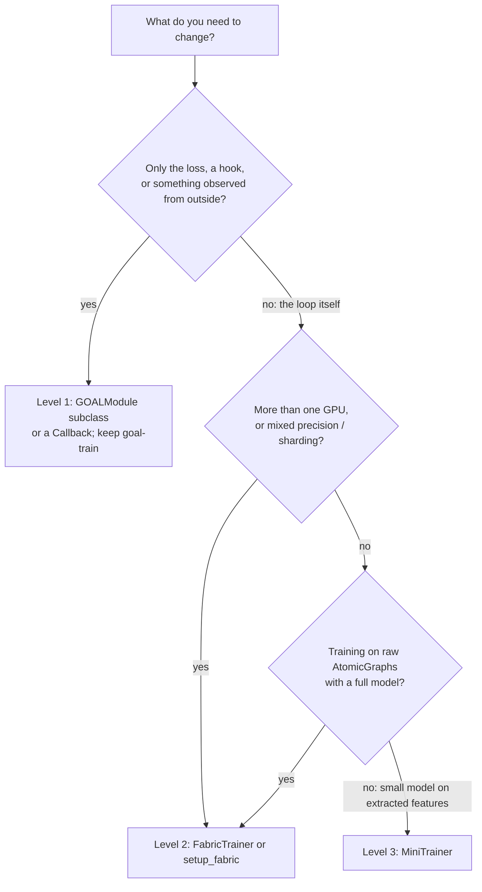

# Custom training loops

`goal-train` covers the standard workflow. When you need something it does not do (an extra loss term computed from intermediate features, a second optimizer, an active-learning step between epochs), GOAL offers three levels of control. This page explains each one, shows how to build GOAL components from an experiment config outside the CLI, and helps you choose.

| Level | Tool | Multi-GPU | What you control | Keeps `goal-train` features |
| --- | --- | --- | --- | --- |
| 1 | Subclass **`GOALModule`** and/or add Lightning callbacks | yes (via `strategy:`) | individual hooks | all: config, dataset stats, checkpoint manager, resume, loggers |
| 2 | **`FabricTrainer`** / `setup_fabric` | yes (Fabric strategies) | the whole `for` loop | none: you assemble data, model and checkpointing |
| 3 | **`MiniTrainer`** | no (single device) | the whole loop, pure PyTorch | none |

## Level 1: subclass `GOALModule`

`GOALModule` ([`src/goal/ml/training/module.py`](https://github.com/Nourollah/GOAL/blob/main/src/goal/ml/training/module.py)) is an ordinary `LightningModule`. These are the hooks it implements, and so the ones you are most likely to override:

| Hook | What GOAL does there |
| --- | --- |
| `forward(graph)` | backbone, then head (or the backbone alone if monolithic). Adds `gate_values`, `aux_loss` and `gate_scores` side channels when the backbone exposes them. |
| `training_step(batch, batch_idx)` | applies the stage weights, runs forward and `CompositeLoss`, adds the model's `aux_loss`, logs losses, metrics, per-round energies and gates. Returns `losses["total"]`. |
| `validation_step(batch, batch_idx, dataloader_idx=0)` | the same under `torch.enable_grad()` and with EMA weights. Dataloader 1 is the OOD set (`test…/` sections). |
| `test_step(batch, batch_idx)` | like validation, but with base loss weights |
| `configure_optimizers()` | AdamW with equivariant / standard parameter groups, plus the configured scheduler |
| `configure_model()` | optional `torch.compile` of the backbone |
| `on_before_optimizer_step(optimizer)` | gradient-norm clipping (`training.gradient_clip`) |
| `on_train_batch_end(...)` | EMA update |
| `on_save_checkpoint` / `on_load_checkpoint` | persist and restore the EMA shadow (`goal_ema`) |

It also has helpers you can reuse instead of re-implementing them: `self._maybe_advance_stage(epoch)`, `self._with_aux_loss(losses, predictions)`, `self._log_losses(losses, batch, prefix)`, `self._log_step_metrics(predictions, batch, prefix)`. These are private (leading underscore), so they may change, but using them keeps your logged keys in the standard [logger sections](callbacks-logging.md#logger-sections).

### Example: an extra regulariser in the training step

```python
# my_project/modules.py
import torch

from goal.ml.training.module import GOALModule


class ForceNormPenaltyModule(GOALModule):
    """GOALModule + a small penalty on predicted force magnitudes."""

    penalty_weight: float = 1.0e-4

    def training_step(self, batch, batch_idx):
        self._maybe_advance_stage(self.current_epoch)  # keep the stage curriculum working
        predictions = self(batch)
        losses = self._with_aux_loss(self.loss(predictions, batch), predictions)

        penalty = predictions["forces"].pow(2).sum(dim=-1).mean()
        losses = {**losses, "force_norm": self.penalty_weight * penalty}
        losses["total"] = losses["total"] + losses["force_norm"]

        self._log_losses(losses, batch, prefix="train/")  # -> train/force_norm, train/total, ...
        self._log_step_metrics(predictions, batch, prefix="train/")
        return losses["total"]
```

### Running a subclass through `goal-train`

`goal-train` builds `GOALModule` directly, and no config key selects a different class. `_run_training` looks the name `GOALModule` up in its own module **at call time**, though, so a tiny launcher script can substitute your class and keep everything else: Hydra config, dataset statistics, checkpoint manager, resume and loggers.

```python
# train_custom.py
import goal.ml.cli.train as goal_train
from my_project.modules import ForceNormPenaltyModule

goal_train.GOALModule = ForceNormPenaltyModule

if __name__ == "__main__":
    goal_train.train_ml()  # same CLI as goal-train
```

```bash
pixi run -e cuda python train_custom.py --config-name simurgh_gmd26 trainer.max_epochs=200
pixi run -e cuda python train_custom.py --config-dir src/goal/configs +debug=fdr trainer.accelerator=gpu   # quick check
```

Some things to keep in mind:

- Your subclass must keep the constructor signature `(backbone, head, loss, config, compile_model=False)`. Call `super().__init__(...)` if you override it.
- The resolved config and `frozen_source/` record which code produced the weights. The frozen source covers the `goal` package files the model imports, so a subclass living in `my_project` is not frozen. Keep it under version control.
- `GOALCalculator` and `.simurgh` archives rebuild a plain `GOALModule`. That is fine as long as your subclass changes only training behaviour, not the forward pass or the parameters.

### Callbacks instead of subclassing

Logic that only *observes* or adjusts the run from outside (monitoring, schedules, periodic evaluation, writing extra files) fits better in a Lightning `Callback` added through the `callbacks:` block. No launcher script is needed. See [Callbacks & logging](callbacks-logging.md#writing-your-own-callback).

## Building GOAL components from a config

Levels 2 and 3, and any notebook work, need the datamodule, model and loss without the CLI. The pattern below reproduces what `goal-train` does for a SIMURGH ARACE config, including the dataset-derived `elements` and `avg_num_neighbors`:

```python
import torch
import torch.nn as nn
from hydra import compose, initialize_config_dir

from goal.ml.cli import CONFIGS_ML_DIR  # importing goal.ml.cli also fills the registries
from goal.ml.cli.train import _build_head, _build_loss
from goal.ml.data.datamodule import GOALDataModule
from goal.ml.data.statistics import compute_avg_num_neighbors, compute_unique_elements
from goal.ml.registry import BACKBONE_REGISTRY

with initialize_config_dir(config_dir=CONFIGS_ML_DIR, version_base=None):
    cfg = compose(
        config_name="simurgh_gmd26",
        overrides=[
            "paths.output_dir=/tmp/goal_custom",  # ${hydra:runtime.output_dir} is undefined outside an app
            "data.monitor_test_during_training=false",
        ],
    )

dm = GOALDataModule(cfg)
dm.prepare_data()
dm.setup("fit")

kwargs = {k: v for k, v in cfg.model.backbone.items() if k != "name"}
kwargs["elements"] = compute_unique_elements(dm.data_train)
kwargs["avg_num_neighbors"] = compute_avg_num_neighbors(dm.data_train)
backbone = BACKBONE_REGISTRY.get(cfg.model.backbone.name)(**kwargs)
head = _build_head(cfg, backbone)  # None for monolithic backbones
loss = _build_loss(cfg)  # CompositeLoss from training.losses


class Potential(nn.Module):
    """backbone -> head as one nn.Module (what GOALModule.forward does)."""

    def __init__(self, backbone, head):
        super().__init__()
        self.backbone, self.head = backbone, head

    def forward(self, graph):
        if self.head is None:
            return self.backbone(graph)
        return self.head(self.backbone(graph), graph)


model = Potential(backbone, head)
```

If your config uses `atomic_energies.mode: dataset`, a `null` `scale`, or `rare_artisan` routing, also replicate those steps from `_run_training` in [`cli/train.py`](https://github.com/Nourollah/GOAL/blob/main/src/goal/ml/cli/train.py) (`compute_atomic_references`, `compute_energy_scale`, `compute_pair_counts`). `_build_head` and `_build_loss` are private helpers. They are stable in practice, but not a public API.

## Level 2: `FabricTrainer`

[Lightning Fabric](https://lightning.ai/docs/fabric/) handles devices, distributed communication and precision, and leaves the loop to you. `goal.ml.utils.fabric_trainer` ([source](https://github.com/Nourollah/GOAL/blob/main/src/goal/ml/utils/fabric_trainer.py)) offers it in two forms.

### Batteries included: `FabricTrainer`

```python
from torch.utils.data import Subset
from torch_geometric.loader import DataLoader

from goal.ml.utils.fabric_trainer import FabricTrainer

# cfg, dm, model, loss from the section above


def energy_force_step(batch, model, loss_fn):
    # Forces are -dE/dr: they need autograd even during validation,
    # and FabricTrainer runs validation under torch.no_grad().
    with torch.enable_grad():
        return loss_fn(model(batch), batch)  # dict with "total" + components


optimizer = torch.optim.AdamW(model.parameters(), lr=5e-3, weight_decay=1e-5)
scheduler = torch.optim.lr_scheduler.CosineAnnealingLR(optimizer, T_max=200, eta_min=1e-6)

ft = FabricTrainer(
    model=model,
    loss_fn=loss,
    optimizer=optimizer,
    train_loader=DataLoader(dm.data_train, batch_size=32, shuffle=True),
    val_loader=DataLoader(dm.data_val, batch_size=64),
    accelerator="gpu",
    devices=1,  # or 4 with strategy="ddp"
    strategy="auto",
    precision="32-true",
    scheduler=scheduler,  # stepped once per epoch (ReduceLROnPlateau gets the val loss)
    step_fn=energy_force_step,
    grad_clip=10.0,
    grad_accumulation_steps=1,
)
history = ft.fit(epochs=200, early_stopping_patience=30)
ft.load_best()  # restore the best-validation weights kept in memory
ft.save_checkpoint("arace_fabric.ckpt")
```

> [!WARNING]
> **Use a step function that enables grad.** `FabricTrainer._val_epoch` is decorated with `@torch.no_grad()`. The built-in `graph_fabric_step` calls `model(batch)` directly, so a model whose head computes forces by autograd (every SIMURGH config) fails in validation with *"element 0 of tensors does not require grad"*. Wrapping the forward pass in `torch.enable_grad()`, as `energy_force_step` above does, fixes it.

`FabricTrainer(...)` arguments:

| Argument | Meaning |
| --- | --- |
| `model`, `loss_fn`, `optimizer` | Any `nn.Module`, any loss callable, and a pre-built optimizer. |
| `train_loader`, `val_loader` | `DataLoader`s. Fabric wraps them, and adds a distributed sampler under DDP. |
| `accelerator`, `strategy`, `devices`, `num_nodes`, `precision` | Passed to `lightning.Fabric`. Strategies are Fabric's strings (`"ddp"`, `"fsdp"`, `"deepspeed"`, …), not GOAL's `strategy:` block. |
| `scheduler` | Stepped once per epoch. `ReduceLROnPlateau` gets the validation loss, or the training loss if there is no validation loader. |
| `step_fn` | `(batch, model, loss_fn) -> dict` with a `"loss"` or `"total"` key. The default, `default_fabric_step`, expects `(x, y)` tuples. `graph_fabric_step` is for `AtomicGraph` batches with direct (non-autograd) outputs. |
| `grad_clip` | Max global gradient norm (`fabric.clip_gradients`). |
| `grad_accumulation_steps` | Accumulates gradients over this many batches. Skips the gradient all-reduce on the accumulating steps via `fabric.no_backward_sync`. |
| `enable_progress` | tqdm bars. |

`fit(epochs, early_stopping_patience=None, checkpoint_best=True, verbose=True)` returns a `TrainingHistory` (`train_loss`, `val_loss`, `lr`, `epoch_times`, `best_val_loss`, `best_epoch`, `.plot()`), the same class `MiniTrainer` uses. `save_checkpoint(path)` and `load_checkpoint(path)` go through `fabric.save` and `fabric.load`, so sharded strategies are handled.

What it does **not** do, compared with `goal-train`: EMA (the module docstring mentions `EMAWrapper`, but `FabricTrainer` does not use it), stage curricula, per-component logging or MLIP metrics, loggers, and `.simurgh` archives. Add the pieces you need in a custom `step_fn`, or move to the from-scratch form below.

### From scratch: `setup_fabric`

`setup_fabric(accelerator, strategy, devices, num_nodes, precision)` returns a launched `Fabric`, and the loop is yours:

```python
from goal.ml.training.ema import EMAWrapper
from goal.ml.training.metrics import mlip_metrics
from goal.ml.utils.fabric_trainer import setup_fabric

fabric = setup_fabric(accelerator="gpu", strategy="ddp", devices=4, precision="32-true")

optimizer = torch.optim.AdamW(model.parameters(), lr=5e-3)
model, optimizer = fabric.setup(model, optimizer)
train_loader = fabric.setup_dataloaders(DataLoader(dm.data_train, batch_size=16, shuffle=True))
val_loader = fabric.setup_dataloaders(DataLoader(dm.data_val, batch_size=32))
ema = EMAWrapper(model.parameters(), decay=0.999)

for epoch in range(300):
    model.train()
    # Example of something goal-train cannot do: switch on forces after 5 epochs
    force_weight = 0.0 if epoch < 5 else 1.0
    for batch in train_loader:
        optimizer.zero_grad()
        pred = model(batch)
        losses = loss(pred, batch)
        total = losses["energy"] + force_weight * losses["forces"]
        fabric.backward(total)
        fabric.clip_gradients(model, optimizer, max_norm=10.0)
        optimizer.step()
        ema.update()

    model.eval()
    with ema.average_parameters(), torch.enable_grad():  # EMA weights + autograd forces
        maes = [mlip_metrics(model(b), b)["forces_mae"].detach() for b in val_loader]
    val_mae = fabric.all_reduce(torch.stack(maes).mean(), reduce_op="mean")
    fabric.print(f"epoch {epoch}: val forces MAE = {val_mae:.4f} eV/Å")

    if epoch % 10 == 0:  # on every rank: Fabric decides which ranks write
        fabric.save(f"ckpt_{epoch:04d}.ckpt", {"model": model, "optimizer": optimizer, "ema": ema.state_dict()})
```

Launch multi-GPU Fabric scripts as you would any PyTorch DDP program: `python script.py` (Fabric spawns the processes), or one `srun` task per GPU on SLURM.

> [!NOTE]
> `fabric.save` must be called on **every** rank. It contains a barrier, and for sharded strategies each rank writes its own shard. Guarding it with `if fabric.is_global_zero:` hangs the job.

## Level 3: `MiniTrainer`

`MiniTrainer` (`goal.ml.utils.mini_trainer`) is a single-device loop in pure PyTorch, with no Lightning dependency. It is meant for notebook experiments: small heads on features extracted from a frozen backbone, quick ablations, teaching. Its API, its step functions (`default_step`, `graph_step`) and `TrainingHistory` are documented in [Mini trainer](../features/mini-trainer.md).

## Choosing a level



Prefer the lowest level that does the job. Level 1 keeps resume, extension, the checkpoint manager, the frozen-source provenance and `.simurgh` archives, and those are much more work to rebuild by hand than a custom loss term.
