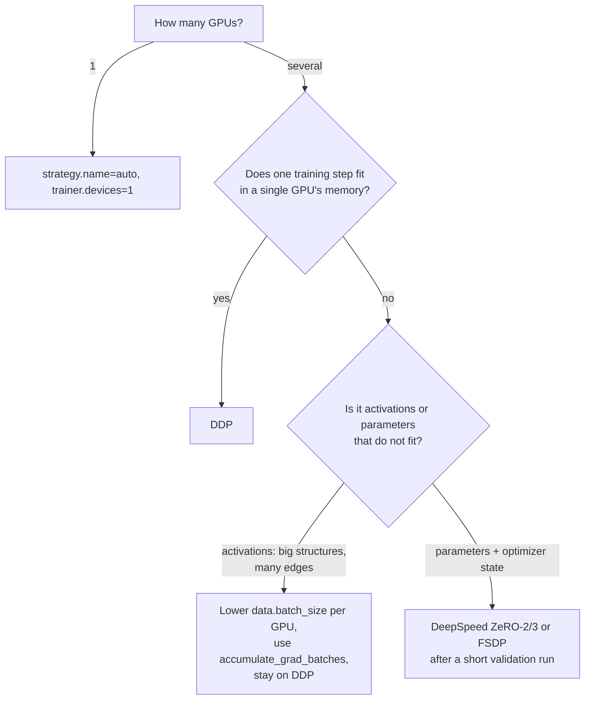

# Distributed training

This page explains how `goal-train` uses more than one GPU: the `strategy:` config block, the `build_strategy(cfg)` factory that turns it into a Lightning strategy, and what DDP, FSDP, FSDP2 and DeepSpeed ZeRO each do and cost. It also states plainly which paths are well-trodden and which are wired up but not yet validated with GOAL's force-field training loop.

## The `strategy:` block and `build_strategy`

Every shipped experiment file has a top-level `strategy:` section. `goal-train` passes the whole config to `build_strategy(cfg)` ([`src/goal/ml/training/strategies/factory.py`](https://github.com/Nourollah/GOAL/blob/main/src/goal/ml/training/strategies/factory.py)), which reads `cfg.strategy.name` and the keys relevant to that strategy, and hands the result to the Lightning `Trainer`:

```python
from goal.ml.training.strategies import build_strategy

strategy = build_strategy(cfg)      # a Lightning Strategy, or the string "auto"
trainer = L.Trainer(strategy=strategy, devices=4, accelerator="gpu", ...)
```

| `strategy.name` | Builds | Notes |
| --- | --- | --- |
| `auto` (default) | the string `"auto"` | Lightning chooses: single device for `devices: 1`, DDP for more. |
| `single` | `SingleDeviceStrategy()` | Created with no `device` argument. Lightning's default for that is CPU, so prefer `auto` with `trainer.devices=1`. |
| `ddp` | `DDPStrategy(...)` | Recommended multi-GPU path. |
| `fsdp` | `FSDPStrategy(...)` (FSDP1) | Shards params, grads and optimizer state. |
| `fsdp2` | `ModelParallelStrategy()` | See the warning below: not functional for GOAL models yet. |
| `deepspeed_zero1` / `deepspeed_zero2` / `deepspeed_zero3` | `DeepSpeedStrategy(stage=1/2/3)` | Needs the `deepspeed` extra. |
| `deepspeed_zero3_offload` | `DeepSpeedStrategy(stage=3, offload_optimizer=True, offload_parameters=True)` | Needs the `deepspeed` extra. |

Any other name raises a `ValueError` that lists the valid ones.

> [!IMPORTANT]
> **Use `strategy.name`, not `trainer.strategy`.** When `cfg.strategy` exists, its result is passed to `Trainer` as a keyword argument and overrides `trainer.strategy`. The shipped configs leave `trainer.strategy: auto` in place, but changing it on the command line does nothing.
>
> ```bash
> pixi run -e cuda goal-train trainer.strategy=ddp      # silently ignored
> pixi run -e cuda goal-train strategy.name=ddp         # what you want
> ```

All strategy options live together in one block, and each builder reads only its own keys:

```yaml
strategy:
  name: auto # "auto", "single", "ddp", "fsdp", "fsdp2", "deepspeed_zero1/2/3", "deepspeed_zero3_offload"

  # DDP
  find_unused_parameters: false
  static_graph: false
  gradient_as_bucket_view: true
  bucket_cap_mb: 25
  process_group_backend: nccl

  # FSDP
  auto_wrap_policy: size
  size_based_min_params: 1000000
  activation_checkpointing: true
  cpu_offload: false
  sharding_strategy: full_shard # read by nobody, see FSDP section
  state_dict_type: full # read by nobody, see FSDP section

  # DeepSpeed
  stage: 3
  offload_optimizer: false
  offload_parameters: false
  overlap_comm: true # read but not forwarded
  contiguous_gradients: true # read but not forwarded
  allgather_bucket_size: 200000000
  reduce_bucket_size: 200000000
  logging_level: 30
```

## Batch size and learning rate across GPUs

`data.batch_size` is **per process**. Lightning wraps each training dataloader in a `DistributedSampler`, so every GPU sees a different `batch_size`-sized slice of each step, and the effective batch size is:

$$
B_\text{eff} = \texttt{data.batch\_size} \times \texttt{trainer.devices} \times \texttt{trainer.num\_nodes} \times \texttt{trainer.accumulate\_grad\_batches}
$$

Going from one GPU to eight with the same `batch_size` therefore takes 8× fewer optimiser steps per epoch with batches 8× larger. Two common approaches:

- **Keep the physics of optimisation the same:** divide `data.batch_size` by the number of GPUs. The run is then statistically equivalent to the single-GPU one, just faster per epoch. This works best when the per-GPU batch stays reasonably large (≥ 8 structures).
- **Use the bigger batch:** keep `data.batch_size` and raise `training.optimizer.lr`. A square-root scaling rule is a reasonable starting point for Adam-type optimisers ($\text{lr} \propto \sqrt{B_\text{eff}}$). Check it with a short run, because equivariant MLIPs are often sensitive to the LR.

Validation metrics are averaged across ranks (`sync_dist=True` throughout `GOALModule`), so `val_forces/forces_mae` means the same thing on any number of GPUs.

> [!NOTE]
> Every rank builds the full `GOALDataModule` and computes the dataset statistics (elements, atomic reference energies, `avg_num_neighbors`, …) independently. The results are deterministic, so ranks agree. However, host RAM use scales with the number of processes per node, which matters for large in-memory datasets.

## DDP (Distributed Data Parallel)

Each GPU holds a full replica of the model. Gradients are averaged with an all-reduce during the backward pass. SIMURGH models are small (well under 10 M parameters for the shipped configs), so DDP is the right choice for practically every GOAL run.

```bash
pixi run -e cuda goal-train strategy.name=ddp trainer.devices=4
pixi run -e cuda goal-train strategy.name=ddp trainer.devices=4 trainer.num_nodes=2   # 8 GPUs over 2 nodes
```

Builder: `build_ddp_strategy` in [`strategies/ddp.py`](https://github.com/Nourollah/GOAL/blob/main/src/goal/ml/training/strategies/ddp.py).

| Key | Default | When to change it |
| --- | --- | --- |
| `find_unused_parameters` | `false` | Set `true` only if some parameters receive no gradient in a step (frozen sub-modules, a conditional branch). DDP then errors with "Expected to have finished reduction…" unless you set it. SIMURGH / ARACE do not need it: the artisan bank uses a static-shape zero-masking schedule, so every parameter takes part in every step. |
| `static_graph` | `false` | `true` lets DDP cache bucket order and skip per-step checks when the autograd graph is identical every step. Try it once the run is stable, because it can conflict with conditional modules. |
| `gradient_as_bucket_view` | `true` | Gradients share memory with the communication buckets, which saves one copy of the gradients. |
| `bucket_cap_mb` | `25` | Size of each all-reduce bucket. Smaller buckets overlap better with backward and lower peak memory. Lower it to ~10 if you run out of memory during the gradient sync. |
| `process_group_backend` | `nccl` | `nccl` for GPUs. Use `gloo` for CPU-only DDP (`trainer.accelerator=cpu`). |

Multi-node DDP needs the usual rendezvous variables (`MASTER_ADDR`, `MASTER_PORT`). Under SLURM, Lightning reads the rest from the environment. A complete job script is in [Training a model](training.md#slurm).

## FSDP (Fully Sharded Data Parallel)

FSDP shards parameters, gradients and optimizer state across GPUs, and all-gathers each wrapped block just in time for its forward and backward pass. Use it only when a model does **not** fit on one GPU, which no shipped GOAL config comes close to.

```bash
pixi run -e cuda goal-train strategy.name=fsdp trainer.devices=4 trainer.precision=bf16-mixed training.gradient_clip=0
```

Builder: `build_fsdp_strategy` in [`strategies/fsdp.py`](https://github.com/Nourollah/GOAL/blob/main/src/goal/ml/training/strategies/fsdp.py).

| Key | Default | Effect |
| --- | --- | --- |
| `auto_wrap_policy` | `size` | `size` wraps every sub-module with more than `size_based_min_params` parameters as its own FSDP unit. `null` wraps the whole model as one unit, which saves no memory during compute. `transformer` passes PyTorch's `transformer_auto_wrap_policy` without a `transformer_layer_cls`, so it is not usable as shipped. |
| `size_based_min_params` | `1000000` | Threshold for `size` wrapping. With models this small, lower it (for example `100000`) or nothing gets wrapped. |
| `activation_checkpointing` | `true` | Applied **only** together with `auto_wrap_policy: size`, using the same size rule. Recomputes activations in the backward pass instead of storing them. |
| `cpu_offload` | `false` | `CPUOffload(offload_params=True)`. Parameters live in host RAM. Very slow, and only a last resort. |
| `sharding_strategy`, `state_dict_type` | `full_shard`, `full` | Documented in the config, but **not forwarded** by the builder. Lightning's defaults (full sharding, full state dict) always apply. |

> [!WARNING]
> **Gradient clipping must be off for FSDP.** `GOALModule` clips by norm with `training.gradient_clip` (default `10.0`), and Lightning's FSDP precision plugin rejects norm clipping. Pass `training.gradient_clip=0`.

## FSDP2 / `ModelParallelStrategy`

`strategy.name=fsdp2` returns Lightning's `ModelParallelStrategy()` with no arguments. That strategy does no wrapping of its own: it expects the `LightningModule.configure_model()` hook to apply `fully_shard` (and any tensor parallelism) to the model using `self.device_mesh`.

> [!WARNING]
> **`fsdp2` is not functional for GOAL models yet.** `GOALModule.configure_model()` currently only applies `torch.compile` (when `training.compile_model` is on). It never calls `fully_shard`, so under `fsdp2` the model is neither sharded nor wrapped for gradient synchronisation. Do not use it for real training until `configure_model` implements the sharding. The FSDP options in the `strategy:` block are not read by this builder.

If you need FSDP2 now, subclass `GOALModule` and implement `configure_model` yourself:

```python
from torch.distributed.fsdp import fully_shard  # PyTorch >= 2.6

from goal.ml.training.module import GOALModule


class FSDP2Module(GOALModule):
    def configure_model(self) -> None:
        super().configure_model()  # keeps the optional torch.compile
        mesh = self.device_mesh  # provided by ModelParallelStrategy
        fully_shard(self.backbone, mesh=mesh)
        if self.head is not None:
            fully_shard(self.head, mesh=mesh)
```

Then run it with the pattern from [Custom training loops](custom-loops.md#level-1-subclass-goalmodule). EMA (`training.ema`) holds references to the unsharded parameters, which are created before `configure_model` runs, so disable it in this setup (`training.ema.enabled=false`).

## DeepSpeed ZeRO

[DeepSpeed](https://www.deepspeed.ai/) ZeRO partitions training state across data-parallel ranks in three steps:

| Stage | Partitions | Memory vs DDP | Extra communication |
| --- | --- | --- | --- |
| ZeRO-1 | optimizer state (Adam moments, fp32 master weights) | large saving on optimizer state | none during forward/backward |
| ZeRO-2 | + gradients | further ~2× on gradients | reduce-scatter instead of all-reduce |
| ZeRO-3 | + parameters (equivalent to FSDP) | parameters ÷ N | all-gather per layer, forward and backward |
| ZeRO-3 + offload | params and optimizer state in CPU RAM | fits models larger than total VRAM | PCIe traffic, much slower |

DeepSpeed is already in every pixi environment (with pip: `pip install "goal-atomistic[deepspeed]"`).

```bash
pixi run -e cuda goal-train strategy.name=deepspeed_zero2 trainer.devices=4 \
    training.gradient_clip=0 trainer.gradient_clip_val=10.0
```

Builder: `build_deepspeed_strategy` in [`strategies/deepspeed.py`](https://github.com/Nourollah/GOAL/blob/main/src/goal/ml/training/strategies/deepspeed.py). The name sets the stage and overrides `strategy.stage`. `deepspeed_zero3_offload` also forces both offload flags. The builder passes `stage`, `offload_optimizer`, `offload_parameters`, `allgather_bucket_size`, `reduce_bucket_size`, `logging_level`, `loss_scale` (default `0`, meaning dynamic) and `initial_scale_power` (default `16`), plus `zero_allow_untested_optimizer=True`, which lets DeepSpeed accept GOAL's `torch.optim.AdamW`. `overlap_comm` and `contiguous_gradients` are read from the config but **not forwarded**, so DeepSpeed's own defaults apply.

> [!WARNING]
> **Gradient clipping with DeepSpeed.** DeepSpeed clips inside its engine, and Lightning's DeepSpeed precision plugin makes `GOALModule`'s manual clipping a no-op. To keep clipping, move it to the Trainer as in the command above (`training.gradient_clip=0 trainer.gradient_clip_val=10.0`). Lightning copies `trainer.gradient_clip_val` into the DeepSpeed config.

## Checkpointing with more than one GPU

> [!WARNING]
> **Validate multi-GPU checkpointing on a short run before a long one.** `GOALCheckpointManager` returns early on every rank except global rank 0 and calls `trainer.save_checkpoint()` from rank 0 only. Lightning documents that `save_checkpoint` must be called on *all* processes, and it ends with a `strategy.barrier()`. With DDP this can leave rank 0 waiting at a barrier that the other ranks never reach (a hang at the end of the first validation epoch), or pair that barrier with an unrelated collective. With FSDP and DeepSpeed, the sharded save itself also needs every rank. Also, DeepSpeed checkpoints are *directories*, while the resume logic reads `last.ckpt` as a single file.
>
> If you see a hang after the first validation, disable the manager and use Lightning's checkpointing, which is safe on all ranks. Keep `last.ckpt` in `training.checkpoint_dir` so automatic resume still works:
>
> ```bash
> pixi run -e cuda goal-train strategy.name=ddp trainer.devices=4 checkpoint_manager=null \
>     '+callbacks.model_checkpoint={_target_: lightning.pytorch.callbacks.ModelCheckpoint, dirpath: ${training.checkpoint_dir}, monitor: val_forces/forces_mae, mode: min, save_top_k: 5, save_last: true}'
> ```
>
> You lose the frozen source snapshot, the sidecars and the end-of-training `.simurgh` archive. `goal-pack-archive` also needs the manager's directory layout (`config.yaml`, `metadata.json`, `frozen_source/`), so it cannot pack these checkpoints as they are. Evaluate them as ordinary Lightning checkpoints (see [Evaluation](../deployment/evaluation.md)), or run a short single-GPU job with the manager enabled to produce the layout.

## Which strategy should I use?



In practice the memory limit for atomistic models comes from **activations**, not parameters. Memory grows with the number of edges in the batch (atoms × neighbours within the cutoff, multiplied by the irreps width), while the parameter count stays modest. Sharding parameters (FSDP, ZeRO-3) does not shrink edge activations at all. The tools that do are a smaller per-GPU batch together with gradient accumulation, a smaller cutoff, narrower `hidden_irreps`, or `bf16-mixed`. This is why DDP covers almost every GOAL workload, and why the other strategies are best treated as experimental here.

Some rules of thumb:

- **1 GPU:** `auto`. The same config moves to DDP by adding `strategy.name=ddp trainer.devices=N`.
- **Many GPUs, model fits:** `ddp`. Leave `find_unused_parameters=false`. Try `static_graph=true` once the run works.
- **Optimizer state is the bottleneck** (large foundation-model fine-tunes): `deepspeed_zero2`, with clipping moved to the Trainer.
- **Parameters themselves do not fit:** `deepspeed_zero3` or `fsdp`, with `training.gradient_clip=0`. Test resume behaviour first, because GOAL's checkpoint manager and resume logic were written around single-file checkpoints.
- **`fsdp2`:** only with your own `configure_model` (see above).

## Related pages

- [Training a model](training.md): SLURM job scripts and the run directory layout.
- [Performance engineering](performance.md): mixed precision and gradient accumulation, usually the first fixes for running out of memory.
- [Custom training loops](custom-loops.md): `FabricTrainer`, which accepts the same strategy strings in a hand-written loop.
