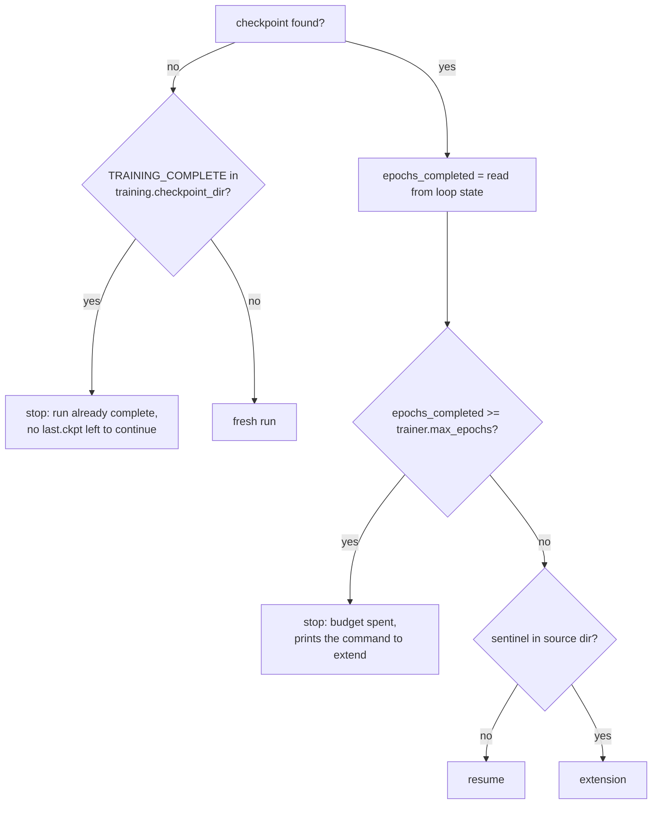

# Resuming & extending

`goal-train` handles two situations with one mechanism. A **resume** picks an interrupted run back up and trains it to its original budget. An **extension** continues a run that already finished, up to a larger `trainer.max_epochs`. This page covers how the checkpoint to continue from is chosen, what is restored, what happens to the learning-rate schedule, how `GOALCheckpointManager` keeps its checkpoint pools consistent across runs, and how this fits with SLURM requeueing.

The logic lives in [`src/goal/ml/training/resume.py`](https://github.com/Nourollah/GOAL/blob/main/src/goal/ml/training/resume.py) and [`src/goal/ml/training/callbacks/checkpoint_manager.py`](https://github.com/Nourollah/GOAL/blob/main/src/goal/ml/training/callbacks/checkpoint_manager.py).

## Quick reference

```bash
# Continue an interrupted run, writing to a new run directory
pixi run -e cuda goal-train resume.from=logs/simurgh_gmd26/runs/<old_run>

# Continue an interrupted run in place (works when the run was launched with a fixed name)
pixi run -e cuda goal-train run_name=arace_gmd26_seed42          # same command as the original launch

# Extend a finished 1500-epoch run to 3000 epochs
pixi run -e cuda goal-train trainer.max_epochs=3000 resume.from=logs/simurgh_gmd26/runs/<old_run>/checkpoints

# Same, but with a fresh cosine cycle over the extra 1500 epochs
pixi run -e cuda goal-train trainer.max_epochs=3000 resume.from=<...>/checkpoints resume.lr_schedule=restart
```

The relevant config keys:

```yaml
resume:
  from: null # run dir, checkpoint dir, or .ckpt file; null = this run's own checkpoint_dir
  lr_schedule: stretch # stretch | restart | keep

ckpt_path: null # legacy alias for resume.from (still honoured)
```

## How the starting point is chosen

At startup, before any data is loaded, `resolve_resume(cfg)` returns a `ResumeDecision`. The checkpoint is looked up in this order:

1. **`resume.from`**, which can be any of three things:
    - a `.ckpt` file, used as given;
    - a checkpoint directory containing `last.ckpt`;
    - a run directory containing `checkpoints/last.ckpt`.

    If none of these match, a `FileNotFoundError` is raised that names the places searched.
2. **`ckpt_path`**: the legacy top-level key, with the same meaning.
3. **`training.checkpoint_dir/last.ckpt`**: this run's own directory. This is how a run restarted with the same output directory picks itself up.

The *source directory* is the directory the checkpoint came from. Pool state (`checkpoint_state.json`) and the `TRAINING_COMPLETE` sentinel are read from there. Then:



The "stop" outcomes print their reason and return without error, which is what keeps a SLURM requeue from looping (see [below](#slurm-auto-resume-and-the-completion-sentinel)). The budget-spent message includes a ready-made command:

```text
.../checkpoints/last.ckpt has already completed 1500 epochs and trainer.max_epochs=1500 — nothing left to train.
To continue this run, raise the budget above 1500, e.g.
    goal-train --config-name simurgh_gmd26 trainer.max_epochs=3000 resume.from=.../checkpoints
```

`epochs_completed` comes from Lightning's fit-loop progress counters stored in the checkpoint, not from the `epoch` field. GOAL saves `last.ckpt` at the end of validation, before Lightning's epoch counter advances, so the raw `processed` count is one short. `read_epochs_completed` applies the same correction Lightning applies on restore, which means the number printed (`[ckpt/resume] Resuming from … — 412 epochs done`) is the number Lightning compares with `max_epochs`. The checkpoint is opened with `mmap=True`, so under DDP no rank loads the full state dict just to read one integer.

> [!WARNING]
> **The default run directory is timestamped.** `run_name` contains `${now:%Y-%m-%d_%H-%M-%S}`, so every launch writes to a new directory and step 3 above finds nothing. "Resume by re-running the same command" only works when `run_name` is fixed (for example `run_name=my_run`, or `run_name=my_run_${SLURM_JOB_ID}` on a cluster). Otherwise, use `resume.from`.

## Resume vs extension

| | Resume | Extension |
| --- | --- | --- |
| Source run state | interrupted (no sentinel) | finished (`TRAINING_COMPLETE` present) |
| `trainer.max_epochs` | usually unchanged | raised above `epochs_completed` |
| LR schedule | restored, and a no-op retarget if the horizon is unchanged | **re-aimed** by `resume.lr_schedule` |
| Provenance written | none | `extensions` entry in `metadata.json`, plus `config_extended_<timestamp>.yaml` |

Both are passed to `trainer.fit(ckpt_path=…)`, so Lightning restores the full training state: model weights, optimizer state (AdamW moments), LR scheduler state, epoch and global-step counters, and the state of every callback that has any (EarlyStopping's `wait_count` and `best_score`, for example). `GOALModule` additionally restores the EMA shadow weights, which it stores under the `goal_ema` key of the checkpoint (see [Performance engineering](performance.md#exponential-moving-average-ema)).

### Where the continued run writes

The continued run writes to **its own** output directory, `training.checkpoint_dir` of the new launch. With `resume.from` pointing at another run, you get a new timestamped folder that:

- inherits the old run's checkpoint pools for ranking (the best old checkpoints still count towards top-k),
- never deletes a file in the old directory (see [Pool ownership](#pool-ownership)),
- freezes its own `frozen_source/`, `config.yaml` and `metadata.json` at training start, because the new directory has none yet.

To extend **in place** instead, so that everything stays in one folder, point both directories at the old run and leave `resume.from` unset:

```bash
OLD=logs/simurgh_gmd26/runs/<old_run>
pixi run -e cuda goal-train trainer.max_epochs=3000 \
    training.checkpoint_dir=$OLD/checkpoints \
    checkpoint_manager.dirpath=$OLD/checkpoints
```

In-place, the existing `frozen_source/` and `config.yaml` are kept untouched. They describe the code and configuration the weights were built from, and every sidecar points at them. The extension is recorded separately in `metadata.json`:

```json
{
  "extensions": [
    {
      "from_epoch": 1500,
      "to_epoch": 3000,
      "source_checkpoint": "logs/.../checkpoints/last.ckpt",
      "timestamp": "2026-10-16T09:12:44"
    }
  ]
}
```

A full snapshot of the extended config is written next to it as `config_extended_2026-10-16T09-12-44.yaml`. Hydra's own `.hydra/` folder and the `.log` file of the new launch still go to the new timestamped output directory.

## The learning-rate schedule needs a policy

Lightning restores LR schedulers *wholesale*. `LRScheduler.state_dict()` holds `T_max`, `base_lrs` and `last_epoch`, and the restore overwrites whatever `configure_optimizers` just built from the new `trainer.max_epochs`. A raised budget would therefore never reach the scheduler. Worse, `CosineAnnealingLR` is periodic with period $2\,T_\text{max}$, so continuing a spent schedule walks the LR **back up** its curve over the added epochs and silently undoes the end of training.

On every resume, `goal-train` adds an `LRScheduleRetarget` callback. It runs in `on_train_start`, the first hook after Lightning's restore, and applies `resume.lr_schedule`:

| Policy | Behaviour | Use it when |
| --- | --- | --- |
| `stretch` *(default)* | Sets `T_max` to the new horizon and re-seeds the LR from the closed-form cosine at the current epoch. The LR lands where a run configured with the new `max_epochs` from the start would be, and keeps annealing down. | You want the result to look like one longer run. |
| `restart` | A fresh cosine over the **added** epochs only (`T_max = max_epochs − epochs_completed`), starting from `training.optimizer.lr` (SGDR-style warm restart). | The run plateaued at `min_lr` and you want to escape the basin. Expect the loss to spike before it converges again. |
| `keep` | Leaves the restored schedule untouched. | Only for reproducing a resume made before this mechanism existed. |

Some details:

- **The LR is re-seeded, not just the horizon.** `CosineAnnealingLR.get_lr()` is recursive: it scales the current LR by a ratio of cosines. A run that annealed to `eta_min` would stay pinned there after a `T_max` change, so `stretch` writes the closed-form value back into the optimizer's param groups.
- **`cosine_warmup`** is a `SequentialLR` (linear warmup, then cosine). Only the cosine part is re-aimed, to `max_epochs − warmup_epochs`. If the checkpoint is still inside the warmup, only the cosine's future horizon is corrected.
- **`reduce_on_plateau`** follows a metric, not a budget, so no policy changes it.
- On a plain resume with an unchanged `max_epochs`, `stretch` detects that `T_max` already matches and does nothing.

Each change is printed as `[resume/lr] stretch: T_max 1500 -> 3000, lr re-seeded to 2.512e-03 at epoch 1500`.

> [!TIP]
> To check what a policy will do before spending GPU time, look at the `lr-AdamW/pg1` and `lr-AdamW/pg2` curves logged by `LearningRateMonitor` (one curve per parameter group) for the first few epochs of the extension.

## What carries over, and what to watch

- **Stage curriculum.** `training.stages` is indexed by absolute epoch. When the schedule runs out, it stays at its final stage, so extending past the last stage simply continues in it. If your last stage has a finite `epochs`, the extension still trains with that stage's weights.
- **Early stopping.** `EarlyStopping`'s `wait_count` and `best_score` are restored. If the original run ended *because* early stopping fired, the extension stops again within about one validation epoch unless the metric improves straight away. For a real extension, raise `callbacks.early_stopping.patience` (or remove the callback with `~callbacks.early_stopping`).
- **EMA.** The shadow weights carry over. If you turn EMA *on* for an extension of a run trained without it, the shadow starts from the restored raw weights. If the number of parameters no longer matches (a different architecture), the stored shadow is discarded with a warning.
- **Architecture changes.** The checkpoint must load into the model built from the *current* config, with the same backbone, widths and elements. Raising the budget is fine. Changing `num_rounds` is not.
- **Dataset statistics.** Elements, atomic reference energies, `scale`, `avg_num_neighbors` and pair counts are taken from the checkpoint, not recomputed. See [Dataset statistics](#dataset-statistics) below.
- **Effective batch size.** Changing `trainer.devices` or `data.batch_size` on a resume is allowed, but the restored optimizer moments and LR were tuned for the old batch size.

## Dataset statistics

Before building the model, `goal-train` derives several backbone arguments from the training set:

| Statistic | Backbone argument | What it controls |
| --- | --- | --- |
| `elements` | `elements` | Which elements the model has parameters for (with `artisan.n_elements: auto`, the size of every per-element table) |
| `atomic_energies` | `atomic_energies.values` (mode `dataset`) | Per-element reference energies (the energy baseline) |
| `scale` | `scale` | Gain on the learned interaction energy |
| `avg_num_neighbors` | `avg_num_neighbors` or `dressing_kwargs.avg_num_neighbors` | Normaliser of the neighbour sums |
| `pair_counts` | `artisan.pair_counts` / `artisan_config.pair_counts` | Which element pairs get a dedicated artisan (rare-pair routing) |

A checkpoint only means something together with the values it was trained with. So every run records them, with the data they came from, in the `dataset_stats` block of its `checkpoints/config.yaml` (and in every `.ckpt`'s hyper-parameters):

```yaml
dataset_stats:
  reuse: true
  recompute: []
  values:
    elements: [1, 6, 8]
    atomic_energies.values: {1: -13.59, 6: -1028.48, 8: -2041.12}
    atomic_energies.mode: dataset
    scale: 0.83
    avg_num_neighbors: 19.8
  provenance:
    origin: computed from the training set
    recorded_at: '2026-10-17T16:05:04'
    dataset:    {dataset_type: trajectory, train_dir: …, cutoff: 8.0, n_train: 21412, …}
    trained_on: {…}
```

The values are also written into `model.backbone`, so `GOALCalculator`, `goal-eval` and LoRA fine-tuning rebuild the model from the saved config alone.

### On resume and extension

When a run resumes (an interruption, `resume.from=…`, or an extension of a finished run), the recorded values are applied **before** anything is computed:

- **No recomputation.** The neighbour-list scan, the reference-energy regression and the pair counting are all skipped, which saves real time on large datasets.
- **The model is rebuilt exactly as trained.** It uses the same element tables, normalisers and routing, even if the training data has changed since.
- **A changed dataset is reported.** The current `data:` block and training-set size are compared with the run's record. Loader settings such as `batch_size` and `num_workers` are ignored. Any difference is printed:

  ```text
  [stats] WARNING: the training data differs from the data the reused statistics were computed on:
      n_train: 21412 -> 30087
      train_dir: '…/Training' -> '…/Training_v2'
  ```

- **Elements the model cannot represent stop the run.** If the new data contains an element outside the checkpoint's `elements`, there is nothing to continue: the model has no parameters for it. Remove those structures, or train a new model.

Runs saved before this record existed still work. Their values are recovered from `model.backbone` in the saved config, but there is no fingerprint to compare against.

### Choosing what to recompute

You decide whether the stored values suit new data. List the statistics to derive again, or `all`:

```bash
# Continue a finished run on a bigger dataset, re-deriving the normalisers from it
pixi run -e cuda goal-train --config-name simurgh_gmd26 trainer.max_epochs=3000 \
    resume.from=logs/simurgh_gmd26/runs/<run> \
    data.train_dir=/data/GMD/Training_v2 \
    'dataset_stats.recompute=[scale,avg_num_neighbors]'

# Set a value by hand instead: list it, then pin it under model.backbone
pixi run -e cuda goal-train … 'dataset_stats.recompute=[scale]' model.backbone.scale=1.2
```

A listed statistic is resolved as on a fresh run: an explicit value under `model.backbone` is kept, otherwise it's computed from the current training set. What a recomputed value does to the restored model depends on the statistic:

| Statistic | On resume |
| --- | --- |
| `scale`, `atomic_energies` | Stored as buffers. Lightning would restore the checkpoint's copy, so `goal-train` keeps the recomputed values instead (`[stats] scale: training with the recomputed values …`) |
| `avg_num_neighbors` | Takes effect directly |
| `elements`, `pair_counts` | Shape the model. If the recomputed result differs, the checkpoint's weights cannot load, and `goal-train` stops before training with the tensors that no longer fit |

`dataset_stats.reuse=false` turns reuse off entirely, which is the old behaviour where every launch recomputed everything.

> [!NOTE]
> Quote overrides that contain `[` … `]`. zsh would otherwise treat them as glob patterns (`no matches found`).

## Checkpoint manager behaviour

`GOALCheckpointManager` (configured by the top-level `checkpoint_manager:` block) keeps three independent pools and saves at the end of every validation epoch:

| Pool | Config | File name | Kept |
| --- | --- | --- | --- |
| top-k | `top_k: {enabled, k, metric, mode}` | `best_<metric_slug>=<value>_epoch=<NNNN>.ckpt` | the `k` best values of `metric`. A new checkpoint that beats the worst one replaces it. |
| interval | `interval: {enabled, every_n_epochs, keep_last_n}` | `interval_epoch=<NNNN>.ckpt` | the last `keep_last_n` checkpoints saved every `every_n_epochs` epochs |
| last | `last: {enabled, filename}` | `last.ckpt` | overwritten every epoch, and never deleted |

```yaml
checkpoint_manager:
  _target_: goal.ml.training.callbacks.checkpoint_manager.GOALCheckpointManager
  dirpath: ${paths.output_dir}/checkpoints
  top_k: { enabled: true, k: 5, metric: "val_forces/forces_mae", mode: "min" }
  interval: { enabled: true, every_n_epochs: 2, keep_last_n: 5 }
  last: { enabled: true, filename: "last.ckpt" }
  save_archive: true # pack the best top-k checkpoint into best_<metric_slug>.simurgh at train end
  archive_interval: false # also pack a .simurgh for every interval checkpoint (large)
```

What it guarantees:

- **Atomic writes.** Every checkpoint is written to `<name>.tmp` and then `os.replace`d, so a job killed mid-save never leaves a truncated `last.ckpt`.
- **Sidecars.** Every `.ckpt` gets a `<name>.json` with the epoch, pool, every scalar metric at that moment, a timestamp, and relative paths to `config.yaml`, `frozen_source/` and `metadata.json`. The directory can be moved and still makes sense.
- **Self-contained directory.** At `on_train_start`, the manager freezes every `goal` source file the model imports into `frozen_source/`, and writes the resolved config and metadata. If `frozen_source/` already exists (an in-place resume), it is kept, because it matches the code the run *started* with.
- **Cross-pool safety.** A checkpoint evicted from one pool is not deleted if the other pool still references it.
- **Persistent pool state.** `checkpoint_state.json` (pool contents plus pool configuration) is rewritten after every epoch. On resume, entries whose files no longer exist are dropped with a warning.
- **Metric checks.** A `mode` that contradicts a well-known metric (`mode: max` on `forces_mae`, say) triggers a warning at construction. An old-style key like `val/forces_mae` is translated to its sectioned name `val_forces/forces_mae`, also with a warning. A metric that is not logged at all skips top-k saving with a warning that lists the available keys. Your run then has no `best_*` files, so check the log if they are missing.

### Pool ownership

When a run resumes from another directory, `restore_pools_from_dir` loads that directory's `checkpoint_state.json`, so the old best checkpoints keep competing for top-k. Evicting one of those inherited entries removes it from the pool but **never deletes the file**. A checkpoint is deleted only when it sits directly in this run's own `dirpath` (`_owns`). Extending a run therefore cannot damage the run it came from.

> [!NOTE]
> Select checkpoints on the in-distribution validation set only. With `data.monitor_test_during_training: true`, the OOD set is logged under `test/`, `test_energy/` and `test_forces/`. Never point `top_k.metric` (or early stopping) at those curves, because selecting on a set turns it into a second validation set. See [Callbacks & logging](callbacks-logging.md#watching-an-ood-set-during-training).

## SLURM auto-resume and the completion sentinel

Together, these pieces make a SLURM job that is preempted, times out, or is requeued blindly behave correctly:

1. **`TRAINING_COMPLETE`.** After `trainer.fit` returns normally (budget reached or early stopping fired), global rank 0 touches `training.checkpoint_dir/TRAINING_COMPLETE`. `GOALCheckpoint`, a `ModelCheckpoint` subclass in `goal.ml.training.callbacks.checkpoint`, writes the same sentinel for setups that use Lightning's checkpointing.
2. **The budget check runs first.** A relaunch whose `last.ckpt` has already reached `trainer.max_epochs` exits immediately with status 0, before the dataset is loaded. A requeued copy of a finished job re-reads the same config, so its budget is still spent and it ends in seconds. The sentinel does **not** need to be deleted by hand to extend: raising `max_epochs` is enough.
3. **A sentinel without a checkpoint** (finished run whose `last.ckpt` was deleted) also stops the launch, because there is no state to continue from.
4. **Requeue.** With `training.slurm_mode: true` (or Lightning's automatic SLURM detection under `srun`) and `#SBATCH --signal=SIGUSR1@<seconds>`, Lightning requeues the job before the wall-clock limit. The requeued job runs the same command again.

The one thing you must supply is a **stable run directory**. Otherwise the requeued job starts a fresh run in a new timestamped folder:

```bash
srun python -m goal.ml.cli.train run_name=arace_gmd26_${SLURM_JOB_ID} training.slurm_mode=true ...
```

`SLURM_JOB_ID` survives a requeue, so the restart finds `checkpoints/last.ckpt` and resumes from the end of the last validated epoch. Lightning also writes its own `hpc_ckpt_<n>.ckpt` into the run directory when it receives the signal. Because GOAL passes `last.ckpt` explicitly to `trainer.fit`, that HPC checkpoint is not used, and a partially finished epoch is simply run again. A complete job script is in [Training a model](training.md#slurm).

## Troubleshooting

| Symptom | Cause | Fix |
| --- | --- | --- |
| Relaunch starts from epoch 0 | New timestamped run directory, so no `last.ckpt` was found | Pass `resume.from=<old run>` or fix `run_name` |
| `… has already completed N epochs … nothing left to train` | Budget spent | Raise `trainer.max_epochs` above N |
| `resume.from=… contains no last.ckpt` | Path points at neither a run dir, a checkpoint dir, nor a `.ckpt` | Point at `<run>/checkpoints` or the file itself |
| LR jumps up after an extension | `resume.lr_schedule=keep` (or `restart` by design) | Use `stretch` |
| Extension stops after one epoch | Restored `EarlyStopping` state | Raise `callbacks.early_stopping.patience` or remove the callback |
| `Early stopping conditioned on metric … which is not available` right after resuming | A config without `check_on_train_epoch_end: false` on its `EarlyStopping` (the shipped configs set it) | Add `+callbacks.early_stopping.check_on_train_epoch_end=false` |
| `[stats] WARNING: the training data differs …` | The `data:` block or training-set size changed since the checkpoint's statistics were recorded | Nothing, if the stored values still suit the new data; otherwise use `dataset_stats.recompute` |
| `The training data contains N(Z=7), which the resumed model has no parameters for` | The new data has elements the checkpoint was not trained with | Remove those structures, or train a new model |
| `Recomputing elements changes the model's structure …` | `dataset_stats.recompute` includes a structural statistic whose value changed | Keep the stored value, or train a new model |
| `Checkpoint EMA state has X tensors but the model has Y parameters` | Architecture changed since the checkpoint | Use the original architecture, or accept EMA re-initialising |
| No `best_*.ckpt` files | `top_k.metric` not logged | Check the warning listing available keys, and use e.g. `val_forces/forces_mae` |
