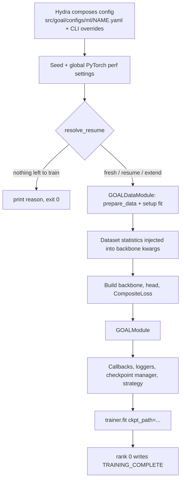

# Training a model

This page covers a `goal.ml` training run from start to finish: launching on a GPU, CPU or Apple Silicon, what `goal-train` does between the command and the first optimiser step, where results go, and how to run on a SLURM cluster. Strategies for more than one GPU are covered in [Distributed training](distributed.md), and continuing a run in [Resuming & extending](resuming.md).

## The short version

```bash
pixi run -e cuda goal-train                                   # SIMURGH ARACE on GMD-26, src/goal/configs/ml/simurgh_gmd26.yaml
pixi run -e cuda goal-train --config-name simurgh_md17        # any other file in src/goal/configs/ml/
pixi run -e cuda goal-train trainer.max_epochs=300 data.batch_size=32 training.optimizer.lr=5e-3
```

Each run is described by one self-contained experiment file in [`src/goal/configs/ml/`](https://github.com/Nourollah/GOAL/tree/main/src/goal/configs/ml). That file holds the data, model, trainer, losses, checkpointing, logging and strategy settings. `--config-name` selects the file, and any key can be overridden on the command line using Hydra's `dotted.key=value` syntax. The default file is [`src/goal/configs/ml/simurgh_gmd26.yaml`](https://github.com/Nourollah/GOAL/blob/main/src/goal/configs/ml/simurgh_gmd26.yaml), which trains the default model, SIMURGH ARACE (`model.backbone.name: simurgh_arace`), on the GMD-26 FragmentDuplication set.

You can launch the same entry point in four ways:

| Command | Notes |
| --- | --- |
| `goal-train` | Console script installed with the package. |
| `goal-train-ml` | Alias for the same function (`goal.ml.cli.train:train_ml`). |
| `python -m goal.ml.cli.train` | Useful under `srun`, debuggers and profilers. |
| `pixi run -e cuda train …` (or `-e cpu` / `-e rocm`) | Pixi task. Arguments after the task name are passed to Hydra. |

> [!TIP]
> Add `--cfg job` to any command to print the fully composed config and exit without training. It is the quickest way to check that an override landed where you meant it to.

## Choosing the hardware

### Single GPU

The shipped experiment files already set `trainer.accelerator: gpu` and `trainer.devices: 1`, so a plain `goal-train` uses one CUDA device. To pick a particular card, use the usual CUDA environment variable:

```bash
CUDA_VISIBLE_DEVICES=2 goal-train
```

On Ampere or newer GPUs (A100, H100, RTX 30xx/40xx, RTX 6000 Ada) it is usually worth enabling TF32 matmuls, which the default config leaves off:

```bash
pixi run -e cuda goal-train training.performance.float32_matmul_precision=high
```

[Performance engineering](performance.md) explains what this does to force accuracy, and covers the other speed settings.

### CPU

```bash
pixi run -e cuda goal-train trainer.accelerator=cpu data.pin_memory=false
```

CPU training is practical for debugging and for small benchmark molecules (rMD17-sized). GOAL skips the cuDNN and TF32 settings when no CUDA device is present, so the `training.performance` block has no effect on CPU and is harmless to leave in place. To use more cores for data loading, set `data.num_workers` and `data.persistent_workers=true`. The default of `0` is deliberate, because some Python 3.14 environments have trouble with worker processes.

### Apple Silicon (MPS)

```bash
pixi run -e cuda goal-train trainer.accelerator=mps data.pin_memory=false
```

MPS does not support float64, so keep `trainer.precision` at `"32"` (the default) and do not use `64-true`. Support for every e3nn operation on MPS depends on your PyTorch version. If an operator is missing, `PYTORCH_ENABLE_MPS_FALLBACK=1` runs it on the CPU (slower, but it works).

### Several GPUs or nodes

```bash
pixi run -e cuda goal-train strategy.name=ddp trainer.devices=4                   # one node, 4 GPUs
pixi run -e cuda goal-train strategy.name=ddp trainer.devices=4 trainer.num_nodes=2
```

> [!IMPORTANT]
> The strategy comes from the top-level `strategy:` block (`strategy.name=…`), **not** from `trainer.strategy`. Whenever `strategy:` is present (it is in every shipped config), `goal-train` builds the strategy from it with `build_strategy(cfg)`, and that result overrides `trainer.strategy`. The full story, including FSDP and DeepSpeed, is in [Distributed training](distributed.md).

## What `goal-train` does, step by step

The whole pipeline lives in `_run_training` in [`src/goal/ml/cli/train.py`](https://github.com/Nourollah/GOAL/blob/main/src/goal/ml/cli/train.py). Knowing the order explains most of the `[stats]` and `[ckpt/resume]` lines you see at startup.



1. **Config composition.** Hydra loads the file from `src/goal/configs/ml/` and applies your overrides. The run's output directory, `${paths.log_dir}/${task_name}/runs/${run_name}`, is created at this point and becomes `paths.output_dir`.
2. **Seeding.** If `seed` is set, `L.seed_everything(seed, workers=True)` runs.
3. **Global performance settings.** `torch.set_float32_matmul_precision` and the cuDNN flags are applied from `training.performance` (see [Performance engineering](performance.md)).
4. **Resume decision.** `resolve_resume(cfg)` decides between a fresh start, resuming an interrupted run, extending a finished one, and refusing to start because the epoch budget is already spent. This runs *before* any data is loaded, so a SLURM requeue of a finished job exits in seconds. See [Resuming & extending](resuming.md).
5. **Data.** `GOALDataModule(cfg)` is built, and `prepare_data()` and `setup("fit")` are called straight away so that statistics can be computed from the training split before the model exists. Lightning calls `setup` again later, and that second call is a no-op.
6. **Dataset-derived model inputs.** For the SIMURGH family (`simurgh`, `simurgh_ace_first`, `simurgh_arace`, `simurgh_monolithic`, `monolithic_arace`), these values are computed from the training set and injected into the backbone kwargs, overriding the config:
    - `elements`: the unique atomic numbers. The dataset always takes precedence over whatever the YAML says.
    - `atomic_energies.values`: a least-squares fit of per-element reference energies when `atomic_energies.mode` is `dataset` (or `compute_from_dataset: true`) and no values are given.
    - `scale`: the ScaleShift gain, computed for `dataset` and `provided` modes when `scale: null`.
    - `avg_num_neighbors`: for `simurgh_arace` (top-level key) and for legacy backbones with a `dressing_kwargs` block, when it is `null`.
    - `pair_counts`: when an artisan block enables `rare_artisan`. These counts are also written back into the config, so `config.yaml` (and therefore every checkpoint) carries the routing they imply.
7. **Model.** The backbone class comes from `BACKBONE_REGISTRY`. The head comes from `HEAD_REGISTRY`, unless the backbone is monolithic, in which case `model.head` must be `null`. A mismatch in either direction raises a `ValueError` at this point rather than failing deep inside the loop. The loss is built from `training.losses` (see [Loss functions](losses.md)), and everything is wrapped in `GOALModule`.
8. **Callbacks and loggers.** `LearningRateMonitor` and `RichLoggingCallback` are always added. Everything under `callbacks:` and `logger:` is instantiated through Hydra, and the top-level `checkpoint_manager:` block becomes a `GOALCheckpointManager`. On a resume, `LRScheduleRetarget` is also added. Having a Lightning `ModelCheckpoint` and `GOALCheckpointManager` active at the same time is an error (see [Callbacks & logging](callbacks-logging.md)).
9. **Trainer.** `trainer:` is instantiated with the strategy from `build_strategy(cfg)`. If `training.slurm_mode: true`, a `SLURMEnvironment(auto_requeue=True)` plugin is added.
10. **Fit.** `trainer.fit(module, datamodule, ckpt_path=…)` runs. If it returns normally, global rank 0 touches `TRAINING_COMPLETE` in `training.checkpoint_dir`.

Inside the loop, `GOALModule` does the following:

- Applies the current stage of `training.stages` (a loss-weight curriculum) on every train and validation step.
- Runs validation and test forwards under `torch.enable_grad()`, so autograd force heads work. This is why `trainer.inference_mode` **must** stay `false`.
- Evaluates with the EMA shadow weights when `training.ema.enabled`.
- Clips gradients by norm (`training.gradient_clip`) in `on_before_optimizer_step`.
- Logs losses and MLIP metrics into separate logger sections per split and property.

The optimiser is always AdamW with two parameter groups. Equivariant tensor-product and `EquivariantLinear` parameters get no weight decay, and everything else gets `training.optimizer.weight_decay`. The scheduler is chosen by `training.optimizer.scheduler_type`:

| `scheduler_type` | Behaviour | Keys used |
| --- | --- | --- |
| `cosine_warmup` | Linear warmup from 1 % of `lr`, then cosine decay to `min_lr` over `trainer.max_epochs − warmup_epochs` | `lr`, `warmup_epochs`, `min_lr` |
| `cosine` | Cosine decay from epoch 0 to `min_lr` over `trainer.max_epochs` | `lr`, `min_lr` |
| `reduce_on_plateau` (fallback for any other value) | Multiply LR by `factor` when `val/total` stalls for `patience` epochs | `scheduler.patience`, `scheduler.factor`, `min_lr` |

The cosine horizon is taken from `trainer.max_epochs`. An old top-level `training.max_epochs` is only read when `trainer.max_epochs` is absent.

## Run naming and the output directory

Every run is named by the `run_name` key:

```yaml
run_name_suffix: "_fragment_duplication"
run_name: ${now:%Y-%m-%d_%H-%M-%S}_${data.dataset_type}_${model.backbone.name}${run_name_suffix}
```

which gives, for example, `2026-10-16_14-30-45_trajectory_simurgh_arace_fragment_duplication`. The same string is used as the leaf of the output directory and as the W&B run name (`logger.wandb.name: ${run_name}`), so the two always match. Override either part:

```bash
pixi run -e cuda goal-train run_name_suffix=_lr5e-3                  # keep the timestamp, change the tag
pixi run -e cuda goal-train run_name=arace_gmd26_baseline            # a fixed name, no timestamp
```

> [!WARNING]
> Because `run_name` contains a timestamp, **every launch gets a new output directory**. Automatic resume looks for `last.ckpt` in *this* run's directory, so re-running the same command after a crash starts a fresh run in a new folder. To pick up an interrupted run, pass `resume.from=<old run dir>` or launch with a fixed `run_name`. This matters most for SLURM requeue (see [below](#slurm)).

The directory is `${paths.log_dir}/${task_name}/runs/${run_name}`. `paths.root_dir` is `$PROJECT_ROOT` if set, otherwise the directory you launched from, so `logs/` appears wherever you run the command. Set `PROJECT_ROOT=/path/to/GOAL` (or `paths.log_dir=/scratch/...`) to pin it.

A finished run looks like this:

```text
logs/simurgh_gmd26/runs/2026-10-16_14-30-45_trajectory_simurgh_arace_fragment_duplication/
├── .hydra/
│   ├── config.yaml              # composed config (before stats injection)
│   ├── hydra.yaml
│   └── overrides.yaml           # exactly what you typed on the command line
├── simurgh_gmd26.log            # Python logging output for the run
├── csv_logs/version_0/metrics.csv
├── wandb/                       # W&B local files (if the W&B logger is on)
└── checkpoints/                 # training.checkpoint_dir == checkpoint_manager.dirpath
    ├── frozen_source/           # every goal .py file the model imports, frozen at train start
    ├── config.yaml              # fully resolved config, incl. injected elements / pair_counts
    ├── metadata.json            # version, git commit, elements, scale, extension records…
    ├── checkpoint_state.json    # pool membership, used on resume
    ├── best_val_forces_forces_mae=0.0241_epoch=0398.ckpt   # top-k pool
    ├── best_val_forces_forces_mae=0.0241_epoch=0398.json   # sidecar: epoch, metrics, pool
    ├── interval_epoch=0400.ckpt                            # interval pool (+ .json)
    ├── last.ckpt                                           # always the latest epoch (+ last.json)
    ├── best_val_forces_forces_mae.simurgh                  # packed best model (save_archive)
    └── TRAINING_COMPLETE                                   # completion sentinel
```

The `.simurgh` archive is a single self-contained file (weights, resolved config, metadata and frozen model source) that loads without the repository at the same commit. See [Checkpoints & archives](../deployment/archives.md) for how to use it and the [ASE calculator](../deployment/ase-calculator.md) page for running it.

## Typical workflows

### 1. Smoke-test a new config (seconds)

The presets in [`src/goal/configs/debug/`](https://github.com/Nourollah/GOAL/tree/main/src/goal/configs/debug) live outside `src/goal/configs/ml/`, so add `configs/` to the search path with `--config-dir src/goal/configs` and attach a preset with `+debug=<name>`:

```bash
# 1 train + 1 val + 1 test batch, no checkpoints written by Lightning
pixi run -e cuda goal-train --config-dir src/goal/configs +debug=fdr

# 3 epochs on 1 % of train and 5 % of val/test
pixi run -e cuda goal-train --config-dir src/goal/configs +debug=limit

# overfit 3 batches for 20 epochs: the loss must go to ~0, otherwise something is broken
pixi run -e cuda goal-train --config-dir src/goal/configs +debug=overfit trainer.accelerator=gpu

# 1 epoch with Lightning's simple profiler
pixi run -e cuda goal-train --config-dir src/goal/configs +debug=profiler trainer.accelerator=gpu
```

| Preset | What it sets |
| --- | --- |
| `default` | `task_name: debug` (so logs go to `logs/debug/`), `callbacks: null`, `logger: null`, `trainer.max_epochs: 1`, `trainer.accelerator: cpu`, `trainer.devices: 1`, `trainer.detect_anomaly: true`, `data.num_workers: 0`, `data.pin_memory: false`, DEBUG-level logging |
| `fdr` | `default` + `trainer.fast_dev_run: true` |
| `limit` | `default` + 3 epochs, `limit_train_batches: 0.01`, `limit_val_batches: 0.05`, `limit_test_batches: 0.05` |
| `overfit` | `default` + 20 epochs, `overfit_batches: 3` |
| `profiler` | `default` + `profiler: simple` |

All presets inherit `trainer.accelerator: cpu`, so add `trainer.accelerator=gpu` when you want to exercise the CUDA path. `callbacks: null` removes EarlyStopping and the rich progress bar, and `logger: null` makes Lightning fall back to its default logger. The `checkpoint_manager` block is **not** removed, so a debug run still freezes source and writes `last.ckpt` into `logs/debug/...`.

> [!TIP]
> `+debug=overfit` is the most informative of these. A model and loss that cannot drive three batches to near-zero error will not learn the full dataset either, and the failure shows up in about a minute instead of after a night.

### 2. A short real run

Before committing GPU-days, run a few dozen epochs with logging on and look at the curves:

```bash
pixi run -e cuda goal-train trainer.max_epochs=30 \
    training.performance.float32_matmul_precision=high \
    run_name_suffix=_shakedown \
    logger.wandb.offline=true
```

Check that `train/total` and `val/total` both decrease, that `val_forces/forces_cosine_similarity` is climbing towards 1, and (for ARACE) that every `val_energy/energy_round_{L}` stays non-zero. Then launch the full run.

### 3. The full run

```bash
pixi run -e cuda goal-train \
    training.performance.float32_matmul_precision=high \
    training.performance.cudnn_benchmark=true \
    run_name=arace_gmd26_seed42 seed=42
```

A fixed `run_name` makes the run restartable in place. If the process dies, re-running the identical command resumes from `checkpoints/last.ckpt`.

### 4. Small sweeps with Hydra multirun

For a handful of configurations, Hydra's built-in multirun is the simplest option. It needs no extra packages:

```bash
pixi run -e cuda goal-train -m training.optimizer.lr=2e-3,5e-3,1e-2 seed=1,2,3
```

Jobs run one after another in the same process, each in `${paths.log_dir}/${task_name}/multiruns/${run_name}/<job_num>/`. For pruning-based search see [Hyperparameter tuning](hyperparameter-tuning.md).

## SLURM

### The pieces GOAL provides

- **Completion sentinel.** After a successful `trainer.fit`, rank 0 writes `TRAINING_COMPLETE` into `training.checkpoint_dir`.
- **Budget check before data loading.** A launch whose `last.ckpt` has already reached `trainer.max_epochs` prints a message and exits with status 0. A requeued job of a finished run therefore costs seconds and does not loop.
- **`training.slurm_mode: true`** attaches Lightning's `SLURMEnvironment(auto_requeue=True)` explicitly. Lightning detects SLURM by itself when launched with `srun`, and auto-requeue is on by default, so this flag mostly documents intent. On the requeue signal, Lightning saves an `hpc_ckpt_*.ckpt` into `trainer.default_root_dir` and calls `scontrol requeue`.

### What you must add

1. **A stable run directory.** A requeued job re-executes the same command. With the default timestamped `run_name`, it would start in a *new* directory and begin from scratch. Tie the name to the job ID, which SLURM keeps across requeues:

    ```bash
    run_name=arace_gmd26_${SLURM_JOB_ID}
    ```

    On restart, `resolve_resume` finds `checkpoints/last.ckpt` in that directory and passes it explicitly to `trainer.fit`. Lightning's own `hpc_ckpt` is then not used, so you resume from the end of the last validated epoch and any partial epoch is repeated.
2. **A signal before the wall-clock limit.** Add `#SBATCH --signal=SIGUSR1@120` so Lightning gets 120 s of warning to requeue.
3. **Matching task layout.** Lightning expects `--ntasks-per-node` to equal `trainer.devices`, and `--nodes` to equal `trainer.num_nodes`.

### A working job script

> [!NOTE]
> [`scripts/slurm_train.sh`](https://github.com/Nourollah/GOAL/blob/main/scripts/slurm_train.sh) is a ready multi-node script (`EXPERIMENT=<name> sbatch scripts/slurm_train.sh`; devices and nodes come from the `#SBATCH` lines), and [`scripts/schedule.sh`](https://github.com/Nourollah/GOAL/blob/main/scripts/schedule.sh) runs a list of `goal-train` invocations back to back. Both were rewritten in October 2026; earlier versions used config-group overrides (`model=…`, `data=…`) that no longer exist. The template below shows the same pattern step by step.

```bash
#!/bin/bash
#SBATCH --job-name=goal-arace
#SBATCH --nodes=2
#SBATCH --ntasks-per-node=4          # == trainer.devices
#SBATCH --gpus-per-node=4
#SBATCH --cpus-per-task=16
#SBATCH --mem=0
#SBATCH --time=24:00:00
#SBATCH --signal=SIGUSR1@120         # give Lightning time to requeue
#SBATCH --requeue
#SBATCH --open-mode=append
#SBATCH --output=logs/slurm/%x_%j.out
#SBATCH --error=logs/slurm/%x_%j.err

export MASTER_ADDR=$(scontrol show hostnames "$SLURM_JOB_NODELIST" | head -n 1)
export MASTER_PORT=29500
export PYTORCH_CUDA_ALLOC_CONF=expandable_segments:True
export NCCL_DEBUG=WARN
export PROJECT_ROOT=$PWD             # logs/ and data/ relative to the repo
mkdir -p logs/slurm

srun pixi run -e cuda python -m goal.ml.cli.train \
    --config-name simurgh_gmd26 \
    run_name=arace_gmd26_${SLURM_JOB_ID} \
    strategy.name=ddp \
    trainer.devices=${SLURM_NTASKS_PER_NODE} \
    trainer.num_nodes=${SLURM_NNODES} \
    training.slurm_mode=true \
    training.performance.float32_matmul_precision=high \
    logger.wandb.id=arace_gmd26_${SLURM_JOB_ID} \
    +logger.wandb.resume=allow
```

The last two lines make a requeued job continue the *same* W&B run instead of opening a new one. Before running multi-GPU jobs, read the multi-GPU checkpointing warning in [Distributed training](distributed.md#checkpointing-with-more-than-one-gpu).

For a single-GPU job, drop `strategy.name=ddp`, and set `--nodes=1`, `--ntasks-per-node=1` and `--gpus-per-node=1`.

### Many runs on a cluster

Rather than a shell loop of `goal-train` calls, submit one job per configuration with a SLURM array, keyed by `SLURM_ARRAY_TASK_ID`:

```bash
#SBATCH --array=0-2
LRS=(2e-3 5e-3 1e-2)
srun python -m goal.ml.cli.train \
    training.optimizer.lr=${LRS[$SLURM_ARRAY_TASK_ID]} \
    run_name=arace_lr${LRS[$SLURM_ARRAY_TASK_ID]}_${SLURM_ARRAY_JOB_ID}
```

## Where to go next

- [Loss functions](losses.md): which properties are supervised and how they are weighted, including the stage curriculum.
- [Callbacks & logging](callbacks-logging.md): what each logged key means, plus early stopping and checkpoint pools.
- [Performance engineering](performance.md): TF32, `torch.compile`, mixed precision and EMA.
- [Configuration reference](../reference/configuration.md) and [CLI reference](../reference/cli.md).
